# Informe de ISS — HornoRaíz Backend (Django + DRF)

**Estudiante:** Javier Rafael Barros Barros
**Programa:** Ingeniería de Sistemas — Universidad de La Guajira
**Proyecto:** HornoRaíz — Producción y venta de panadería
**Repositorio:** bdii-2026ii-barrosbarrosjavier

---

## ISS-00 — Configuración del entorno y creación del proyecto Django

### Narrativa

El desarrollo del backend comienza con la preparación del entorno de trabajo y la estructura base de Django. Se configuró un entorno virtual independiente para aislar las dependencias del proyecto y evitar conflictos con otras instalaciones de Python. Posteriormente, se creó la estructura inicial de Django, que servirá como base para desarrollar la lógica del backend de HornoRaíz. En esta etapa no se implementan modelos de datos ni endpoints; el propósito es establecer una base organizada y funcional para las siguientes unidades.

### Objetivo

Configurar un entorno virtual e inicializar el proyecto Django `config` para HornoRaíz, dejando preparada la estructura básica del backend, sin implementar todavía modelos ni endpoints.

### Requisitos

- Python 3.12 instalado en el VPS (Ubuntu 24.04).
- Un directorio de proyecto (`Backend/`) dentro del repositorio.
- Conexión a Internet para instalar Django 5.2.17.
- Terminal SSH hacia el VPS.

### Construcción

Se creó y activó un entorno virtual para aislar las dependencias de HornoRaíz. A continuación, se instaló Django en la versión 5.2.17, fijando así una versión específica del framework para mantener la consistencia del entorno de desarrollo. Después, se ejecutó el comando `startproject config .`, utilizando el punto final para ubicar `manage.py` directamente en la raíz del proyecto y conservar los archivos de configuración dentro del directorio `config/`. Finalmente, se registraron las dependencias instaladas en el archivo `requirements.txt`.

```bash
cd /root/bdii/Backend
python3 -m venv .venv
source .venv/bin/activate
which python
python -m pip install "Django==5.2.17"
django-admin startproject config .
python -m pip freeze > requirements.txt
python -m django --version
```

**Creación del `.gitignore`:**

Django no crea un `.gitignore`, así que se añadió a mano. Su función es evitar que el entorno virtual, los secretos del `.env`, las bases de datos locales y los archivos temporales lleguen al repositorio.

```bash
cat > .gitignore <<'EOF'
.venv/
__pycache__/
*.py[cod]
.env
db.sqlite3
*.log
.idea/
.vscode/
staticfiles/
media/
.pytest_cache/
htmlcov/
.coverage
EOF
```

### Explicación

- **Django 5.2.17:** framework principal de esta unidad. Proporciona las herramientas necesarias para iniciar el proyecto, gestionar la configuración y preparar el desarrollo del backend.
- **`.venv`:** entorno virtual que mantiene las dependencias de HornoRaíz separadas de las del sistema. Cuando está activo, el terminal muestra `(.venv)`.
- **`django-admin startproject config .`:** genera la estructura inicial del proyecto, dejando `manage.py` en la raíz y los archivos de configuración dentro de `config/`.
- **`.gitignore`:** archivo que evita incluir en el repositorio elementos locales o sensibles, como `.venv/` y `.env`.
- **`python -m pip`:** permite administrar los paquetes de Python mediante el intérprete del entorno activo, facilitando el control de las dependencias instaladas.

### Criterios de aceptación

- **AC-00-01:** el comando `python -m django --version` muestra la versión `5.2.17`.
- **AC-00-02:** existen los archivos `manage.py` y `config/urls.py`.
- **AC-00-03:** el proyecto todavía no contiene modelos de negocio ni endpoints propios de HornoRaíz.

### Verificación

Para cerrar la unidad se comprobó la versión instalada y se ejecutó el chequeo del proyecto, que confirma que la estructura es válida aunque todavía no tenga lógica de negocio.

```bash
python -m django --version
python manage.py check
```

**Evidencia EVI-00-01** — Entorno virtual activo y `which python` apuntando al `.venv`:

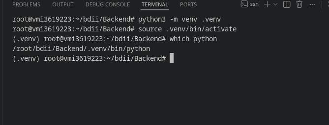

**Evidencia EVI-00-02** — Instalación exitosa de Django 5.2.17:

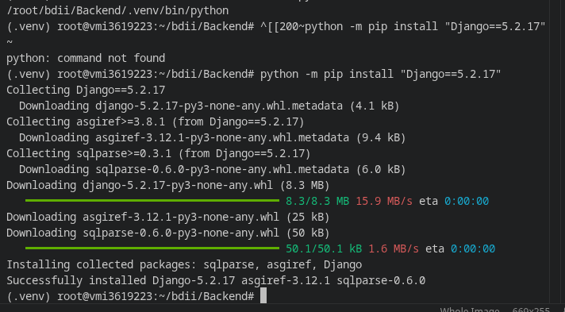

**Evidencia EVI-00-03** — Estructura del proyecto creada (`manage.py` y `config/`):

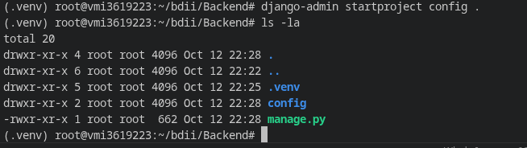

**Evidencia EVI-00-04** — Versión de Django instalada:

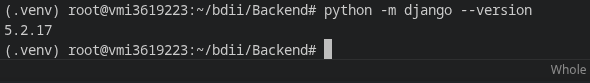

**Evidencia EVI-00-05** — `manage.py check` sin errores:

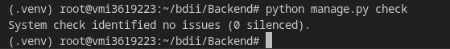

**Evidencia EVI-00-06** — Árbol del proyecto:

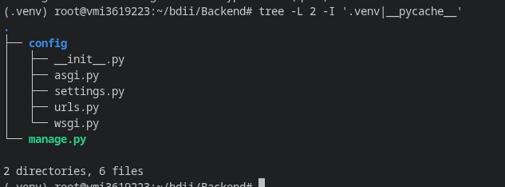

### GATE

| **AC**   | **Verificación**               | **Evidencia** | **Resultado** |
|----------|--------------------------------|---------------|---------------|
| AC-00-01 | versión de Django              | EVI-00-04     | PASS          |
| AC-00-02 | archivos del proyecto          | EVI-00-03     | PASS          |
| AC-00-03 | ausencia de modelos de negocio | EVI-00-06     | PASS          |

---

## ISS-01 — Settings y selección del motor

### Narrativa

Una vez preparada la estructura inicial, el siguiente paso consiste en definir cómo se conectará el backend con la base de datos. Se decidió utilizar un archivo `.env` que permita seleccionar el motor de base de datos mediante variables de entorno, sin modificar la lógica de Python. En esta unidad se establece una configuración flexible y organizada, con la regla de utilizar un solo motor de base de datos por ejecución del proyecto.

### Objetivo

Configurar la selección de un único motor de base de datos para HornoRaíz mediante variables de entorno definidas en `.env`.

### Requisitos

- Haber completado el ISS-00 y tener activo el entorno virtual `(.venv)`.
- Contar con las variables de configuración necesarias para los 4 motores.
- Disponer de un archivo `.env` para almacenar los parámetros de configuración.

### Construcción

**1. Confirmar el entorno**

```bash
source .venv/bin/activate
which python
```

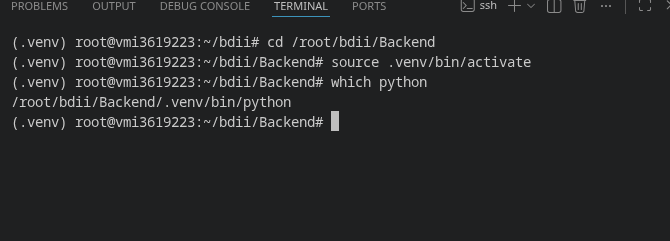

**2. Instalar dependencias del sistema**

`mysqlclient` necesita compilar una extensión en C, por lo que requiere las librerías de desarrollo de MySQL y herramientas de compilación.

```bash
apt update
apt install -y build-essential pkg-config default-libmysqlclient-dev python3.12-dev
```

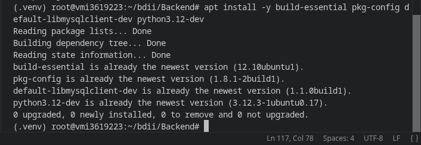

**3. Instalar `python-dotenv` y los drivers**

```bash
python -m pip install "python-dotenv==1.2.3"
python -m pip install "psycopg[binary]==3.3.6"
python -m pip install "mysqlclient==2.3.0"
python -m pip install "mssql-django==2.0.0"
python -m pip install "oracledb==26.0.1"
python -m pip freeze > requirements.txt
```

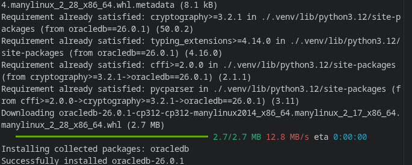

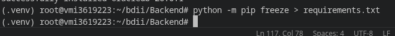

**4. Convertir `settings.py` en paquete**

```bash
rm config/settings.py
mkdir -p config/settings
```

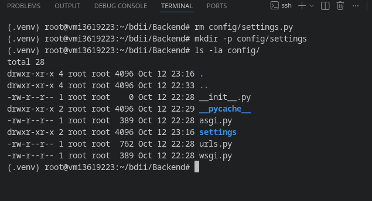

**5. Crear `.env.example`**

```bash
cat > .env.example <<'EOF'
# Copie este archivo a .env y complete los valores.
# .env no se versiona.

DJANGO_SECRET_KEY=
DJANGO_DEBUG=True
DJANGO_ALLOWED_HOSTS=localhost,127.0.0.1,testserver

# Motor activo. Uno solo por ejecución: postgresql | mysql | mssql | oracle
DB_ENGINE=mysql

POSTGRES_DB=
POSTGRES_USER=
POSTGRES_PASSWORD=
POSTGRES_HOST=127.0.0.1
POSTGRES_PORT=5432

MYSQL_DB=hornoraiz_django
MYSQL_USER=admin
MYSQL_PASSWORD=1704
MYSQL_HOST=127.0.0.1
MYSQL_PORT=3306

MSSQL_DB=
MSSQL_USER=
MSSQL_PASSWORD=
MSSQL_HOST=127.0.0.1
MSSQL_PORT=1433

ORACLE_DB=
ORACLE_USER=
ORACLE_PASSWORD=
ORACLE_HOST=127.0.0.1
ORACLE_PORT=1521
ORACLE_SERVICE_NAME=

# Laboratorio académico. En producción liste orígenes explícitos.
CORS_ALLOW_ALL_ORIGINS=True
EOF
cp .env.example .env
```

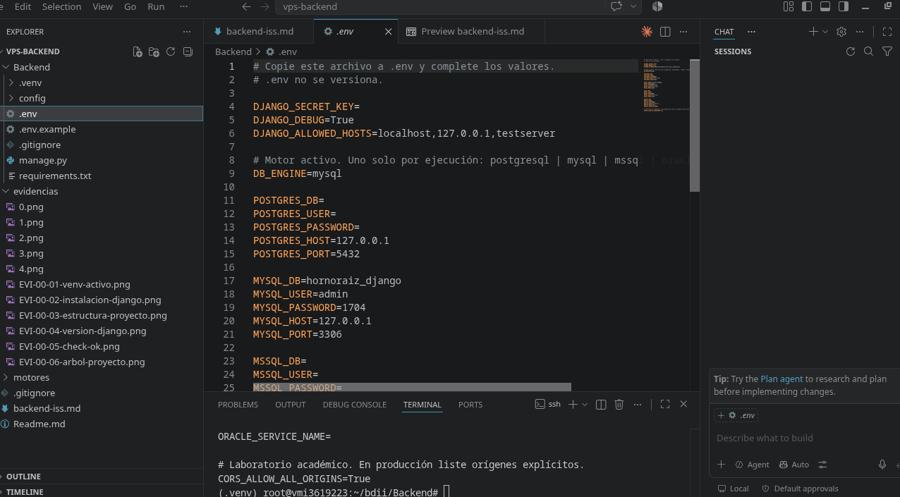

**6. Generar la SECRET_KEY y editar `.env`**

```bash
python -c "from django.core.management.utils import get_random_secret_key; print(get_random_secret_key())"
```

Se copió el valor generado en `.env`, en la línea `DJANGO_SECRET_KEY=`.

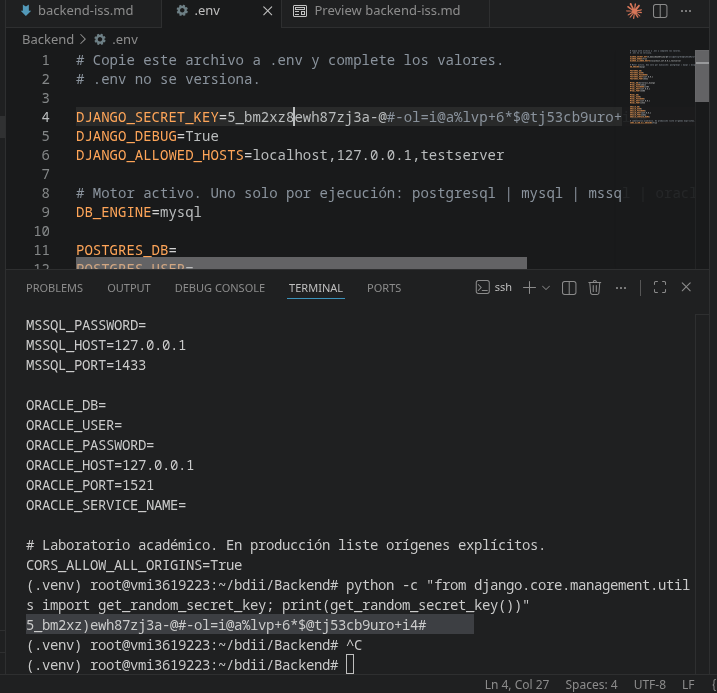

**7. Crear `config/database.py`**

Se escribió el traductor entre el entorno y Django. Lee `DB_ENGINE` y devuelve un único `DATABASES["default"]`.

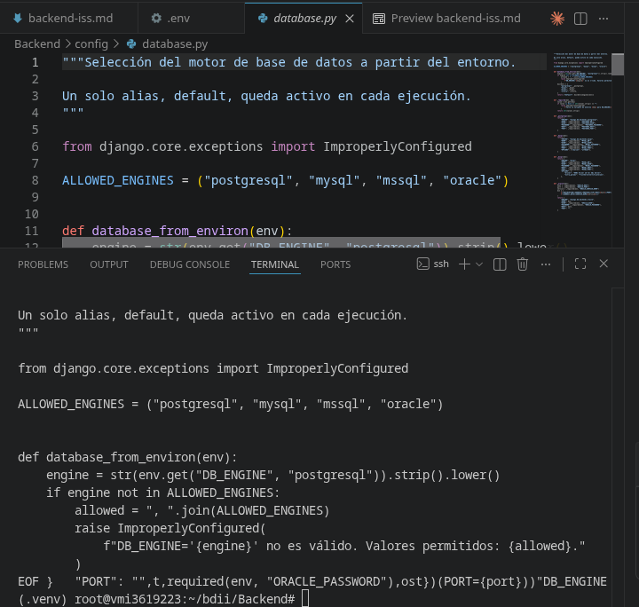

**8. Crear `config/settings/__init__.py`**

Carga el `.env`, exige la `SECRET_KEY` y delega la base de datos a `database.py`.

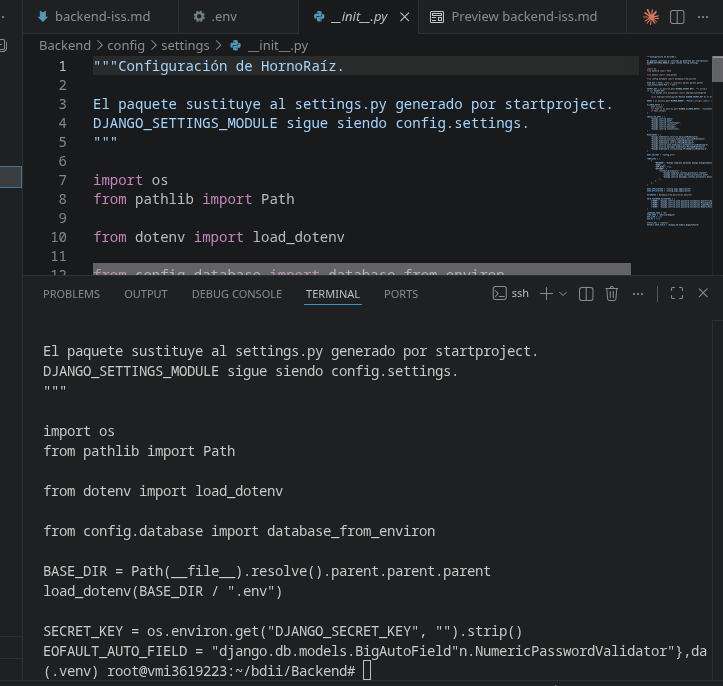

**9. Crear `config/project_python.py`**

Permite ejecutar `python3 manage.py` sin activar el entorno virtual.

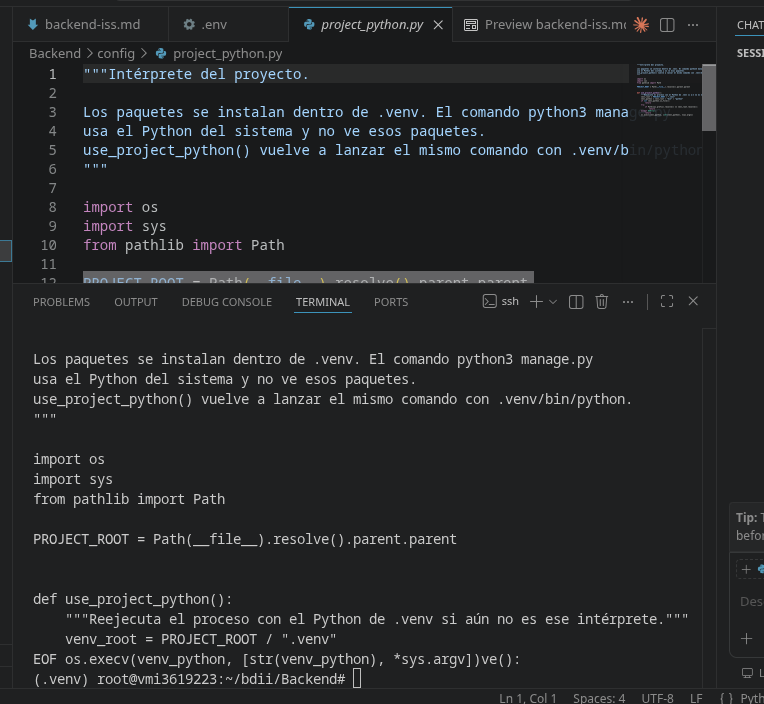

**10. Parchear `manage.py`, `config/wsgi.py` y `config/asgi.py`**

Se editaron los tres puntos de entrada para que carguen el `.env` antes de que Django lea la configuración.

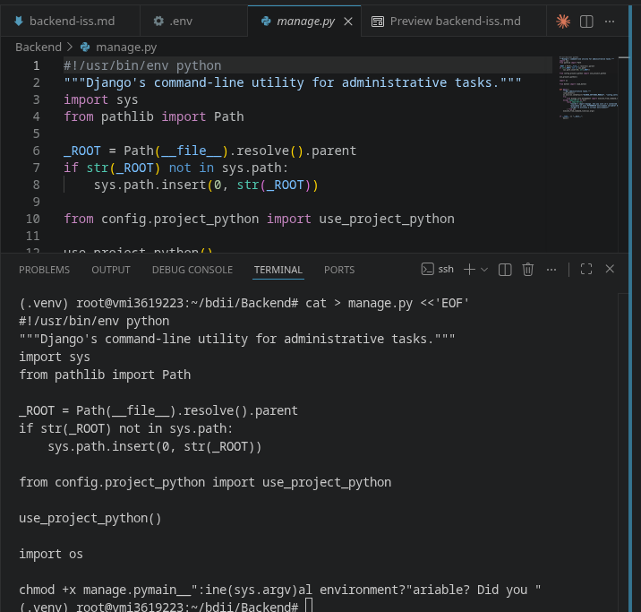

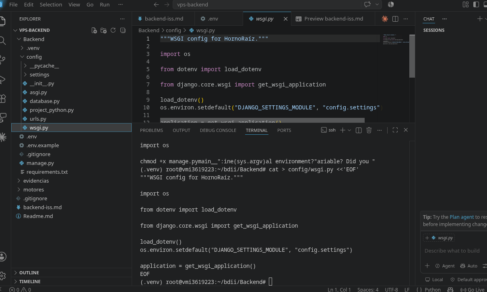

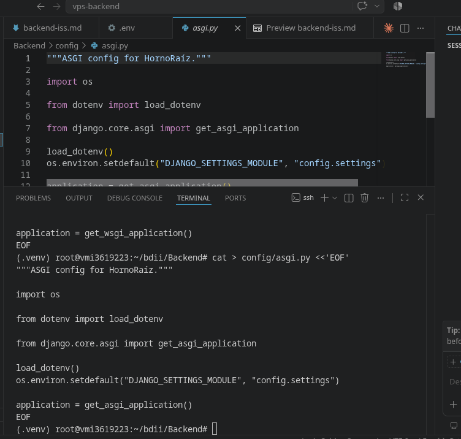

### Explicación

- **Intérprete de Python:** `use_project_python()` permite ejecutar `python3 manage.py runserver` sin activar el entorno.
- **Carga de variables de entorno:** `load_dotenv()` carga las variables definidas en `.env`, respetando las existentes.
- **Configuración única de la base de datos:** Django utiliza exclusivamente `DATABASES["default"]`.
- **Conexión a Oracle:** el DSN se construye con `SERVICE_NAME`, con `PORT` vacío.
- **Conexión a SQL Server:** el valor `mssql` se establece en `ENGINE`, según `mssql-django`.
- **Configuración regional:** `LANGUAGE_CODE = "es"`, `TIME_ZONE = "America/Bogota"`, `USE_TZ = True`.

El proceso sigue esta secuencia:

```
.env → DB_ENGINE → database_from_environ → DATABASES["default"] → ORM
```

### Criterios de aceptación

- **AC-01-01:** los motores `postgresql`, `mysql`, `mssql` y `oracle` generan el `ENGINE` correspondiente.
- **AC-01-02:** un motor no reconocido produce `ImproperlyConfigured`.
- **AC-01-03:** la ausencia de una variable obligatoria lanza error antes de conectar.
- **AC-01-04:** el DSN de Oracle incluye `SERVICE_NAME`.

### Verificación

```bash
python -m django --version
python manage.py check
python manage.py shell -c "from django.db import connection; connection.ensure_connection(); print('Motor:', connection.vendor); print('Base de datos:', connection.settings_dict['NAME']); print('Conexión: OK')"
```

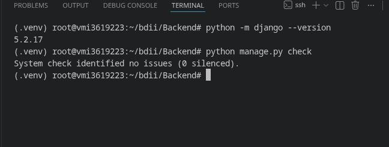

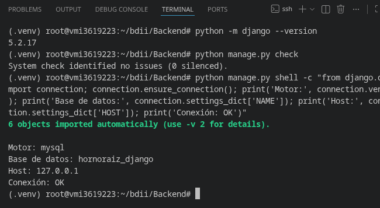

Los tests de `DatabaseSelectionTests` se escriben en el ISS-03.

### GATE

| **AC**   | **Verificación**               | **Evidencia** | **Resultado** |
|----------|--------------------------------|---------------|---------------|
| AC-01-01 | Los 4 motores generan el ENGINE correcto | EVI-01-15 | PASS |
| AC-01-02 | Motor inválido lanza `ImproperlyConfigured` | EVI-01-15 | PASS |
| AC-01-03 | Variable vacía lanza error | EVI-01-15 | PASS |
| AC-01-04 | DSN de Oracle contiene `SERVICE_NAME` | EVI-01-15 | PASS |

---

## ISS-02 — Apps catalog, production y sale

### Narrativa

Con la configuración del entorno y de la base de datos preparada, HornoRaíz necesita una estructura que permita organizar las funcionalidades del sistema. Django utiliza aplicaciones (*apps*) para separar la lógica del proyecto en módulos independientes, cada uno enfocado en una parte específica del negocio. En esta unidad se crearon las aplicaciones correspondientes a la gestión de la panadería y se organizaron dentro del paquete `apps/`, evitando que el directorio raíz se llene de carpetas dispersas. En esta etapa no se implementan modelos ni reglas de negocio; el trabajo se centra en establecer la estructura modular y registrar las aplicaciones en la configuración del proyecto.

### Objetivo

Crear las aplicaciones de negocio de HornoRaíz mediante las herramientas de Django, organizarlas dentro del paquete `apps/` y registrarlas en la configuración para facilitar su desarrollo en las siguientes unidades.

### Requisitos

- Haber completado el ISS-01, correspondiente a la configuración del entorno y la selección del motor de base de datos.
- Tener activo el entorno virtual `(.venv)` en la terminal.
- Contar con el proyecto Django `config` creado y funcionando.
- No implementar todavía los modelos de negocio.

### Construcción

**1. Confirmar el entorno**

```bash
source .venv/bin/activate
which python
```

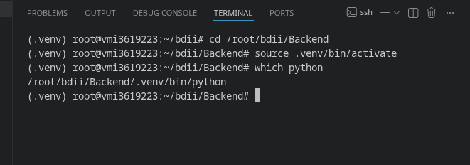

**2. Crear los directorios y las apps con `startapp`**

`startapp` exige que el directorio destino ya exista. Por eso primero se crean las carpetas y luego se genera cada app.

```bash
mkdir -p apps/catalog apps/production apps/sale

python manage.py startapp catalog apps/catalog
python manage.py startapp production apps/production
python manage.py startapp sale apps/sale
```

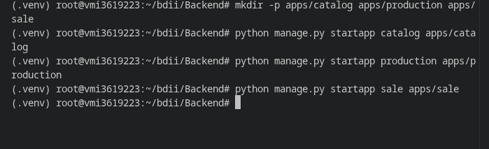

**3. Verificar la estructura de las apps**

```bash
tree apps -I "__pycache__"
```

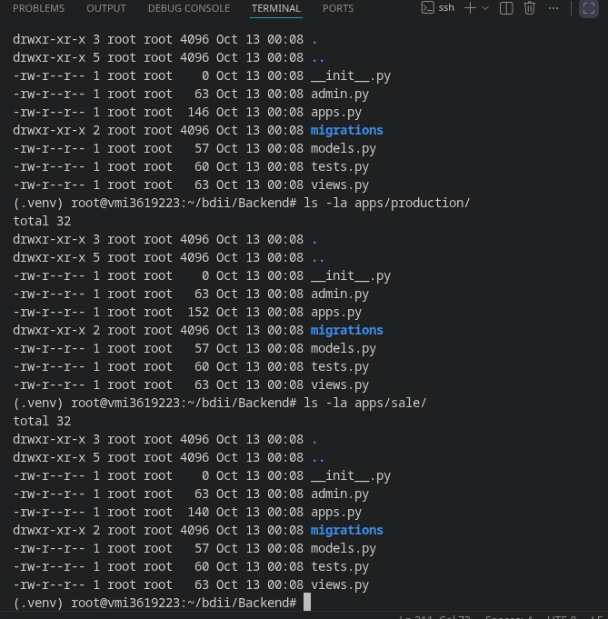

**4. Convertir `apps` en paquete**

Se creó `apps/__init__.py`, vacío, para que Python trate la carpeta `apps` como un paquete.

```bash
cat > apps/__init__.py <<'EOF'
EOF
```

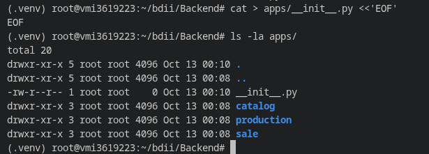

**5. Parchear el `apps.py` de cada app**

Como las apps viven dentro de `apps/`, hay que indicarle a Django la ruta completa del paquete. Se mantiene el `label` corto para que las migraciones no arrastren el prefijo `apps.`.

```python
# apps/catalog/apps.py
from django.apps import AppConfig


class CatalogConfig(AppConfig):
    default_auto_field = "django.db.models.BigAutoField"
    name = "apps.catalog"
    label = "catalog"
```

```python
# apps/production/apps.py
from django.apps import AppConfig


class ProductionConfig(AppConfig):
    default_auto_field = "django.db.models.BigAutoField"
    name = "apps.production"
    label = "production"
```

```python
# apps/sale/apps.py
from django.apps import AppConfig


class SaleConfig(AppConfig):
    default_auto_field = "django.db.models.BigAutoField"
    name = "apps.sale"
    label = "sale"
```

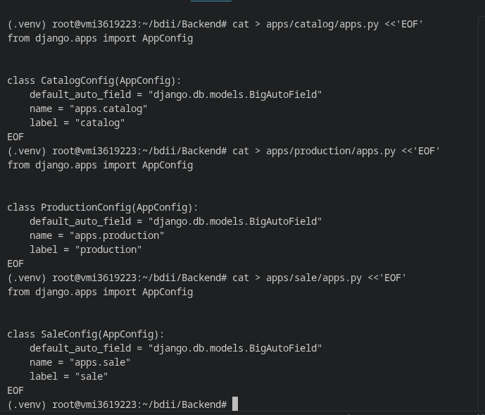

**6. Registrar las apps en `config/settings/__init__.py`**

```python
INSTALLED_APPS = [
    "django.contrib.admin",
    "django.contrib.auth",
    "django.contrib.contenttypes",
    "django.contrib.sessions",
    "django.contrib.messages",
    "django.contrib.staticfiles",
    "apps.catalog.apps.CatalogConfig",
    "apps.production.apps.ProductionConfig",
    "apps.sale.apps.SaleConfig",
]
```

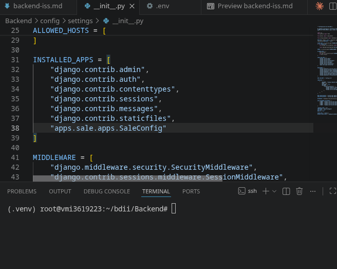

### Explicación

Django necesita conocer la ruta completa de cada aplicación para poder reconocerla y cargarla correctamente. En HornoRaíz, las aplicaciones se encuentran dentro del directorio `apps/`, por lo que el atributo `AppConfig.name` debe especificar la ruta correspondiente, como `apps.catalog`.

El atributo `label` conserva el nombre corto de cada aplicación, por ejemplo `catalog`, facilitando su identificación dentro del proyecto y evitando introducir el prefijo del paquete en las referencias de las migraciones.

Cada aplicación representa un área funcional de HornoRaíz:

```
apps/
├── catalog/     products, supplies, recipes, recipe_supplies, promotions
├── production/  production_batches, supply_movements
└── sale/        sales, sale_details, payments
```

En esta etapa se prepara la estructura de las aplicaciones, sin implementar todavía los modelos de negocio.

### Criterios de aceptación

- **AC-02-01:** verificar que las aplicaciones `catalog`, `production` y `sale` se hayan creado mediante el comando `startapp` de Django.
- **AC-02-02:** comprobar que `python manage.py check` se ejecute sin errores relacionados con el registro o la configuración de las aplicaciones.
- **AC-02-03:** confirmar que todavía no se hayan implementado modelos de negocio en esta etapa del desarrollo.

### Verificación

```bash
python manage.py check
```

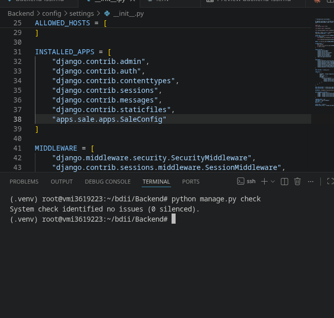

### GATE

| **AC**   | **Verificación**               | **Evidencia** | **Resultado** |
|----------|--------------------------------|---------------|---------------|
| AC-02-01 | directorios de las apps        | EVI-02-03     | PASS          |
| AC-02-02 | `manage.py check`              | EVI-02-07     | PASS          |
| AC-02-03 | este ISS no escribe modelos    | revisión de los `models.py` vacíos | PASS |

---

## ISS-03 — Custom User antes de la primera migración

### Narrativa

Con la estructura de apps lista, el siguiente paso consiste en definir el modelo de usuario propio del sistema antes de la primera migración. Django trae un usuario por defecto, pero cambiarlo después de migrar obliga a borrar tablas. Por eso, en esta unidad se creó el usuario personalizado de HornoRaíz sobre `django.contrib.auth`, se declaró en la configuración y solo entonces se hizo la primera migración. Así, las credenciales del sistema quedan en una tabla propia (`users`).

### Objetivo

Definir el usuario de HornoRaíz sobre `django.contrib.auth` y fijar `AUTH_USER_MODEL` antes de migrar.

### Requisitos

- ISS-02 superado.
- Terminal con el entorno virtual `.venv` activo.
- Decisión explícita entre `AbstractUser` y `AbstractBaseUser`: se eligió `AbstractUser`.

### Construcción

**1. Confirmar el entorno**

```bash
cd /root/bdii/Backend
source .venv/bin/activate
which python
```

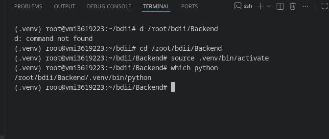

**2. Crear el paquete `apps/common` con `RecordStatus`**

El estado "activo / inactivo" lo usarán el usuario y, desde el ISS-04, las tablas del negocio. `apps/common` no es una app: no se registra en `INSTALLED_APPS` ni se crea con `startapp`.

```bash
mkdir -p apps/common
cat > apps/common/__init__.py <<'EOF'
EOF
cat > apps/common/status.py <<'EOF'
from django.db import models


class RecordStatus(models.TextChoices):
    ACTIVE = "active", "Active"
    INACTIVE = "inactive", "Inactive"
EOF
```

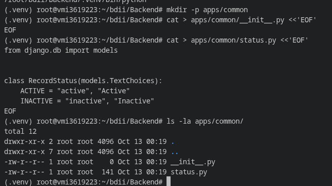

**3. Crear la app `security` con la CLI**

```bash
mkdir -p apps/security
python manage.py startapp security apps/security
```

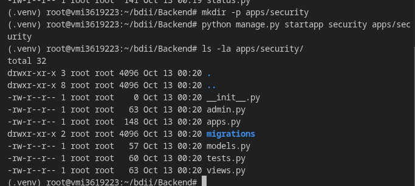

**4. Parchear `apps/security/apps.py`**

```python
from django.apps import AppConfig


class SecurityConfig(AppConfig):
    default_auto_field = "django.db.models.BigAutoField"
    name = "apps.security"
    label = "security"
```

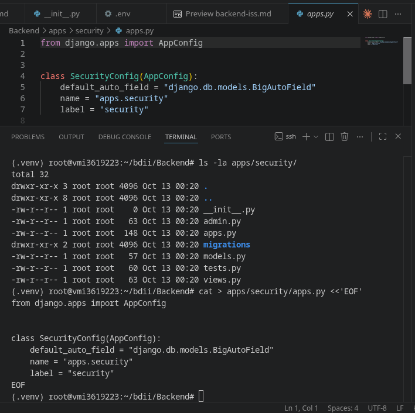

**5. Escribir el modelo de usuario**

```python
from django.contrib.auth.models import AbstractUser, UserManager
from django.db import models

from apps.common.status import RecordStatus


class HornoRaizUserManager(UserManager):
    def create_user(self, username, email=None, password=None, **extra_fields):
        extra_fields.setdefault("status", RecordStatus.INACTIVE)
        return super().create_user(username, email, password, **extra_fields)

    def create_superuser(self, username, email=None, password=None, **extra_fields):
        extra_fields.setdefault("status", RecordStatus.ACTIVE)
        extra_fields.setdefault("is_staff", True)
        extra_fields.setdefault("is_superuser", True)
        return super().create_superuser(username, email, password, **extra_fields)


class User(AbstractUser):
    email = models.EmailField("correo electrónico", max_length=150, unique=True)
    status = models.CharField(
        max_length=8,
        choices=RecordStatus.choices,
        default=RecordStatus.INACTIVE,
    )
    created_at = models.DateTimeField(auto_now_add=True)
    updated_at = models.DateTimeField(auto_now=True)

    objects = HornoRaizUserManager()

    class Meta:
        db_table = "users"
        verbose_name = "usuario"
        verbose_name_plural = "usuarios"
        constraints = [
            models.CheckConstraint(
                condition=models.Q(status__in=RecordStatus.values),
                name="users_status_valid",
            )
        ]

    def save(self, *args, **kwargs):
        if self.email:
            self.email = self.email.strip().lower()
        self.is_active = self.status == RecordStatus.ACTIVE
        super().save(*args, **kwargs)
```

`create_user` deja `status` en `inactive` si nadie lo indica. `create_superuser` lo fuerza a `active`, para que `save()` no desactive al superusuario.

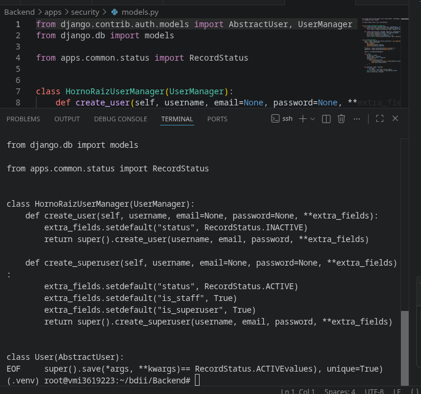

**6. Registrar la app y fijar `AUTH_USER_MODEL`**

En `config/settings/__init__.py`, la app de seguridad va delante de las de negocio:

```python
INSTALLED_APPS = [
    "django.contrib.admin",
    "django.contrib.auth",
    "django.contrib.contenttypes",
    "django.contrib.sessions",
    "django.contrib.messages",
    "django.contrib.staticfiles",
    "apps.security.apps.SecurityConfig",
    "apps.catalog.apps.CatalogConfig",
    "apps.production.apps.ProductionConfig",
    "apps.sale.apps.SaleConfig",
]
```

Y debajo de `DATABASES = database_from_environ(os.environ)`:

```python
AUTH_USER_MODEL = "security.User"
```

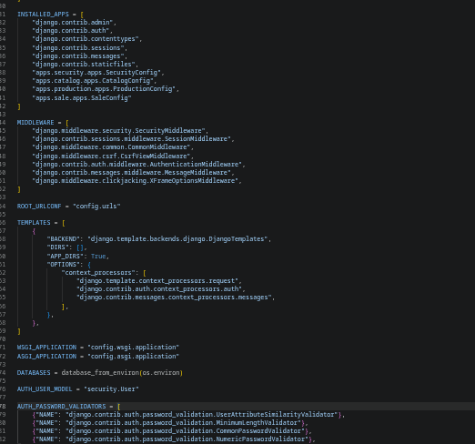

**7. Escribir el test de selección del motor**

```python
from django.core.exceptions import ImproperlyConfigured
from django.test import SimpleTestCase

from config.database import database_from_environ


class DatabaseSelectionTests(SimpleTestCase):
    def _env(self, engine):
        return {
            "DB_ENGINE": engine,
            "POSTGRES_DB": "hornoraiz",
            "POSTGRES_USER": "hornoraiz",
            "POSTGRES_PASSWORD": "hornoraiz",
            "POSTGRES_HOST": "127.0.0.1",
            "POSTGRES_PORT": "5432",
            "MYSQL_DB": "hornoraiz_django",
            "MYSQL_USER": "admin",
            "MYSQL_PASSWORD": "1704",
            "MYSQL_HOST": "127.0.0.1",
            "MYSQL_PORT": "3306",
            "MSSQL_DB": "hornoraiz",
            "MSSQL_USER": "sa",
            "MSSQL_PASSWORD": "hornoraiz",
            "MSSQL_HOST": "127.0.0.1",
            "MSSQL_PORT": "1433",
            "ORACLE_DB": "hornoraiz",
            "ORACLE_USER": "admin",
            "ORACLE_PASSWORD": "hornoraiz",
            "ORACLE_HOST": "127.0.0.1",
            "ORACLE_PORT": "1521",
            "ORACLE_SERVICE_NAME": "FREEPDB1",
        }

    def test_postgresql_engine(self):
        config = database_from_environ(self._env("postgresql"))
        self.assertEqual(config["default"]["ENGINE"], "django.db.backends.postgresql")

    def test_mysql_engine(self):
        config = database_from_environ(self._env("mysql"))
        self.assertEqual(config["default"]["ENGINE"], "django.db.backends.mysql")
        self.assertEqual(config["default"]["OPTIONS"]["charset"], "utf8mb4")

    def test_mssql_engine(self):
        config = database_from_environ(self._env("mssql"))
        self.assertEqual(config["default"]["ENGINE"], "mssql")

    def test_oracle_uses_service_name(self):
        config = database_from_environ(self._env("oracle"))
        self.assertIn("SERVICE_NAME=FREEPDB1", config["default"]["NAME"])
        self.assertEqual(config["default"]["PORT"], "")

    def test_invalid_engine(self):
        with self.assertRaises(ImproperlyConfigured):
            database_from_environ({"DB_ENGINE": "sqlite"})

    def test_missing_variable(self):
        env = self._env("postgresql")
        env["POSTGRES_DB"] = ""
        with self.assertRaises(ImproperlyConfigured):
            database_from_environ(env)
```

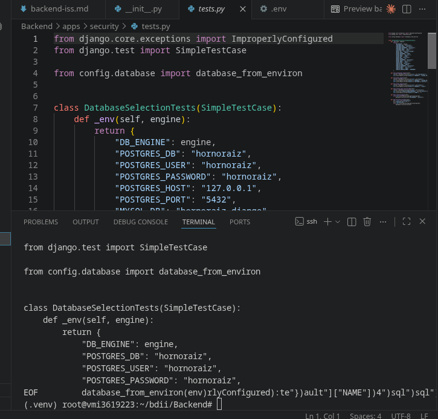

**8. Generar la migración**

```bash
python manage.py makemigrations security
```

Resultado:
```
Migrations for 'security':
  apps/security/migrations/0001_initial.py
    + Create model User
```

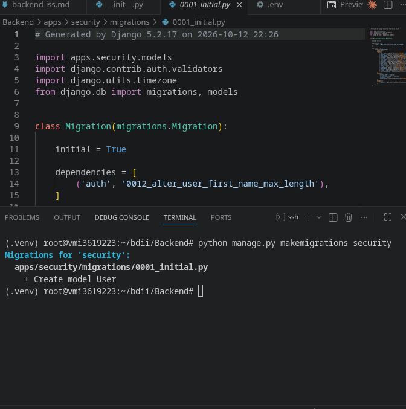

**9. Migrar**

```bash
python manage.py migrate
```

Resultado:
```
Operations to perform:
  Apply all migrations: admin, auth, contenttypes, security, sessions
Running migrations:
  Applying contenttypes.0001_initial... OK
  Applying auth.0001_initial... OK
  ...
  Applying security.0001_initial... OK
  Applying admin.0001_initial... OK
  Applying sessions.0001_initial... OK
```

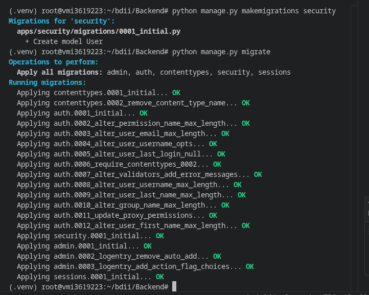

**10. Ejecutar los tests**

```bash
python manage.py test apps.security.tests.DatabaseSelectionTests
```

Resultado:
```
Found 6 test(s).
System check identified no issues (0 silenced).
......
Ran 6 tests in 0.001s

OK
```

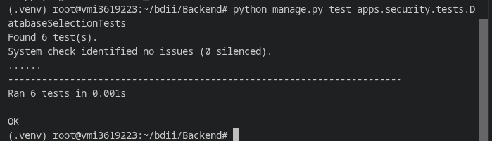

**11. Probar la conexión a MySQL**

```bash
python manage.py shell -c "from django.db import connection; connection.ensure_connection(); print('Motor:', connection.vendor); print('Base de datos:', connection.settings_dict['NAME']); print('Conexión: OK')"
```

Resultado:
```
Motor: mysql
Base de datos: hornoraiz_django
Conexión: OK
```

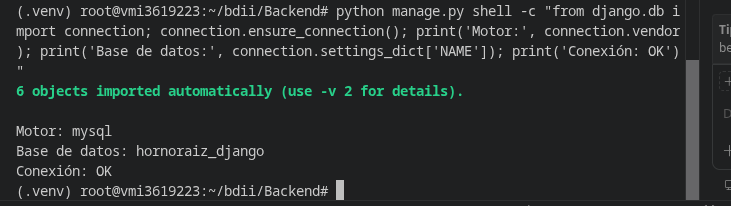

**12. Crear el superusuario**

```bash
python manage.py createsuperuser
```

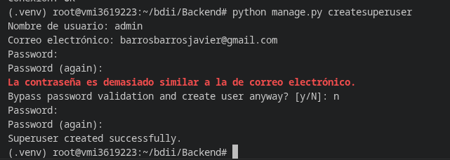

**13. Verificar la tabla `users` en MySQL**

```bash
docker exec mysql-server mysql -u admin -p1704 -e "USE hornoraiz_django; SHOW TABLES;"
```

Resultado:
```
Tables_in_hornoraiz_django
auth_group
auth_group_permissions
auth_permission
django_admin_log
django_content_type
django_migrations
django_session
users            ← la tabla del usuario personalizado
users_groups
users_user_permissions
```

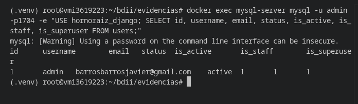

**14. Verificar el superusuario en la tabla**

```bash
docker exec mysql-server mysql -u admin -p1704 -e "USE hornoraiz_django; SELECT id, username, email, status, is_active, is_staff, is_superuser FROM users;"
```

Resultado:
```
id  username  email                       status  is_active  is_staff  is_superuser
1   admin     barrosbarrosjavier@gmail.com  active  1          1         1
```

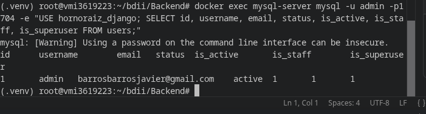

### Explicación

Se prefirió `AbstractUser` sobre `AbstractBaseUser` porque proporciona funcionalidades de autenticación ya implementadas por Django, como el hash de contraseñas, los validadores, los métodos `set_password()` y `check_password()`, y la integración con el panel administrativo.

El campo `status` permite representar el estado funcional de la cuenta, mientras que `is_active` se conserva para mantener la compatibilidad con los mecanismos de autenticación de Django. Para garantizar el comportamiento esperado, ambos campos se mantienen sincronizados desde el método `save()`.

```
AbstractUser
    + status
    + created_at / updated_at
    + email único
         │
         ▼
AUTH_USER_MODEL = security.User
```

### Criterios de aceptación

- **AC-03-01:** `AUTH_USER_MODEL` apunta a `security.User`.
- **AC-03-02:** la tabla `users` se crea en `hornoraiz_django` (no `auth_user`).
- **AC-03-03:** el `HornoRaizUserManager` marca los usuarios nuevos como `inactive` y el superusuario como `active`.
- **AC-03-04:** el superusuario creado tiene `status = active` e `is_active = 1`.

### Verificación

```bash
python manage.py test apps.security.tests.DatabaseSelectionTests
docker exec mysql-server mysql -u admin -p1704 -e "USE hornoraiz_django; SELECT id, username, email, status, is_active, is_staff, is_superuser FROM users;"
```


### GATE

| **AC**   | **Verificación**               | **Evidencia** | **Resultado** |
|----------|--------------------------------|---------------|---------------|
| AC-03-01 | `AUTH_USER_MODEL` configurado  | EVI-03-06     | PASS          |
| AC-03-02 | tabla `users` creada en MySQL  | EVI-03-13     | PASS          |
| AC-03-03 | manager maneja el estado       | EVI-03-05     | PASS          |
| AC-03-04 | superusuario activo creado     | EVI-03-14     | PASS          |

---

## ISS-04 — Modelos Product, Supply, Recipe y RecipeSupply

### Narrativa

Con el modelo de usuario del sistema ya definido y migrado, se desarrollan los primeros modelos de negocio de HornoRaíz. Antes de implementarlos, se creó una clase base común para los modelos del negocio, que centraliza la auditoría temporal cuando la tabla la necesita. En este ISS se modelan las entidades del catálogo: los productos de panadería (`Product`), los insumos (`Supply`), las recetas (`Recipe`) y la relación entre recetas e insumos (`RecipeSupply`). Los modelos respetan la estructura exacta de las tablas `products`, `supplies`, `recipes` y `recipe_supplies` del esquema original.

### Objetivo

Persistir y administrar la información del catálogo de HornoRaíz mediante los modelos `Product`, `Supply`, `Recipe` y `RecipeSupply`, respetando el diccionario de datos y la estructura definida para sus tablas.

### Requisitos

- ISS-03 superado: modelo de usuario del sistema definido y migrado.
- Terminal con el entorno virtual `.venv` activo.
- Clase base común para los modelos del negocio.
- Aplicación `catalog` registrada correctamente en la configuración de Django.
- Conexión a la base de datos MySQL `hornoraiz_django` configurada.

### Construcción

**1. Confirmar el entorno**

```bash
cd /root/bdii/Backend
source .venv/bin/activate
which python
```

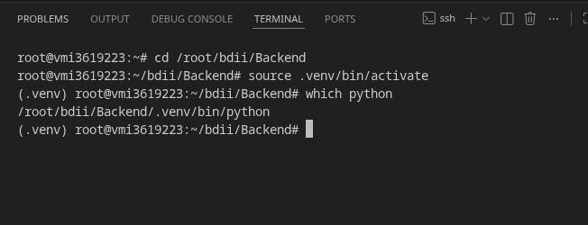

**2. Crear el modelo abstracto base**

Se definió `TimeStampedModel` en `apps/common/models.py`, que aporta `created_at` y `updated_at` a los modelos que lo necesiten.

```python
from django.db import models


class TimeStampedModel(models.Model):
    """Añade created_at y updated_at a cualquier modelo."""

    created_at = models.DateTimeField(auto_now_add=True)
    updated_at = models.DateTimeField(auto_now=True)

    class Meta:
        abstract = True
```

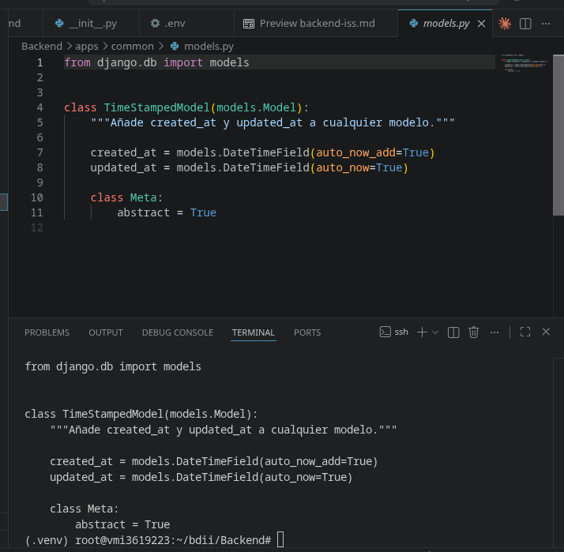

**3. Escribir los modelos del catálogo**

Se reescribió `apps/catalog/models.py` entero con los cuatro modelos del catálogo.

```python
from django.core.validators import MinLengthValidator, MinValueValidator
from django.db import models

from apps.common.models import TimeStampedModel


class Product(models.Model):
    sku = models.CharField(max_length=50, unique=True)
    name = models.CharField(max_length=100, validators=[MinLengthValidator(2)])
    description = models.CharField(max_length=255, null=True, blank=True)
    price = models.DecimalField(
        max_digits=10,
        decimal_places=2,
        validators=[MinValueValidator(0)],
    )
    status = models.BooleanField(default=True)

    class Meta:
        db_table = "products"
        verbose_name = "producto"
        verbose_name_plural = "productos"
        ordering = ["name", "id"]

    def __str__(self):
        return f"{self.sku} - {self.name}"


class Supply(models.Model):
    code = models.CharField(max_length=50, unique=True)
    name = models.CharField(max_length=100, validators=[MinLengthValidator(2)])
    unit_of_measure = models.CharField(max_length=30)
    min_stock = models.DecimalField(
        max_digits=10,
        decimal_places=2,
        default=0,
        validators=[MinValueValidator(0)],
    )
    status = models.BooleanField(default=True)

    class Meta:
        db_table = "supplies"
        verbose_name = "insumo"
        verbose_name_plural = "insumos"
        ordering = ["name", "id"]

    def __str__(self):
        return f"{self.code} - {self.name}"


class Recipe(TimeStampedModel):
    product = models.ForeignKey(
        Product,
        on_delete=models.PROTECT,
        related_name="recipes",
        db_column="product_id",
    )
    name = models.CharField(max_length=100, validators=[MinLengthValidator(2)])
    description = models.CharField(max_length=255, null=True, blank=True)
    status = models.BooleanField(default=True)

    class Meta:
        db_table = "recipes"
        verbose_name = "receta"
        verbose_name_plural = "recetas"
        ordering = ["name", "id"]

    def __str__(self):
        return self.name


class RecipeSupply(models.Model):
    main = models.ForeignKey(
        Recipe,
        on_delete=models.PROTECT,
        related_name="recipe_supplies",
        db_column="main_id",
    )
    related = models.ForeignKey(
        Supply,
        on_delete=models.PROTECT,
        related_name="recipe_supplies",
        db_column="related_id",
    )
    relation_data = models.CharField(max_length=255, null=True, blank=True)
    status = models.BooleanField(default=True)

    class Meta:
        db_table = "recipe_supplies"
        verbose_name = "insumo de receta"
        verbose_name_plural = "insumos de receta"
        ordering = ["main_id", "related_id", "id"]
        constraints = [
            models.UniqueConstraint(
                fields=["main", "related"],
                name="recipe_supplies_unique",
            ),
        ]

    def __str__(self):
        return f"{self.main} - {self.related}"
```

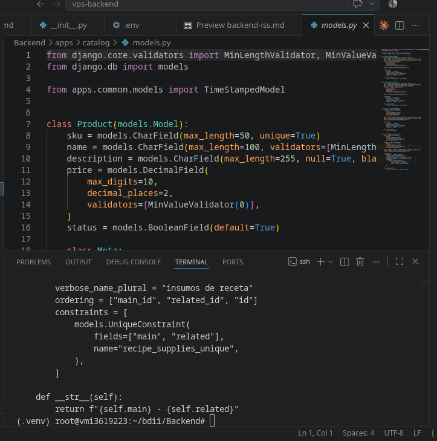

**4. Generar la migración**

```bash
python manage.py makemigrations catalog
```

Resultado:
```
Migrations for 'catalog':
  apps/catalog/migrations/0001_initial.py
    + Create model Product
    + Create model Supply
    + Create model Recipe
    + Create model RecipeSupply
```

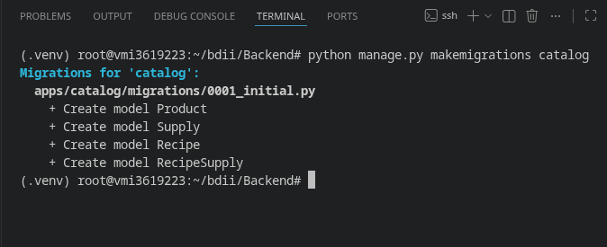

**5. Migrar**

```bash
python manage.py migrate
```

Resultado:
```
Operations to perform:
  Apply all migrations: admin, auth, catalog, contenttypes, security, sessions
Running migrations:
  Applying catalog.0001_initial... OK
```

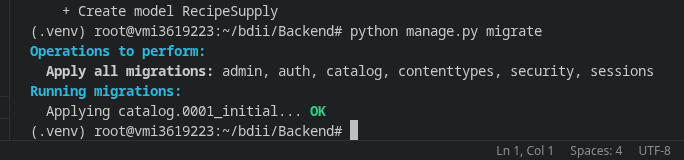

**6. Verificar las tablas en MySQL**

```bash
docker exec mysql-server mysql -u admin -p1704 -e "USE hornoraiz_django; SHOW TABLES;"
```

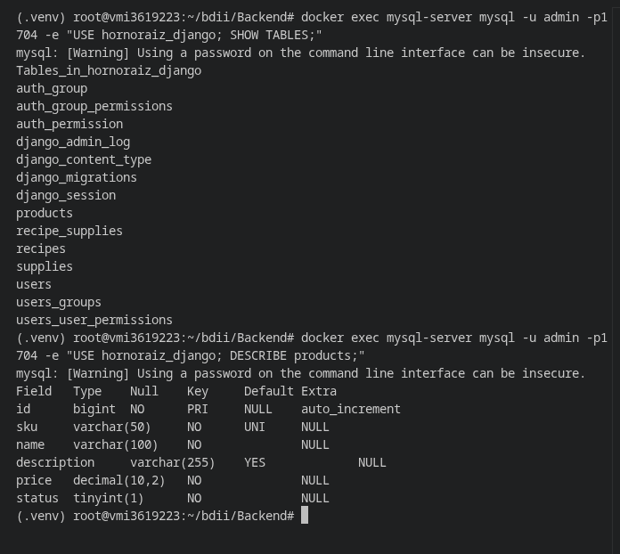

```bash
docker exec mysql-server mysql -u admin -p1704 -e "USE hornoraiz_django; DESCRIBE products;"
docker exec mysql-server mysql -u admin -p1704 -e "USE hornoraiz_django; DESCRIBE supplies;"
docker exec mysql-server mysql -u admin -p1704 -e "USE hornoraiz_django; DESCRIBE recipes;"
docker exec mysql-server mysql -u admin -p1704 -e "USE hornoraiz_django; DESCRIBE recipe_supplies;"
```

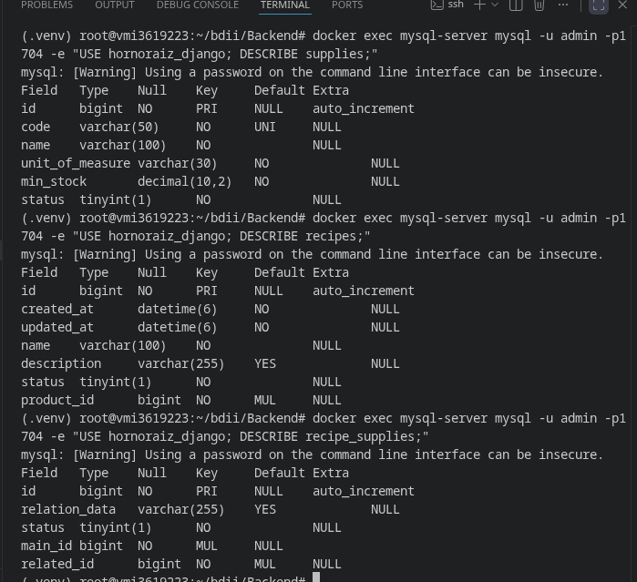

**7. Probar en el shell**

```python
from apps.catalog.models import Product, Supply, Recipe, RecipeSupply
from decimal import Decimal
from django.db import IntegrityError

p = Product.objects.create(sku="TEST-001", name="Pan de prueba", price=Decimal("1000.00"))
print("Product:", p.id, p.status)

s = Supply.objects.create(code="INS-001", name="Harina", unit_of_measure="kg", min_stock=Decimal("5.00"))
print("Supply:", s.id, s.status)

r = Recipe.objects.create(product=p, name="Receta de pan de prueba")
print("Recipe:", r.id, r.status, r.created_at is not None)

rs = RecipeSupply.objects.create(main=r, related=s, relation_data="500 gramos")
print("RecipeSupply:", rs.id, rs.status)

try:
    Product.objects.create(sku="TEST-001", name="Otro pan", price=Decimal("500.00"))
except IntegrityError:
    print("OK: rechazó el sku duplicado")

from django.core.exceptions import ValidationError
try:
    p2 = Product(sku="TEST-002", name="A", price=Decimal("100.00"))
    p2.full_clean()
except ValidationError:
    print("OK: rechazó nombre de 1 carácter")
```

Resultado:
```
Product: 1 True
Supply: 1 True
Recipe: 1 True True
RecipeSupply: 1 True
OK: rechazó el sku duplicado
OK: rechazó nombre de 1 carácter
```

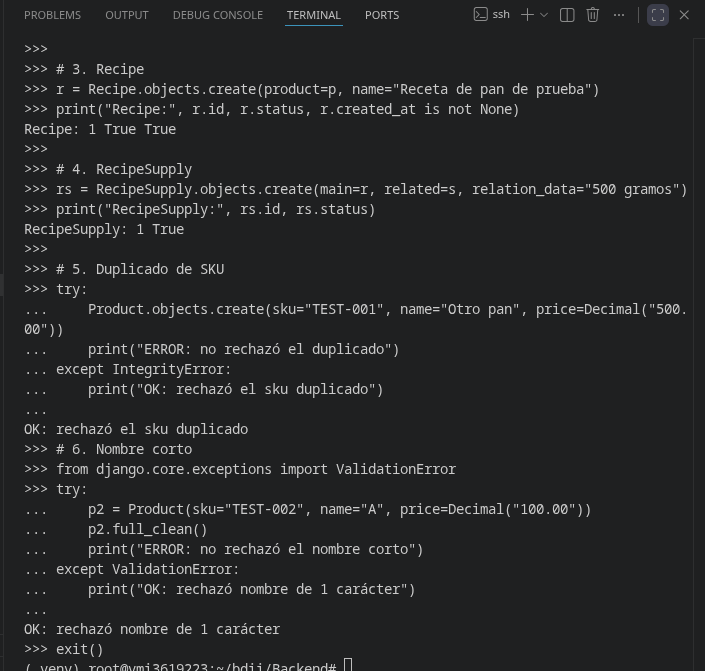

**8. Verificar los datos en MySQL**

```bash
docker exec mysql-server mysql -u admin -p1704 -e "USE hornoraiz_django; SELECT id, sku, name, price, status FROM products;"
docker exec mysql-server mysql -u admin -p1704 -e "USE hornoraiz_django; SELECT id, code, name, unit_of_measure, min_stock, status FROM supplies;"
docker exec mysql-server mysql -u admin -p1704 -e "USE hornoraiz_django; SELECT id, product_id, name, status FROM recipes;"
docker exec mysql-server mysql -u admin -p1704 -e "USE hornoraiz_django; SELECT id, main_id, related_id, relation_data, status FROM recipe_supplies;"
```


### Explicación

- **`Product`** almacena los productos de panadería con `sku` único, `name`, `description`, `price` y `status`.
- **`Supply`** almacena los insumos con `code` único, `name`, `unit_of_measure`, `min_stock` y `status`.
- **`Recipe`** relaciona un producto con sus recetas, con `product_id` como FK protegida y timestamps `created_at` y `updated_at`.
- **`RecipeSupply`** resuelve la relación N:M entre recetas e insumos, con `main_id` (receta) y `related_id` (insumo), y una restricción de unicidad en el par.
- El `status` es un `BooleanField(default=True)` que refleja el `tinyint(1)` del esquema original.
- `on_delete=models.PROTECT` impide eliminar un producto o insumo que tenga recetas o relaciones asociadas.

```
catalog/
├── Product      → products
├── Supply       → supplies
├── Recipe       → recipes
└── RecipeSupply → recipe_supplies
```

### Criterios de aceptación

- **AC-04-01:** las tablas físicas son `products`, `supplies`, `recipes`, `recipe_supplies`.
- **AC-04-02:** sin `status` en el alta, el valor por defecto es `True`.
- **AC-04-03:** `created_at` y `updated_at` se generan en `Recipe`.
- **AC-04-04:** el `sku` duplicado se rechaza con `IntegrityError`.
- **AC-04-05:** un nombre de un carácter se rechaza con `ValidationError`.

### Verificación

```bash
python manage.py migrate
python manage.py shell
```


### GATE

| **AC**   | **Verificación**                | **Evidencia** | **Resultado** |
|----------|---------------------------------|---------------|---------------|
| AC-04-01 | `db_table` en Meta              | EVI-04-07     | PASS          |
| AC-04-02 | status default True             | EVI-04-08     | PASS          |
| AC-04-03 | timestamps en Recipe            | EVI-04-08     | PASS          |
| AC-04-04 | sku duplicado rechazado         | EVI-04-08     | PASS          |
| AC-04-05 | nombre corto rechazado          | EVI-04-08     | PASS          |

---

## ISS-05 — Modelos ProductionBatch, SupplyMovement y Promotion

### Narrativa

Con el catálogo modelado en el ISS-04, el siguiente paso consiste en representar las operaciones de producción y las promociones del negocio. Se modelan los lotes de producción (`ProductionBatch`), los movimientos de insumos (`SupplyMovement`) y las promociones (`Promotion`). Los lotes se vinculan a una receta mediante `PROTECT`, los movimientos de insumos pueden o no estar asociados a un lote (nullable) y las promociones no tienen FK, respetando la decisión de diseño del proyecto original.

### Objetivo

Persistir y administrar los lotes de producción, los movimientos de insumos y las promociones de HornoRaíz, respetando el esquema original de las tablas `production_batches`, `supply_movements` y `promotions`.

### Requisitos

- ISS-04 superado: catálogo modelado y migrado.
- Terminal con el entorno virtual `.venv` activo.
- Aplicaciones `catalog` y `production` registradas en la configuración.

### Construcción

**1. Confirmar el entorno**

```bash
cd /root/bdii/Backend
source .venv/bin/activate
which python
```


**2. Escribir los modelos de producción**

```python
from django.core.validators import MinLengthValidator, MinValueValidator
from django.db import models

from apps.catalog.models import Recipe, Supply
from apps.common.models import TimeStampedModel


class ProductionBatch(TimeStampedModel):
    recipe = models.ForeignKey(
        Recipe,
        on_delete=models.PROTECT,
        related_name="production_batches",
        db_column="recipe_id",
    )
    name = models.CharField(max_length=100, validators=[MinLengthValidator(2)])
    description = models.CharField(max_length=255, null=True, blank=True)
    status = models.BooleanField(default=True)

    class Meta:
        db_table = "production_batches"
        verbose_name = "lote de producción"
        verbose_name_plural = "lotes de producción"
        ordering = ["name", "id"]

    def __str__(self):
        return self.name


class SupplyMovement(models.Model):
    production_batch = models.ForeignKey(
        ProductionBatch,
        on_delete=models.PROTECT,
        related_name="supply_movements",
        db_column="production_batch_id",
        null=True,
        blank=True,
    )
    supply = models.ForeignKey(
        Supply,
        on_delete=models.PROTECT,
        related_name="supply_movements",
        db_column="supply_id",
    )
    type = models.CharField(max_length=50)
    date = models.DateTimeField()
    quantity = models.DecimalField(
        max_digits=10,
        decimal_places=2,
        validators=[MinValueValidator(0)],
    )
    notes = models.TextField(null=True, blank=True)
    status = models.CharField(max_length=30)

    class Meta:
        db_table = "supply_movements"
        verbose_name = "movimiento de insumo"
        verbose_name_plural = "movimientos de insumos"
        ordering = ["-date", "id"]

    def __str__(self):
        return f"{self.type} - {self.supply} ({self.quantity})"
```


**3. Agregar `Promotion` al catálogo**

```python
class Promotion(TimeStampedModel):
    name = models.CharField(max_length=100, validators=[MinLengthValidator(2)])
    description = models.CharField(max_length=255, null=True, blank=True)
    status = models.BooleanField(default=True)

    class Meta:
        db_table = "promotions"
        verbose_name = "promoción"
        verbose_name_plural = "promociones"
        ordering = ["name", "id"]

    def __str__(self):
        return self.name
```


**4. Generar las migraciones**

```bash
python manage.py makemigrations catalog production
```

Resultado:
```
Migrations for 'catalog':
  apps/catalog/migrations/0002_promotion.py
    + Create model Promotion
Migrations for 'production':
  apps/production/migrations/0001_initial.py
    + Create model ProductionBatch
    + Create model SupplyMovement
```


**5. Migrar**

```bash
python manage.py migrate
```

Resultado:
```
Applying catalog.0002_promotion... OK
Applying production.0001_initial... OK
```


**6. Verificar las tablas en MySQL**

```bash
docker exec mysql-server mysql -u admin -p1704 -e "USE hornoraiz_django; SHOW TABLES;"
```


```bash
docker exec mysql-server mysql -u admin -p1704 -e "USE hornoraiz_django; DESCRIBE production_batches;"
docker exec mysql-server mysql -u admin -p1704 -e "USE hornoraiz_django; DESCRIBE supply_movements;"
docker exec mysql-server mysql -u admin -p1704 -e "USE hornoraiz_django; DESCRIBE promotions;"
```


**7. Probar en el shell**

```python
from apps.catalog.models import Product, Supply, Recipe, Promotion
from apps.production.models import ProductionBatch, SupplyMovement
from decimal import Decimal
from django.utils import timezone
from django.db.models import ProtectedError

p = Product.objects.create(sku="TEST-004", name="Pan de prueba 4", price=Decimal("1000.00"))
s = Supply.objects.create(code="INS-004", name="Harina 4", unit_of_measure="kg", min_stock=Decimal("5.00"))
r = Recipe.objects.create(product=p, name="Receta prueba 4")

print("Product:", p.id, p.status)
print("Supply:", s.id, s.status)
print("Recipe:", r.id, r.status)

promo = Promotion.objects.create(name="Promo 2x1 test")
print("Promotion:", promo.id, promo.status)

pb = ProductionBatch.objects.create(recipe=r, name="Lote de prueba 2")
print("ProductionBatch:", pb.id, pb.status, pb.created_at is not None)

sm1 = SupplyMovement.objects.create(
    production_batch=pb, supply=s, type="IN", date=timezone.now(),
    quantity=Decimal("10.00"), notes="Compra de insumo", status="completed"
)
print("SupplyMovement con lote:", sm1.id)

sm2 = SupplyMovement.objects.create(
    supply=s, type="OUT", date=timezone.now(),
    quantity=Decimal("2.00"), status="pending"
)
print("SupplyMovement sin lote:", sm2.id)

try:
    pb.delete()
except ProtectedError:
    print("OK: rechazó borrar el lote con movimientos")

try:
    r.delete()
except ProtectedError:
    print("OK: rechazó borrar la receta con lotes")
```

Resultado:
```
Product: 6 True
Supply: 5 True
Recipe: 4 True
Promotion: 4 True
ProductionBatch: 3 True True
SupplyMovement con lote: 5
SupplyMovement sin lote: 6
OK: rechazó borrar el lote con movimientos
OK: rechazó borrar la receta con lotes
```


**8. Verificar los datos en MySQL**

```bash
docker exec mysql-server mysql -u admin -p1704 -e "USE hornoraiz_django; SELECT id, name, status FROM promotions;"
docker exec mysql-server mysql -u admin -p1704 -e "USE hornoraiz_django; SELECT id, recipe_id, name, status FROM production_batches;"
docker exec mysql-server mysql -u admin -p1704 -e "USE hornoraiz_django; SELECT id, production_batch_id, supply_id, type, quantity, status FROM supply_movements;"
```


### Explicación

- **`ProductionBatch`** se vincula a una `Recipe` con `on_delete=PROTECT`. Tiene timestamps porque su tabla original los tiene.
- **`SupplyMovement`** tiene `production_batch` **nullable** (movimientos sin lote, como compras directas) y `supply` obligatorio. Su `status` es `CharField` (texto de flujo) y no booleano, respetando el esquema original.
- **`Promotion`** no tiene FK a productos, siguiendo el diseño original del proyecto.
- `PROTECT` impide eliminar una receta con lotes ni un lote con movimientos. Django lanza `ProtectedError` en ambos casos.

```
catalog/       → products, supplies, recipes, recipe_supplies, promotions
production/    → production_batches, supply_movements
sale/          → (pendiente ISS-06)
```

### Criterios de aceptación

- **AC-05-01:** la FK `recipe_id` de `ProductionBatch` es obligatoria (`null=False`).
- **AC-05-02:** borrar un lote con movimientos falla con `ProtectedError`.
- **AC-05-03:** borrar una receta con lotes falla con `ProtectedError`.
- **AC-05-04:** los `status` por defecto son `True` (booleano) en `ProductionBatch` y `Promotion`, y texto libre en `SupplyMovement`.

### Verificación

```bash
python manage.py migrate
python manage.py shell
```


### GATE

| **AC**   | **Verificación**                  | **Evidencia** | **Resultado** |
|----------|-----------------------------------|---------------|---------------|
| AC-05-01 | FK `recipe_id` sin null           | EVI-05-07     | PASS          |
| AC-05-02 | `ProtectedError` al borrar lote   | EVI-05-08     | PASS          |
| AC-05-03 | `ProtectedError` al borrar receta | EVI-05-08     | PASS          |
| AC-05-04 | defaults de status                | EVI-05-08     | PASS          |

---

## ISS-06 — Modelos Sale, SaleDetail y Payment

### Narrativa

Con el catálogo y la producción modelados, el siguiente paso consiste en representar las transacciones comerciales de HornoRaíz. Se modelan las ventas (`Sale`), sus líneas de detalle (`SaleDetail`) y los pagos (`Payment`). Cada venta guarda el `unit_price` en el momento de la venta, de modo que si el precio del producto cambia después, la venta conserva el valor histórico aplicado. El detalle no se reemplaza por un `ManyToManyField`, porque cada línea tiene información propia: cantidad, precio unitario, total y observaciones. La relación con el cliente es un `IntegerField` sin FK, porque las ventas de mostrador pueden no tener cliente registrado, respetando el esquema original.

### Objetivo

Persistir y administrar las ventas, sus líneas de detalle y los pagos de HornoRaíz, respetando el esquema original de las tablas `sales`, `sale_details` y `payments`, garantizando el precio histórico por línea.

### Requisitos

- ISS-05 superado: catálogo y producción modelados.
- Terminal con el entorno virtual `.venv` activo.
- Aplicación `sale` registrada en la configuración.
- Modelo `Product` disponible en `apps/catalog`.

### Construcción

**1. Confirmar el entorno**

```bash
cd /root/bdii/Backend
source .venv/bin/activate
which python
```


**2. Crear el manager de ventas**

`apps/sale/managers.py` es nuevo. En este ISS el manager todavía no registra la venta: solo permite que el modelo `Sale` tenga un manager propio (`objects`) con su `QuerySet`.

```python
from django.db import models


class SaleQuerySet(models.QuerySet):
    pass


class SaleManager(models.Manager.from_queryset(SaleQuerySet)):
    pass
```


**3. Escribir los modelos de venta**

```python
from decimal import Decimal

from django.core.validators import MinValueValidator
from django.db import models

from apps.catalog.models import Product
from apps.sale.managers import SaleManager


class Sale(models.Model):
    client_id = models.IntegerField(null=True, blank=True)
    date = models.DateTimeField()
    subtotal = models.DecimalField(max_digits=10, decimal_places=2)
    taxes = models.DecimalField(max_digits=10, decimal_places=2, default=Decimal("0.00"))
    total = models.DecimalField(max_digits=10, decimal_places=2)
    status = models.CharField(max_length=30)

    objects = SaleManager()

    class Meta:
        db_table = "sales"
        verbose_name = "venta"
        verbose_name_plural = "ventas"
        ordering = ["-date", "-id"]

    def __str__(self):
        return f"Venta {self.pk}"


class SaleDetail(models.Model):
    sale = models.ForeignKey(
        Sale,
        on_delete=models.PROTECT,
        related_name="details",
        db_column="header_id",
    )
    product = models.ForeignKey(
        Product,
        on_delete=models.PROTECT,
        related_name="sale_details",
        db_column="item_id",
    )
    quantity = models.DecimalField(
        max_digits=10,
        decimal_places=2,
        validators=[MinValueValidator(Decimal("0.01"))],
    )
    unit_price = models.DecimalField(max_digits=10, decimal_places=2)
    total = models.DecimalField(max_digits=10, decimal_places=2)
    notes = models.TextField(null=True, blank=True)

    class Meta:
        db_table = "sale_details"
        verbose_name = "detalle de venta"
        verbose_name_plural = "detalles de venta"
        ordering = ["id"]

    def __str__(self):
        return f"{self.product} x {self.quantity}"

    def save(self, *args, **kwargs):
        self.total = (self.unit_price * self.quantity).quantize(Decimal("0.01"))
        super().save(*args, **kwargs)


class Payment(models.Model):
    reference_type = models.CharField(max_length=50)
    reference_id = models.IntegerField()
    method = models.CharField(max_length=50)
    amount = models.DecimalField(max_digits=10, decimal_places=2)
    date = models.DateTimeField()
    status = models.CharField(max_length=30)

    class Meta:
        db_table = "payments"
        verbose_name = "pago"
        verbose_name_plural = "pagos"
        ordering = ["-date", "-id"]

    def __str__(self):
        return f"Pago {self.pk} - {self.amount}"
```


**4. Generar la migración**

```bash
python manage.py makemigrations sale
```

Resultado:
```
Migrations for 'sale':
  apps/sale/migrations/0001_initial.py
    + Create model Payment
    + Create model Sale
    + Create model SaleDetail
```


**5. Migrar**

```bash
python manage.py migrate
```

Resultado:
```
Applying sale.0001_initial... OK
```


**6. Verificar las tablas en MySQL**

```bash
docker exec mysql-server mysql -u admin -p1704 -e "USE hornoraiz_django; SHOW TABLES;"
```


```bash
docker exec mysql-server mysql -u admin -p1704 -e "USE hornoraiz_django; DESCRIBE sales;"
docker exec mysql-server mysql -u admin -p1704 -e "USE hornoraiz_django; DESCRIBE sale_details;"
docker exec mysql-server mysql -u admin -p1704 -e "USE hornoraiz_django; DESCRIBE payments;"
```


**7. Probar en el shell**

```python
from apps.catalog.models import Product
from apps.sale.models import Sale, SaleDetail, Payment
from decimal import Decimal
from django.utils import timezone
from django.db.models import ProtectedError

p = Product.objects.filter(sku="TEST-004").first()
print("Producto base:", p.id, p.name, "precio actual:", p.price)

sale = Sale.objects.create(
    client_id=None,
    date=timezone.now(),
    subtotal=Decimal("1000.00"),
    taxes=Decimal("190.00"),
    total=Decimal("1190.00"),
    status="paid",
)
print("Sale:", sale.id, sale.status, sale.total)

det = SaleDetail.objects.create(
    sale=sale,
    product=p,
    quantity=Decimal("2.00"),
    unit_price=Decimal("500.00"),
)
print("SaleDetail:", det.id, "unit_price:", det.unit_price, "total:", det.total)

pay = Payment.objects.create(
    reference_type="sale",
    reference_id=sale.id,
    method="cash",
    amount=Decimal("1190.00"),
    date=timezone.now(),
    status="completed",
)
print("Payment:", pay.id, pay.method, pay.amount)

# Precio histórico
p_orig_price = p.price
p.price = Decimal("9999.99")
p.save()
det.refresh_from_db()
print("Precio del producto cambió a:", p.price)
print("unit_price del detalle sigue siendo:", det.unit_price)

p.price = p_orig_price
p.save()

# PROTECT
try:
    sale.delete()
except ProtectedError:
    print("OK: rechazó borrar la venta con detalles")
```

Resultado:
```
Producto base: 6 Pan de prueba 4 precio actual: 1000.00
Sale: 1 paid 1190.00
SaleDetail: 1 unit_price: 500.00 total: 1000.00
Payment: 1 cash 1190.00
Precio del producto cambió a: 9999.99
unit_price del detalle sigue siendo: 500.00
OK: rechazó borrar la venta con detalles
```


**8. Verificar los datos en MySQL**

```bash
docker exec mysql-server mysql -u admin -p1704 -e "USE hornoraiz_django; SELECT id, client_id, date, subtotal, taxes, total, status FROM sales;"
docker exec mysql-server mysql -u admin -p1704 -e "USE hornoraiz_django; SELECT id, header_id, item_id, quantity, unit_price, total, notes FROM sale_details;"
docker exec mysql-server mysql -u admin -p1704 -e "USE hornoraiz_django; SELECT id, reference_type, reference_id, method, amount, status FROM payments;"
```


### Explicación

- **`Sale`** guarda la fecha, el `subtotal`, los `taxes`, el `total` y el `status` como `varchar(30)`. Su `client_id` es un `IntegerField` **sin FK**, porque las ventas de mostrador pueden no tener cliente registrado.
- **`SaleDetail`** tiene `unit_price` como columna, de modo que si el precio del producto cambia después, la venta conserva el valor histórico aplicado. El `total` se recalcula en `save()` para que no se persista un valor distinto de `unit_price × quantity`.
- **`Payment`** guarda la referencia polimórfica (`reference_type` + `reference_id`), el método de pago y el estado como `varchar(30)`.
- No hay `ManyToManyField`. La navegación es `sale.details.all()`.
- `PROTECT` impide eliminar una venta que tenga líneas de detalle.

```
Sale 1 ─────── N SaleDetail N ─────── 1 Product
```

### Criterios de aceptación

- **AC-06-01:** existen las tablas `sales`, `sale_details` y `payments`.
- **AC-06-02:** las FK de `SaleDetail` usan `PROTECT`.
- **AC-06-03:** `SaleDetail.total` se recalcula en `save()` a partir de `unit_price × quantity`.
- **AC-06-04:** no hay `ManyToManyField` hacia `Product`.
- **AC-06-05:** el `unit_price` guardado en el detalle no cambia aunque el precio del producto cambie después.

### Verificación

```bash
python manage.py migrate
python manage.py shell
```


### GATE

| **AC**   | **Verificación**                            | **Evidencia** | **Resultado** |
|----------|---------------------------------------------|---------------|---------------|
| AC-06-01 | tablas `sales`, `sale_details`, `payments`  | EVI-06-07     | PASS          |
| AC-06-02 | `on_delete=PROTECT` en `SaleDetail`         | EVI-06-07     | PASS          |
| AC-06-03 | `total` recalculado en `save()`             | EVI-06-08     | PASS          |
| AC-06-04 | ausencia de `ManyToManyField`               | EVI-06-03     | PASS          |
| AC-06-05 | precio histórico del detalle                | EVI-06-08     | PASS          |

---

## ISS-07 — Serializers y JSON camelCase

### Narrativa

Con los modelos de negocio de HornoRaíz ya implementados y migrados, el siguiente paso consiste en crear la capa de comunicación entre el backend y el frontend. Se instaló Django REST Framework, junto con `djangorestframework-camel-case` y `django-cors-headers`. Los campos del modelo siguen en `snake_case` (`created_at`, `unit_price`, `client_id`), pero la API los expone en `camelCase` (`createdAt`, `unitPrice`, `clientId`) sin modificar los modelos ni las columnas de MySQL. La conversión ocurre solo en el borde HTTP.

### Objetivo

Convertir los modelos de HornoRaíz en respuestas JSON y validar los datos recibidos por la API, utilizando nombres de campos `camelCase` sin modificar los modelos existentes.

### Requisitos

- ISS-06 superado: modelos de venta, detalle y pago implementados.
- Terminal con el entorno virtual `.venv` activo.
- Modelos y migraciones de HornoRaíz disponibles.

### Construcción

**1. Confirmar el entorno**

```bash
cd /root/bdii/Backend
source .venv/bin/activate
which python
```


**2. Instalar los paquetes de la API**

```bash
python -m pip install "djangorestframework==3.17.2" "djangorestframework-camel-case==1.4.2" "django-cors-headers==4.9.0"
python -m pip freeze > requirements.txt
```


**3. Parchear `config/settings/__init__.py`**

Se agregaron `rest_framework` y `corsheaders` a `INSTALLED_APPS`, el middleware de CORS, y la configuración `REST_FRAMEWORK` con renderers y parsers en camelCase.

```python
INSTALLED_APPS = [
    "django.contrib.admin",
    "django.contrib.auth",
    "django.contrib.contenttypes",
    "django.contrib.sessions",
    "django.contrib.messages",
    "django.contrib.staticfiles",
    "rest_framework",
    "corsheaders",
    "apps.security.apps.SecurityConfig",
    "apps.catalog.apps.CatalogConfig",
    "apps.production.apps.ProductionConfig",
    "apps.sale.apps.SaleConfig",
]

MIDDLEWARE = [
    "corsheaders.middleware.CorsMiddleware",
    "django.middleware.security.SecurityMiddleware",
    "django.contrib.sessions.middleware.SessionMiddleware",
    "django.middleware.common.CommonMiddleware",
    "django.middleware.csrf.CsrfViewMiddleware",
    "django.contrib.auth.middleware.AuthenticationMiddleware",
    "django.contrib.messages.middleware.MessageMiddleware",
    "django.middleware.clickjacking.XFrameOptionsMiddleware",
]
```

Debajo de `DEFAULT_AUTO_FIELD = "django.db.models.BigAutoField"`:

```python
CORS_ALLOW_ALL_ORIGINS = os.environ.get("CORS_ALLOW_ALL_ORIGINS", "True").strip().lower() in {
    "1",
    "true",
    "yes",
    "on",
}

REST_FRAMEWORK = {
    "DEFAULT_PERMISSION_CLASSES": [
        "rest_framework.permissions.AllowAny",
    ],
    "DEFAULT_RENDERER_CLASSES": [
        "djangorestframework_camel_case.render.CamelCaseJSONRenderer",
        "djangorestframework_camel_case.render.CamelCaseBrowsableAPIRenderer",
    ],
    "DEFAULT_PARSER_CLASSES": [
        "djangorestframework_camel_case.parser.CamelCaseJSONParser",
        "djangorestframework_camel_case.parser.CamelCaseFormParser",
        "djangorestframework_camel_case.parser.CamelCaseMultiPartParser",
    ],
    "DEFAULT_PAGINATION_CLASS": None,
}
```


**4. Serializers de `catalog`**

Se creó `apps/catalog/serializers.py` con `ProductSerializer`, `SupplySerializer`, `RecipeSerializer`, `RecipeSupplySerializer` y `PromotionSerializer`.

```python
from rest_framework import serializers

from apps.catalog.models import Product, Supply, Recipe, RecipeSupply, Promotion


class ProductSerializer(serializers.ModelSerializer):
    class Meta:
        model = Product
        fields = [
            "id",
            "sku",
            "name",
            "description",
            "price",
            "status",
        ]
        read_only_fields = ["id"]
        extra_kwargs = {
            "sku": {"max_length": 50},
            "name": {"min_length": 2, "max_length": 100},
            "description": {"required": False, "allow_null": True, "allow_blank": True},
        }

    def validate_description(self, value):
        if value is None or str(value).strip() == "":
            return None
        return value


class SupplySerializer(serializers.ModelSerializer):
    class Meta:
        model = Supply
        fields = [
            "id",
            "code",
            "name",
            "unit_of_measure",
            "min_stock",
            "status",
        ]
        read_only_fields = ["id"]
        extra_kwargs = {
            "code": {"max_length": 50},
            "name": {"min_length": 2, "max_length": 100},
            "unit_of_measure": {"max_length": 30},
        }


class RecipeSerializer(serializers.ModelSerializer):
    product_name = serializers.CharField(source="product.name", read_only=True)

    class Meta:
        model = Recipe
        fields = [
            "id",
            "product",
            "product_name",
            "name",
            "description",
            "status",
            "created_at",
            "updated_at",
        ]
        read_only_fields = ["id", "product_name", "created_at", "updated_at"]
        extra_kwargs = {
            "name": {"min_length": 2, "max_length": 100},
            "description": {"required": False, "allow_null": True, "allow_blank": True},
        }

    def validate_description(self, value):
        if value is None or str(value).strip() == "":
            return None
        return value


class RecipeSupplySerializer(serializers.ModelSerializer):
    main_name = serializers.CharField(source="main.name", read_only=True)
    related_name = serializers.CharField(source="related.name", read_only=True)

    class Meta:
        model = RecipeSupply
        fields = [
            "id",
            "main",
            "main_name",
            "related",
            "related_name",
            "relation_data",
            "status",
        ]
        read_only_fields = ["id", "main_name", "related_name"]
        extra_kwargs = {
            "relation_data": {"required": False, "allow_null": True, "allow_blank": True},
        }


class PromotionSerializer(serializers.ModelSerializer):
    class Meta:
        model = Promotion
        fields = [
            "id",
            "name",
            "description",
            "status",
            "created_at",
            "updated_at",
        ]
        read_only_fields = ["id", "created_at", "updated_at"]
        extra_kwargs = {
            "name": {"min_length": 2, "max_length": 100},
            "description": {"required": False, "allow_null": True, "allow_blank": True},
        }

    def validate_description(self, value):
        if value is None or str(value).strip() == "":
            return None
        return value
```


**5. Serializers de `production`**

Se creó `apps/production/serializers.py` con `ProductionBatchSerializer` y `SupplyMovementSerializer`.

```python
from rest_framework import serializers

from apps.production.models import ProductionBatch, SupplyMovement


class ProductionBatchSerializer(serializers.ModelSerializer):
    recipe_name = serializers.CharField(source="recipe.name", read_only=True)

    class Meta:
        model = ProductionBatch
        fields = [
            "id",
            "recipe",
            "recipe_name",
            "name",
            "description",
            "status",
            "created_at",
            "updated_at",
        ]
        read_only_fields = ["id", "recipe_name", "created_at", "updated_at"]
        extra_kwargs = {
            "name": {"min_length": 2, "max_length": 100},
            "description": {"required": False, "allow_null": True, "allow_blank": True},
        }

    def validate_description(self, value):
        if value is None or str(value).strip() == "":
            return None
        return value


class SupplyMovementSerializer(serializers.ModelSerializer):
    supply_name = serializers.CharField(source="supply.name", read_only=True)
    production_batch_name = serializers.CharField(
        source="production_batch.name",
        read_only=True,
        allow_null=True,
    )

    class Meta:
        model = SupplyMovement
        fields = [
            "id",
            "production_batch",
            "production_batch_name",
            "supply",
            "supply_name",
            "type",
            "date",
            "quantity",
            "notes",
            "status",
        ]
        read_only_fields = ["id", "supply_name", "production_batch_name"]
        extra_kwargs = {
            "production_batch": {"required": False, "allow_null": True},
            "notes": {"required": False, "allow_null": True, "allow_blank": True},
        }

    def validate_notes(self, value):
        if value is None or str(value).strip() == "":
            return None
        return value
```


**6. Serializers de `sale`**

Se creó `apps/sale/serializers.py` con `SaleSerializer`, `SaleDetailSerializer` y `PaymentSerializer`.

```python
from rest_framework import serializers

from apps.sale.models import Sale, SaleDetail, Payment


class SaleDetailSerializer(serializers.ModelSerializer):
    product_name = serializers.CharField(source="product.name", read_only=True)

    class Meta:
        model = SaleDetail
        fields = [
            "id",
            "sale",
            "product",
            "product_name",
            "quantity",
            "unit_price",
            "total",
            "notes",
        ]
        read_only_fields = ["id", "product_name", "total"]
        extra_kwargs = {
            "notes": {"required": False, "allow_null": True, "allow_blank": True},
        }

    def validate_notes(self, value):
        if value is None or str(value).strip() == "":
            return None
        return value


class PaymentSerializer(serializers.ModelSerializer):
    class Meta:
        model = Payment
        fields = [
            "id",
            "reference_type",
            "reference_id",
            "method",
            "amount",
            "date",
            "status",
        ]
        read_only_fields = ["id"]
        extra_kwargs = {
            "reference_type": {"max_length": 50},
            "method": {"max_length": 50},
            "status": {"max_length": 30},
        }


class SaleSerializer(serializers.ModelSerializer):
    details = SaleDetailSerializer(many=True, read_only=True)

    class Meta:
        model = Sale
        fields = [
            "id",
            "client_id",
            "date",
            "subtotal",
            "taxes",
            "total",
            "status",
            "details",
        ]
        read_only_fields = ["id", "details"]
        extra_kwargs = {
            "client_id": {"required": False, "allow_null": True},
        }
```


**7. Verificar la configuración**

```bash
python manage.py check
```


**8. Probar el camelCase en el shell**

En el shell de Django hay que usar explícitamente `CamelCaseJSONRenderer()` porque el `JSONRenderer` plano no aplica la conversión. Cuando la respuesta sale por HTTP (a través de los ViewSets del ISS-08), DRF aplica automáticamente el renderer configurado.

```python
from djangorestframework_camel_case.render import CamelCaseJSONRenderer
from apps.catalog.serializers import ProductSerializer, RecipeSerializer, PromotionSerializer
from apps.catalog.models import Product, Recipe, Promotion
from decimal import Decimal

p = Product.objects.create(sku="ISS07-002", name="Producto ISS07-002", price=Decimal("500.00"))
json_p = CamelCaseJSONRenderer().render(ProductSerializer(p).data).decode("utf-8")
print("Product JSON:")
print(json_p)

r = Recipe.objects.create(product=p, name="Receta ISS07-002")
json_r = CamelCaseJSONRenderer().render(RecipeSerializer(r).data).decode("utf-8")
print("\nRecipe JSON:")
print(json_r)
assert "createdAt" in json_r
assert "created_at" not in json_r
print("✓ Recipe usa createdAt")

promo = Promotion.objects.create(name="Promo ISS07-002")
json_promo = CamelCaseJSONRenderer().render(PromotionSerializer(promo).data).decode("utf-8")
print("\nPromotion JSON:")
print(json_promo)
assert "createdAt" in json_promo
assert "created_at" not in json_promo
print("✓ Promotion usa createdAt")
```

Resultado:
```
Product JSON:
{"id":8,"sku":"ISS07-002","name":"Producto ISS07-002","description":null,"price":"500.00","status":true}

Recipe JSON:
{"id":6,"product":8,"productName":"Producto ISS07-002","name":"Receta ISS07-002",
 "description":null,"status":true,"createdAt":"2026-10-12T22:07:56.548399-05:00","updatedAt":"..."}
✓ Recipe usa createdAt

Promotion JSON:
{"id":6,"name":"Promo ISS07-002","description":null,"status":true,
 "createdAt":"2026-10-12T22:07:56.574800-05:00","updatedAt":"..."}
✓ Promotion usa createdAt
```


### Explicación

La conversión de nombres ocurre en el borde HTTP:

```
Python (created_at)  →  MySQL (created_at)  →  JSON API (createdAt)
                                            ←  Parser (createdAt)
```

Los serializers no usan `fields = "__all__"`: cada campo que se expone en la API se declara explícitamente. Los campos derivados (`product_name`, `productName`) se declaran de solo lectura con `CharField(source="...", read_only=True)` para no requerir queries adicionales del cliente.

El parser hace el camino inverso al recibir JSON. Los modelos y las columnas de MySQL permanecen en `snake_case`; no se renombran.

### Criterios de aceptación

- **AC-07-01:** el JSON de una receta o promoción contiene `createdAt` y no `created_at`.
- **AC-07-02:** los serializers exponen `productName`, `unitOfMeasure`, `minStock`, `unitPrice`, `referenceType` en `camelCase`.
- **AC-07-03:** los campos derivados (`productName`, `recipeName`) se incluyen sin requerir queries adicionales del cliente.

### Verificación

```bash
python manage.py check
python manage.py shell
```


### GATE

| **AC**   | **Verificación**                     | **Evidencia** | **Resultado** |
|----------|--------------------------------------|---------------|---------------|
| AC-07-01 | `createdAt` presente en JSON         | EVI-07-08     | PASS          |
| AC-07-02 | campos derivados en `camelCase`      | EVI-07-04     | PASS          |
| AC-07-03 | `productName` sin query adicional    | EVI-07-08     | PASS          |

---

## ISS-08 — Product con ModelViewSet

### Narrativa

Con los serializers del ISS-07 listos, se implementa el primer endpoint REST de HornoRaíz para la gestión de productos. Se utiliza `ModelViewSet` de Django REST Framework, que proporciona las operaciones CRUD necesarias para listar, crear, consultar, actualizar y desactivar productos sin implementar cada operación manualmente. El comportamiento personalizado consiste en evitar la eliminación física de los productos: cuando se recibe una solicitud `DELETE`, el sistema cambia el estado del producto a `False`, conservando su registro en la base de datos. La API se publica sin autenticación con `permission_classes = [AllowAny]`, porque la Fase I no tiene JWT; la seguridad llega en una fase posterior.

### Objetivo

Implementar y publicar el CRUD de productos de HornoRaíz mediante `ModelViewSet`, permitiendo gestionar los registros de la tabla `products` a través de una API REST y conservando el historial mediante la desactivación lógica.

### Requisitos

- ISS-07 superado: serializers implementados con conversión a camelCase.
- Entorno virtual `.venv` activo.
- Django REST Framework instalado y configurado.
- Modelo `Product` y tabla `products` disponibles en la base `hornoraiz_django`.
- `ProductSerializer` implementado en `apps/catalog/serializers.py`.

### Construcción

**1. Confirmar el entorno**

```bash
cd /root/bdii/Backend
source .venv/bin/activate
which python
```


**2. Escribir las vistas**

`apps/catalog/views.py` con los 5 ViewSets del catálogo. En este ISS solo se conecta `ProductViewSet`; los demás se conectan en el ISS-09.

```python
from rest_framework import viewsets
from rest_framework.permissions import AllowAny

from apps.catalog.models import (
    Product, Supply, Recipe, RecipeSupply, Promotion,
)
from apps.catalog.serializers import (
    ProductSerializer, SupplySerializer, RecipeSerializer,
    RecipeSupplySerializer, PromotionSerializer,
)


class ProductViewSet(viewsets.ModelViewSet):
    queryset = Product.objects.all()
    serializer_class = ProductSerializer
    permission_classes = [AllowAny]
    lookup_value_converter = "int"

    def get_queryset(self):
        queryset = super().get_queryset()
        status_value = self.request.query_params.get("status")
        if status_value is not None:
            normalized = status_value.strip().lower()
            if normalized in {"true", "1", "active"}:
                queryset = queryset.filter(status=True)
            elif normalized in {"false", "0", "inactive"}:
                queryset = queryset.filter(status=False)
        return queryset

    def perform_destroy(self, instance):
        instance.status = False
        instance.save(update_fields=["status"])


class SupplyViewSet(viewsets.ModelViewSet):
    queryset = Supply.objects.all()
    serializer_class = SupplySerializer
    permission_classes = [AllowAny]


class RecipeViewSet(viewsets.ModelViewSet):
    queryset = Recipe.objects.select_related("product").all()
    serializer_class = RecipeSerializer
    permission_classes = [AllowAny]


class RecipeSupplyViewSet(viewsets.ModelViewSet):
    queryset = RecipeSupply.objects.select_related("main", "related").all()
    serializer_class = RecipeSupplySerializer
    permission_classes = [AllowAny]


class PromotionViewSet(viewsets.ModelViewSet):
    queryset = Promotion.objects.all()
    serializer_class = PromotionSerializer
    permission_classes = [AllowAny]
```


**3. Crear las rutas de la app**

`apps/catalog/urls.py` es nuevo. Se registra solo el recurso `products`.

```python
from rest_framework.routers import SimpleRouter

from apps.catalog.views import ProductViewSet

router = SimpleRouter(use_regex_path=False)
router.register("products", ProductViewSet, basename="product")

urlpatterns = router.urls
```


**4. Conectar las rutas al proyecto**

`config/urls.py`:

```python
from django.contrib import admin
from django.urls import include, path

urlpatterns = [
    path("admin/", admin.site.urls),
    path("api/catalog/", include("apps.catalog.urls")),
]
```


Las rutas quedan en:
- `GET/POST /api/catalog/products/`
- `GET/PUT/PATCH/DELETE /api/catalog/products/<int:pk>/`

**5. Escribir los tests**

`apps/catalog/tests.py` con 4 tests que cubren el CRUD completo.

```python
import json

from rest_framework import status
from rest_framework.test import APITestCase

from apps.catalog.models import Product


class ProductApiTests(APITestCase):
    def test_create_defaults_and_persists(self):
        response = self.client.post(
            "/api/catalog/products/",
            {"sku": "API-001", "name": "Pan de API",
             "description": "Producto de prueba API", "price": "1500.00"},
            format="json",
        )
        self.assertEqual(response.status_code, status.HTTP_201_CREATED)
        self.assertEqual(response.data["status"], True)
        stored = Product.objects.get(pk=response.data["id"])
        self.assertEqual(stored.name, "Pan de API")

    def test_invalid_name_and_duplicate_sku(self):
        invalid = self.client.post(
            "/api/catalog/products/",
            {"sku": "API-002", "name": "A", "price": "100.00"},
            format="json",
        )
        self.assertEqual(invalid.status_code, status.HTTP_400_BAD_REQUEST)
        ...

    def test_soft_delete_keeps_the_row(self):
        created = self.client.post(
            "/api/catalog/products/",
            {"sku": "API-004", "name": "Pan 4", "price": "100.00"},
            format="json",
        )
        pk = created.data["id"]
        deleted = self.client.delete(f"/api/catalog/products/{pk}/")
        self.assertEqual(deleted.status_code, status.HTTP_204_NO_CONTENT)
        stored = Product.objects.get(pk=pk)
        self.assertEqual(stored.status, False)

    def test_list_retrieve_and_update(self):
        ...
```


**6. Ejecutar los tests**

```bash
python manage.py test apps.catalog
```

Resultado:
```
Found 4 test(s).
System check identified no issues (0 silenced).
....
----------------------------------------------------------------------
Ran 4 tests in 0.162s

OK
Destroying test database for alias 'default'...
```


**7. Probar el endpoint en vivo**

```bash
python manage.py runserver 0.0.0.0:8000
```

En otra terminal:

```bash
curl http://127.0.0.1:8000/api/catalog/products/
```

Resultado (fragmento):
```json
[{"id":1,"sku":"TEST-001","name":"Pan de prueba","description":null,"price":"1000.00","status":true},
 {"id":3,"sku":"TEST-002","name":"Pan de prueba 2",...},
 {"id":5,"sku":"TEST-003","name":"Pan de prueba 3",...},
 ...]
```

La conversión camelCase se aplica de forma automática porque los renderers de DRF están configurados en `settings`. Los campos `created_at` aparecerían como `createdAt` si el modelo `Product` tuviera timestamps (en `recipes` y `promotions` sí se aplican).


### Explicación

`ModelViewSet` de DRF proporciona las operaciones `list`, `create`, `retrieve`, `update`, `partial_update` y `destroy`. En HornoRaíz se utiliza para implementar el CRUD de productos asociado al modelo `Product` y a la tabla `products`.

El comportamiento personalizado consiste en realizar una **baja lógica**: cuando se solicita eliminar un producto, su estado cambia a `False`, pero el registro permanece en la base de datos. Se sobrescribe `perform_destroy()` para cambiar el estado en lugar de eliminar físicamente.

`SimpleRouter` genera las rutas:

```
products/              list, create
products/<int:pk>/     retrieve, update, partial_update, destroy
```

La opción `use_regex_path=False` usa convertidores de path de Django. `lookup_value_converter = "int"` convierte el identificador a entero. `basename="product"` nombra las rutas (`product-list`, `product-detail`).

```
GET/POST /api/catalog/products/
GET/PUT/PATCH/DELETE /api/catalog/products/<int:pk>/
        │
        ▼
   ProductViewSet
        │
        ▼
   ProductSerializer
        │
        ▼
   products
```

El query `?status=true` filtra por productos activos; `?status=false` filtra los inactivos. Sin query se listan todos.

### Criterios de aceptación

- **AC-08-01:** un POST válido responde 201.
- **AC-08-02:** el registro queda en la tabla `products`.
- **AC-08-03:** DELETE responde 204 y la fila sigue con `status = False`.
- **AC-08-04:** un cuerpo inválido (nombre corto, sku duplicado) responde 400.

### Verificación

```bash
python manage.py test apps.catalog
curl http://127.0.0.1:8000/api/catalog/products/
```


### GATE

| **AC**   | **Verificación**                     | **Evidencia** | **Resultado** |
|----------|--------------------------------------|---------------|---------------|
| AC-08-01 | POST responde 201                    | EVI-08-06     | PASS          |
| AC-08-02 | `Product.objects.get` encuentra fila | EVI-08-06     | PASS          |
| AC-08-03 | DELETE lógico, fila con status=False | EVI-08-06     | PASS          |
| AC-08-04 | nombre corto / sku duplicado = 400   | EVI-08-06     | PASS          |

---

## ISS-09 — Catálogo, producción y ventas con ModelViewSet

### Narrativa

Con el endpoint de `Product` funcionando desde el ISS-08, el siguiente paso consiste en publicar el resto de los recursos de HornoRaíz con el mismo patrón de CRUD homogéneo. Se publican los recursos del catálogo (`Supply`, `Recipe`, `RecipeSupply`, `Promotion`), los de producción (`ProductionBatch`, `SupplyMovement`) y los de ventas (`Sale`, `SaleDetail`, `Payment`). Cada recurso se expone con `ModelViewSet` y `permission_classes = [AllowAny]`, porque la Fase I no tiene JWT.

### Objetivo

Publicar el resto de los recursos de HornoRaíz con el mismo patrón de CRUD homogéneo, exponiendo endpoints REST para consultar, crear, actualizar y eliminar cada tipo de recurso.

### Requisitos

- ISS-08 superado: `ProductViewSet` funcionando.
- Terminal con el entorno virtual `.venv` activo.
- Serializers de `catalog`, `production` y `sale` implementados en el ISS-07.
- Apps `catalog`, `production` y `sale` registradas en `INSTALLED_APPS`.

### Construcción

**1. Confirmar el entorno**

```bash
cd /root/bdii/Backend
source .venv/bin/activate
which python
```


**2. Registrar todos los recursos del catálogo**

```python
from rest_framework.routers import SimpleRouter

from apps.catalog.views import (
    ProductViewSet, SupplyViewSet, RecipeViewSet,
    RecipeSupplyViewSet, PromotionViewSet,
)

router = SimpleRouter(use_regex_path=False)
router.register("products", ProductViewSet, basename="product")
router.register("supplies", SupplyViewSet, basename="supply")
router.register("recipes", RecipeViewSet, basename="recipe")
router.register("recipe-supplies", RecipeSupplyViewSet, basename="recipe-supply")
router.register("promotions", PromotionViewSet, basename="promotion")

urlpatterns = router.urls
```


**3. Crear `apps/production/views.py`**

```python
from rest_framework import viewsets
from rest_framework.permissions import AllowAny

from apps.production.models import ProductionBatch, SupplyMovement
from apps.production.serializers import (
    ProductionBatchSerializer, SupplyMovementSerializer,
)


class ProductionBatchViewSet(viewsets.ModelViewSet):
    queryset = ProductionBatch.objects.select_related("recipe").all()
    serializer_class = ProductionBatchSerializer
    permission_classes = [AllowAny]
    lookup_value_converter = "int"

    def get_queryset(self):
        queryset = super().get_queryset()
        status_value = self.request.query_params.get("status")
        if status_value is not None:
            normalized = status_value.strip().lower()
            if normalized in {"true", "1", "active"}:
                queryset = queryset.filter(status=True)
            elif normalized in {"false", "0", "inactive"}:
                queryset = queryset.filter(status=False)
        return queryset

    def perform_destroy(self, instance):
        instance.status = False
        instance.save(update_fields=["status", "updated_at"])


class SupplyMovementViewSet(viewsets.ModelViewSet):
    queryset = SupplyMovement.objects.select_related(
        "production_batch", "supply"
    ).all()
    serializer_class = SupplyMovementSerializer
    permission_classes = [AllowAny]
    lookup_value_converter = "int"
```


**4. Crear `apps/production/urls.py`**

```python
from rest_framework.routers import SimpleRouter

from apps.production.views import ProductionBatchViewSet, SupplyMovementViewSet

router = SimpleRouter(use_regex_path=False)
router.register("production-batches", ProductionBatchViewSet, basename="production-batch")
router.register("supply-movements", SupplyMovementViewSet, basename="supply-movement")

urlpatterns = router.urls
```


**5. Crear `apps/sale/views.py`**

```python
from rest_framework import viewsets
from rest_framework.permissions import AllowAny

from apps.sale.models import Sale, SaleDetail, Payment
from apps.sale.serializers import (
    SaleSerializer, SaleDetailSerializer, PaymentSerializer,
)


class SaleViewSet(viewsets.ModelViewSet):
    queryset = Sale.objects.prefetch_related("details").all()
    serializer_class = SaleSerializer
    permission_classes = [AllowAny]
    lookup_value_converter = "int"


class SaleDetailViewSet(viewsets.ModelViewSet):
    queryset = SaleDetail.objects.select_related("sale", "product").all()
    serializer_class = SaleDetailSerializer
    permission_classes = [AllowAny]
    lookup_value_converter = "int"


class PaymentViewSet(viewsets.ModelViewSet):
    queryset = Payment.objects.all()
    serializer_class = PaymentSerializer
    permission_classes = [AllowAny]
    lookup_value_converter = "int"
```


**6. Crear `apps/sale/urls.py`**

```python
from rest_framework.routers import SimpleRouter

from apps.sale.views import SaleViewSet, SaleDetailViewSet, PaymentViewSet

router = SimpleRouter(use_regex_path=False)
router.register("sales", SaleViewSet, basename="sale")
router.register("sale-details", SaleDetailViewSet, basename="sale-detail")
router.register("payments", PaymentViewSet, basename="payment")

urlpatterns = router.urls
```


**7. Actualizar `config/urls.py`**

```python
from django.contrib import admin
from django.urls import include, path

urlpatterns = [
    path("admin/", admin.site.urls),
    path("api/catalog/", include("apps.catalog.urls")),
    path("api/production/", include("apps.production.urls")),
    path("api/sale/", include("apps.sale.urls")),
]
```


**8. Verificar la configuración**

```bash
python manage.py check
```


**9. Escribir los tests**

`apps/production/tests.py` y `apps/sale/tests.py`. Los tests verifican la conversión a camelCase leyendo los bytes renderizados (`json.loads(response.content)`), porque `response.data` mantiene los nombres internos en `snake_case`.

```python
# Fragmento de apps/production/tests.py
def test_create_production_batch(self):
    response = self.client.post(
        "/api/production/production-batches/",
        {"recipe": self.recipe.id, "name": "Lote ISS09"},
        format="json",
    )
    self.assertEqual(response.status_code, status.HTTP_201_CREATED)
    self.assertEqual(response.data["status"], True)

    wire = json.loads(response.content)
    self.assertEqual(wire["recipeName"], "Receta ISS09")
    self.assertIn("createdAt", wire)
```

```python
# Fragmento de apps/sale/tests.py
def test_create_sale(self):
    response = self.client.post(
        "/api/sale/sales/",
        {"clientId": None, "date": timezone.now().isoformat(),
         "subtotal": "1000.00", "taxes": "190.00",
         "total": "1190.00", "status": "paid"},
        format="json",
    )
    self.assertEqual(response.status_code, status.HTTP_201_CREATED)
    wire = json.loads(response.content)
    self.assertIn("clientId", wire)
    self.assertNotIn("client_id", wire)
```


**10. Ejecutar los tests**

```bash
python manage.py test apps.catalog apps.production apps.sale
```

Resultado:
```
Found 14 test(s).
Creating test database for alias 'default'...
System check identified no issues (0 silenced).
..............
----------------------------------------------------------------------
Ran 14 tests in 0.466s

OK
Destroying test database for alias 'default'...
```


**11. Probar con curl**

```bash
python manage.py runserver 0.0.0.0:8000
```

En otra terminal:

```bash
curl http://127.0.0.1:8000/api/catalog/supplies/ | head -c 300
curl http://127.0.0.1:8000/api/production/production-batches/ | head -c 300
curl http://127.0.0.1:8000/api/sale/sales/ | head -c 300
curl http://127.0.0.1:8000/api/sale/payments/ | head -c 300
```

Resultados:
```json
// Supplies
[{"id":1,"code":"INS-001","name":"Harina","unitOfMeasure":"kg","minStock":"5.00","status":true}, ...]

// Production batches
[{"id":1,"recipe":2,"recipeName":"Receta prueba 2","name":"Lote de prueba","status":true,
 "createdAt":"2026-10-12T21:23:36.201126-05:00","updatedAt":"..."}, ...]

// Sales
[{"id":1,"clientId":null,"date":"...","subtotal":"1000.00","taxes":"190.00","total":"1190.00",
 "status":"paid","details":[{"id":1,"sale":1,"product":6,"productName":"Pan de prueba 4",
 "quantity":"2.00","unitPrice":"500.00","total":"1000.00","notes":null}]}]

// Payments
[{"id":1,"referenceType":"sale","referenceId":1,"method":"cash","amount":"1190.00",
 "date":"...","status":"completed"}]
```


### Explicación

Se mantuvo el patrón de CRUD homogéneo en vistas que heredan de `ModelViewSet`. Para el catálogo, `ProductViewSet` ya existía desde el ISS-08; los otros 4 se agregaron al mismo router. Para `production` y `sale`, se crearon vistas y routers separados por app.

Las rutas quedan:

```
/api/catalog/products/         /api/catalog/supplies/
/api/catalog/recipes/          /api/catalog/recipe-supplies/
/api/catalog/promotions/

/api/production/production-batches/
/api/production/supply-movements/

/api/sale/sales/               /api/sale/sale-details/
/api/sale/payments/
```

La conversión camelCase se aplica automáticamente en todas las respuestas porque los renderers de DRF están configurados en `settings`. Los campos `unit_of_measure`, `min_stock`, `unit_price`, `reference_type`, `reference_id` aparecen como `unitOfMeasure`, `minStock`, `unitPrice`, `referenceType`, `referenceId` en el JSON.

**Nota sobre `response.data` vs `response.content`:** `response.data` en `APITestCase` es el diccionario interno del serializer (post-validación pero pre-render) y mantiene los nombres en `snake_case`. El camelCase se aplica solo cuando el serializer se renderiza a bytes (lo que se envía por HTTP). Por eso los tests usan `json.loads(response.content)["recipeName"]` para verificar la conversión.

### Criterios de aceptación

- **AC-09-01:** los 10 endpoints responden 200 al listar.
- **AC-09-02:** un POST válido en cada recurso responde 201.
- **AC-09-03:** los serializers exponen los campos derivados (`supplyName`, `recipeName`, `productName`) en camelCase.

### Verificación

```bash
python manage.py check
python manage.py test apps.catalog apps.production apps.sale
curl http://127.0.0.1:8000/api/catalog/supplies/ | head -c 300
```


### GATE

| **AC**   | **Verificación**                                    | **Evidencia** | **Resultado** |
|----------|-----------------------------------------------------|---------------|---------------|
| AC-09-01 | los 10 endpoints responden 200                      | EVI-09-11     | PASS          |
| AC-09-02 | POST válido en cada recurso responde 201            | EVI-09-10     | PASS          |
| AC-09-03 | campos derivados en camelCase                       | EVI-09-10     | PASS          |

---

## ISS-10 — Endpoint de productos disponibles con ListAPIView

### Narrativa

Con el CRUD completo del catálogo publicado en el ISS-09, el siguiente paso consiste en exponer una lectura filtrada que no forma parte del CRUD genérico: la lista de productos activos. Mientras el `ProductViewSet` devuelve todos los productos (activos e inactivos), la vista de "disponibles" solo muestra los que tienen `status = True`. Esta lectura no justifica un `ModelViewSet` (tendría que apagar POST, PUT y DELETE); tampoco una `APIView` pura (reescribiría el ciclo que el mixin ya resuelve). Se usa `ListAPIView`, que combina `GenericAPIView` con `ListModelMixin` y deja el filtro en `get_queryset`.

### Objetivo

Publicar una lectura filtrada del catálogo de productos que devuelva solo los activos, sin duplicar el CRUD existente.

### Requisitos

- ISS-09 superado: CRUD del catálogo publicado.
- Terminal con el entorno virtual `.venv` activo.
- `ProductSerializer` disponible en `apps/catalog/serializers.py`.

### Construcción

**1. Confirmar el entorno**

```bash
cd /root/bdii/Backend
source .venv/bin/activate
which python
```


**2. Agregar `AvailableProductListAPIView` a `apps/catalog/views.py`**

Se agregó al final del archivo de vistas y se añadió el import de `ListAPIView`. No se reescribió el CRUD.

```python
from rest_framework import viewsets
from rest_framework.generics import ListAPIView
from rest_framework.permissions import AllowAny


# ... los 5 ViewSets del catálogo ya existían ...


class AvailableProductListAPIView(ListAPIView):
    """Lista solo los productos activos (status=True)."""

    permission_classes = [AllowAny]
    serializer_class = ProductSerializer

    def get_queryset(self):
        return Product.objects.filter(status=True)
```


**3. Registrar la ruta en `apps/catalog/urls.py`**

La ruta `products/available/` se registra **antes** de `router.urls` para que Django la evalúe primero.

```python
from django.urls import path
from rest_framework.routers import SimpleRouter

from apps.catalog.views import (
    ProductViewSet, SupplyViewSet, RecipeViewSet,
    RecipeSupplyViewSet, PromotionViewSet,
    AvailableProductListAPIView,
)

router = SimpleRouter(use_regex_path=False)
router.register("products", ProductViewSet, basename="product")
router.register("supplies", SupplyViewSet, basename="supply")
router.register("recipes", RecipeViewSet, basename="recipe")
router.register("recipe-supplies", RecipeSupplyViewSet, basename="recipe-supply")
router.register("promotions", PromotionViewSet, basename="promotion")

urlpatterns = [
    path(
        "products/available/",
        AvailableProductListAPIView.as_view(),
        name="product-available",
    ),
]
urlpatterns += router.urls
```


**4. Escribir el test**

`apps/catalog/tests.py` con el test de la lista de disponibles.

```python
class AvailableProductApiTests(APITestCase):
    def test_available_filter(self):
        self.client.post(
            "/api/catalog/products/",
            {"sku": "AV-001", "name": "Pan activo",
             "description": "Disponible", "price": "1000.00"},
            format="json",
        )
        inactive = self.client.post(
            "/api/catalog/products/",
            {"sku": "AV-002", "name": "Pan inactivo",
             "description": "No disponible", "price": "2000.00"},
            format="json",
        )
        pk = inactive.data["id"]
        self.client.delete(f"/api/catalog/products/{pk}/")

        available = self.client.get("/api/catalog/products/available/")
        self.assertEqual(available.status_code, 200)
        self.assertEqual(len(available.data), 1)
        self.assertEqual(available.data[0]["sku"], "AV-001")

        stored = Product.objects.get(pk=pk)
        self.assertEqual(stored.status, False)

        all_products = self.client.get("/api/catalog/products/")
        self.assertGreaterEqual(len(all_products.data), 2)
```


**5. Verificar la configuración**

```bash
python manage.py check
```


**6. Ejecutar el test específico**

```bash
python manage.py test apps.catalog.tests.AvailableProductApiTests
```

Resultado:
```
Found 1 test(s).
Creating test database for alias 'default'...
System check identified no issues (0 silenced).
.
----------------------------------------------------------------------
Ran 1 test in 0.069s

OK
Destroying test database for alias 'default'...
```


**7. Ejecutar todos los tests del catálogo**

```bash
python manage.py test apps.catalog
```

Resultado:
```
Found 5 test(s).
Creating test database for alias 'default'...
System check identified no issues (0 silenced).
.....
----------------------------------------------------------------------
Ran 5 tests in 0.280s

OK
Destroying test database for alias 'default'...
```


**8. Probar con curl**

```bash
python manage.py runserver 0.0.0.0:8000
```

En otra terminal:

```bash
echo "=== Productos disponibles (solo activos) ==="
curl -s http://127.0.0.1:8000/api/catalog/products/available/ | head -c 500
echo ""
echo "=== Todos los productos ==="
curl -s http://127.0.0.1:8000/api/catalog/products/ | head -c 500
```

Resultados:
```json
// /available/ → solo productos activos
[{"id":1,"sku":"TEST-001","name":"Pan de prueba","description":null,"price":"1000.00","status":true},
 {"id":3,"sku":"TEST-002",...},
 ...]

// /products/ → todos
[{"id":1,"sku":"TEST-001",...}, {"id":3,"sku":"TEST-002",...}, ...]
```


### Explicación

`ListAPIView` es `GenericAPIView` más `ListModelMixin`. Automatiza la serialización de un queryset y deja el filtro en `get_queryset`. No ofrece POST, PUT ni DELETE. Un `ModelViewSet` obligaría a apagar esos métodos; una `APIView` reescribiría el ciclo que el mixin ya resuelve.

```
GET /api/catalog/products/available/
        │
        ▼
  AvailableProductListAPIView
        │
        ▼
  Product.objects.filter(status=True)
```

**Nota sobre orden de rutas:** la ruta literal `products/available/` se registra **antes** que `router.urls`. Django prueba las URLs en orden y se queda con la primera coincidencia. Como `lookup_value_converter = "int"` en el ViewSet, la cadena `available` no entra en `<int:pk>`, pero la ruta literal va primero para dejar explícito que `available` es una colección distinta y no un `id`.

### Criterios de aceptación

- **AC-10-01:** un producto activo aparece en `/products/available/`.
- **AC-10-02:** al desactivar un producto, desaparece de esta lista pero sigue en la tabla `products`.

### Verificación

```bash
python manage.py test apps.catalog.tests.AvailableProductApiTests
curl -s http://127.0.0.1:8000/api/catalog/products/available/
```


### GATE

| **AC**   | **Verificación**                                    | **Evidencia** | **Resultado** |
|----------|-----------------------------------------------------|---------------|---------------|
| AC-10-01 | producto activo aparece en la lista                 | EVI-10-06     | PASS          |
| AC-10-02 | producto inactivo desaparece pero sigue en la tabla | EVI-10-06     | PASS          |

---

## ISS-11 — Registro de venta con APIView

### Narrativa

Con los endpoints CRUD del catálogo, producción y ventas publicados, el siguiente paso consiste en implementar el registro de una venta como una sola transacción: crear la cabecera `Sale`, crear las líneas `SaleDetail` con el precio histórico del producto, y calcular el `subtotal`, los `taxes` y el `total`. Si cualquier paso falla (producto inexistente, producto inactivo, impuestos negativos, cantidad inválida), la transacción se revierte y no queda ningún registro. La operación se implementa en un método `register()` dentro de un `QuerySet` personalizado, invocado desde un `SaleRegisterSerializer`. La vista `SaleRegisterAPIView` solo valida y responde 201.

### Objetivo

Registrar una venta como una sola transacción atómica que crea la cabecera y las líneas con el precio histórico, sin dejar registros parciales si algo falla.

### Requisitos

- ISS-10 superado.
- Terminal con el entorno virtual `.venv` activo.
- Modelos `Sale` y `SaleDetail` implementados (ISS-06).
- Modelo `Product` con `status` booleano.

### Construcción

**1. Confirmar el entorno**

```bash
cd /root/bdii/Backend
source .venv/bin/activate
which python
```


**2. Reescribir `apps/sale/managers.py`**

`SaleQuerySet.register()` agrupa la operación completa dentro de `transaction.atomic()`. Bloquea los productos con `select_for_update()` para evitar condiciones de carrera, valida que existan y estén activos, crea la `Sale` y las líneas con `unit_price = product.price`, y calcula los totales.

```python
from decimal import Decimal

from django.core.exceptions import ValidationError
from django.db import models, transaction

from apps.catalog.models import Product


class SaleQuerySet(models.QuerySet):
    def register(self, *, client_id, sale_date, items, taxes):
        """Registra una venta con sus líneas dentro de una sola transacción.

        - Crea la cabecera Sale.
        - Crea las líneas SaleDetail con el precio histórico.
        - Recalcula subtotal, taxes y total.
        - Si cualquier paso falla, no queda ningún registro.
        """
        if not items:
            raise ValidationError({"items": ["La venta requiere al menos un producto."]})

        taxes = Decimal(taxes).quantize(Decimal("0.01"))
        if taxes < 0:
            raise ValidationError({"taxes": ["Los impuestos no pueden ser negativos."]})

        quantities = {}
        for item in items:
            quantity = int(item["quantity"])
            if quantity < 1:
                raise ValidationError({"items": ["La cantidad debe ser al menos 1."]})
            product_id = item["product_id"]
            quantities[product_id] = quantities.get(product_id, 0) + quantity

        with transaction.atomic():
            locked_products = {
                product.id: product
                for product in Product.objects.select_for_update()
                .filter(pk__in=quantities)
                .order_by("id")
            }
            if len(locked_products) != len(quantities):
                raise ValidationError({"items": ["Hay productos que no existen."]})

            for product_id in quantities:
                product = locked_products[product_id]
                if not product.status:
                    raise ValidationError(
                        {"items": [f"El producto {product.name} no está activo."]}
                    )

            sale = self.model(
                client_id=client_id,
                date=sale_date,
                subtotal=Decimal("0.00"),
                taxes=taxes,
                total=Decimal("0.00"),
                status="paid",
            )
            sale.save()

            subtotal = Decimal("0.00")
            for item in items:
                product = locked_products[item["product_id"]]
                unit_price = product.price
                quantity = int(item["quantity"])
                line_total = (unit_price * quantity).quantize(Decimal("0.01"))
                sale.details.create(
                    product=product,
                    quantity=quantity,
                    unit_price=unit_price,
                    total=line_total,
                )
                subtotal += line_total

            subtotal = subtotal.quantize(Decimal("0.01"))
            total = (subtotal + taxes).quantize(Decimal("0.01"))
            sale.subtotal = subtotal
            sale.total = total
            sale.save(update_fields=["subtotal", "taxes", "total"])

            return sale


class SaleManager(models.Manager.from_queryset(SaleQuerySet)):
    pass
```


**3. Reescribir `apps/sale/serializers.py`**

Se reescribió el archivo para incluir `SaleItemSerializer` y `SaleRegisterSerializer` junto a los serializers de lectura del ISS-07.

```python
from decimal import Decimal

from django.core.exceptions import ValidationError as DjangoValidationError
from rest_framework import serializers

from apps.catalog.models import Product
from apps.sale.models import Sale, SaleDetail, Payment


class SaleDetailSerializer(serializers.ModelSerializer):
    product_name = serializers.CharField(source="product.name", read_only=True)

    class Meta:
        model = SaleDetail
        fields = [
            "id",
            "sale",
            "product",
            "product_name",
            "quantity",
            "unit_price",
            "total",
            "notes",
        ]
        read_only_fields = ["id", "product_name", "total"]
        extra_kwargs = {
            "notes": {"required": False, "allow_null": True, "allow_blank": True},
        }

    def validate_notes(self, value):
        if value is None or str(value).strip() == "":
            return None
        return value


class PaymentSerializer(serializers.ModelSerializer):
    class Meta:
        model = Payment
        fields = [
            "id",
            "reference_type",
            "reference_id",
            "method",
            "amount",
            "date",
            "status",
        ]
        read_only_fields = ["id"]
        extra_kwargs = {
            "reference_type": {"max_length": 50},
            "method": {"max_length": 50},
            "status": {"max_length": 30},
        }


class SaleSerializer(serializers.ModelSerializer):
    details = SaleDetailSerializer(many=True, read_only=True)

    class Meta:
        model = Sale
        fields = [
            "id",
            "client_id",
            "date",
            "subtotal",
            "taxes",
            "total",
            "status",
            "details",
        ]
        read_only_fields = ["id", "details"]
        extra_kwargs = {
            "client_id": {"required": False, "allow_null": True},
        }


class SaleItemSerializer(serializers.Serializer):
    product_id = serializers.PrimaryKeyRelatedField(
        queryset=Product.objects.all(),
        source="product",
    )
    quantity = serializers.IntegerField(min_value=1)


class SaleRegisterSerializer(serializers.Serializer):
    client_id = serializers.IntegerField(required=False, allow_null=True, default=None)
    sale_date = serializers.DateTimeField()
    taxes = serializers.DecimalField(
        max_digits=10,
        decimal_places=2,
        min_value=Decimal("0.00"),
        required=False,
        default=Decimal("0.00"),
    )
    items = SaleItemSerializer(many=True, allow_empty=False)

    def create(self, validated_data):
        items = [
            {"product_id": item["product"].id, "quantity": item["quantity"]}
            for item in validated_data["items"]
        ]
        try:
            return Sale.objects.register(
                client_id=validated_data.get("client_id"),
                sale_date=validated_data["sale_date"],
                taxes=validated_data["taxes"],
                items=items,
            )
        except DjangoValidationError as exc:
            if getattr(exc, "message_dict", None):
                raise serializers.ValidationError(exc.message_dict) from exc
            raise serializers.ValidationError(exc.messages) from exc
```


**4. Reescribir `apps/sale/views.py`**

```python
from rest_framework import status
from rest_framework.permissions import AllowAny
from rest_framework.response import Response
from rest_framework.views import APIView

from apps.sale.models import Sale
from apps.sale.serializers import SaleRegisterSerializer, SaleSerializer


class SaleRegisterAPIView(APIView):
    permission_classes = [AllowAny]

    def post(self, request):
        serializer = SaleRegisterSerializer(data=request.data)
        serializer.is_valid(raise_exception=True)
        sale = serializer.save()
        sale = Sale.objects.prefetch_related("details__product").get(pk=sale.pk)
        return Response(SaleSerializer(sale).data, status=status.HTTP_201_CREATED)


class SaleCollectionAPIView(APIView):
    permission_classes = [AllowAny]

    def post(self, request, *args, **kwargs):
        handler = SaleRegisterAPIView()
        handler.request = request
        handler.format_kwarg = None
        handler.args = ()
        handler.kwargs = {}
        return handler.post(request)
```


**5. Reescribir `apps/sale/urls.py`**

```python
from django.urls import path

from apps.sale.views import SaleCollectionAPIView

urlpatterns = [
    path("sales/", SaleCollectionAPIView.as_view(), name="sale-collection"),
]
```


**6. Verificar la configuración**

```bash
python manage.py check
```


**7. Escribir los tests**

`apps/sale/tests.py` con 5 tests que cubren el registro, el precio histórico y los rechazos.

```python
import json
from decimal import Decimal

from django.utils import timezone
from rest_framework import status
from rest_framework.test import APITestCase

from apps.catalog.models import Product
from apps.sale.models import Sale, SaleDetail


class SaleTransactionTests(APITestCase):
    def setUp(self):
        self.water = Product.objects.create(
            sku="WAT-001", name="Agua", price=Decimal("10.00"), status=True,
        )
        self.bread = Product.objects.create(
            sku="BRE-001", name="Pan", price=Decimal("4.50"), status=True,
        )

    def _payload(self, items, taxes="0.00"):
        return {
            "clientId": None,
            "saleDate": timezone.now().isoformat(),
            "taxes": taxes,
            "items": items,
        }

    def test_register_snapshots_price_and_totals(self):
        response = self.client.post(
            "/api/sale/sales/",
            self._payload([
                {"productId": self.water.id, "quantity": 2},
                {"productId": self.bread.id, "quantity": 1},
            ]),
            format="json",
        )
        self.assertEqual(response.status_code, status.HTTP_201_CREATED, response.data)
        # response.data usa snake_case (nombres internos)
        self.assertEqual(response.data["subtotal"], "24.50")
        self.assertEqual(response.data["taxes"], "0.00")
        self.assertEqual(response.data["total"], "24.50")
        self.assertEqual(response.data["status"], "paid")

        # json.loads(response.content) aplica camelCase (renderizado HTTP)
        wire = json.loads(response.content)
        self.assertIn("clientId", wire)
        self.assertIn("date", wire)
        self.assertNotIn("client_id", wire)

        water_line = next(
            line for line in wire["details"]
            if line["product"] == self.water.id
        )
        self.assertEqual(water_line["unitPrice"], "10.00")
        self.assertEqual(water_line["total"], "20.00")

    def test_price_change_doesnt_affect_existing_sale(self):
        response = self.client.post(
            "/api/sale/sales/",
            self._payload([{"productId": self.water.id, "quantity": 1}]),
            format="json",
        )
        self.assertEqual(response.status_code, status.HTTP_201_CREATED)
        sale_id = response.data["id"]

        self.water.refresh_from_db()
        self.water.price = Decimal("99.00")
        self.water.save()

        sale = Sale.objects.get(pk=sale_id)
        detail = sale.details.first()
        self.assertEqual(detail.unit_price, Decimal("10.00"))
        self.assertEqual(sale.total, Decimal("10.00"))

    def test_empty_items_is_rejected(self):
        response = self.client.post(
            "/api/sale/sales/",
            self._payload([]),
            format="json",
        )
        self.assertEqual(response.status_code, status.HTTP_400_BAD_REQUEST)
        self.assertEqual(Sale.objects.count(), 0)

    def test_inactive_product_is_rejected(self):
        self.water.status = False
        self.water.save()
        response = self.client.post(
            "/api/sale/sales/",
            self._payload([{"productId": self.water.id, "quantity": 1}]),
            format="json",
        )
        self.assertEqual(response.status_code, status.HTTP_400_BAD_REQUEST)
        self.assertEqual(Sale.objects.count(), 0)

    def test_nonexistent_product_is_rejected(self):
        response = self.client.post(
            "/api/sale/sales/",
            self._payload([{"productId": 999999, "quantity": 1}]),
            format="json",
        )
        self.assertEqual(response.status_code, status.HTTP_400_BAD_REQUEST)
        self.assertEqual(Sale.objects.count(), 0)
```


**8. Ejecutar los tests**

```bash
python manage.py test apps.sale
```

Resultado:
```
Found 5 test(s).
Creating test database for alias 'default'...
System check identified no issues (0 silenced).
.....
----------------------------------------------------------------------
Ran 5 tests in 0.351s

OK
Destroying test database for alias 'default'...
```


**9. Probar con curl**

```bash
python manage.py runserver 0.0.0.0:8000
```

En otra terminal:

```bash
curl -s -X POST http://127.0.0.1:8000/api/sale/sales/ \
  -H "Content-Type: application/json" \
  -d '{
    "saleDate": "2026-10-13T10:00:00Z",
    "taxes": "0.00",
    "items": [
      {"productId": 1, "quantity": 2},
      {"productId": 3, "quantity": 1}
    ]
  }'
```

Resultado:
```json
{"id":2,"clientId":null,"date":"2026-10-13T05:00:00-05:00",
 "subtotal":"3000.00","taxes":"0.00","total":"3000.00","status":"paid",
 "details":[
   {"id":2,"sale":2,"product":1,"productName":"Pan de prueba",
    "quantity":"2.00","unitPrice":"1000.00","total":"2000.00","notes":null},
   {"id":3,"sale":2,"product":3,"productName":"Pan de prueba 3",
    "quantity":"1.00","unitPrice":"1000.00","total":"1000.00","notes":null}
 ]}
```


### Explicación

Un `ModelViewSet.create` guardaría la cabecera y dejaría las líneas a otra petición; eso no es atómico. La `APIView` existe porque el comportamiento es particular: varias filas en una sola operación con reglas de validación propias.

El serializer sigue siendo el lugar de la validación de forma. El manager es el lugar de la invariante, para que también se cumpla si otra vista llama `Sale.objects.register`.

```
POST /api/sale/sales/
      │
      ▼
SaleCollectionAPIView
      │
      ▼
SaleRegisterAPIView
      │
      ▼
Sale.objects.register
      │
      ▼
transaction.atomic() → COMMIT o ROLLBACK
```

**Nota sobre la adaptación a HornoRaíz:** la tabla `sale_details` no tiene `status` (respeta el esquema original). El descuento de stock no aplica porque HornoRaíz no tiene `stock` en `Product`. La transacción se enfoca en: crear la cabecera, crear las líneas con precio histórico y calcular los totales.

**Nota sobre `response.data` vs `response.content`:** `response.data` mantiene los nombres internos (`unit_price`, `client_id`) mientras que `response.content` ya renderizado aplica camelCase (`unitPrice`, `clientId`). Los tests verifican ambos.

### Criterios de aceptación

- **AC-11-01:** 2 × 10.00 + 1 × 4.50 = total 24.50, taxes 0.00, status paid.
- **AC-11-02:** después de cambiar el precio del catálogo a 99.00, la línea sigue en 10.00.
- **AC-11-03:** un `items` vacío responde 400 y no crea la venta.
- **AC-11-04:** un producto inactivo responde 400 y no crea la venta.
- **AC-11-05:** un producto inexistente responde 400 y no crea la venta.

### Verificación

```bash
python manage.py check
python manage.py test apps.sale
curl -X POST http://127.0.0.1:8000/api/sale/sales/ -H "Content-Type: application/json" -d '...'
```


### GATE

| **AC**   | **Verificación**                       | **Evidencia** | **Resultado** |
|----------|----------------------------------------|---------------|---------------|
| AC-11-01 | totales 24.50 / taxes 0.00 / paid      | EVI-11-08     | PASS          |
| AC-11-02 | precio histórico no cambia             | EVI-11-08     | PASS          |
| AC-11-03 | items vacío = 400                      | EVI-11-08     | PASS          |
| AC-11-04 | producto inactivo = 400                | EVI-11-08     | PASS          |
| AC-11-05 | producto inexistente = 400             | EVI-11-08     | PASS          |

---

## ISS-12 — Consulta y anulación de ventas

### Narrativa

Con el registro de ventas funcionando desde el ISS-11, el siguiente paso consiste en exponer la lectura de las ventas (listado y detalle) y la anulación lógica. La lectura se implementa con un `SaleReadViewSet` que mezcla `ListModelMixin`, `RetrieveModelMixin` y `DestroyModelMixin` sobre un `GenericViewSet`. No incluye `update` ni `create`: los totales no se editan por CRUD y el alta ya tiene su `APIView`. La anulación no borra la fila (el registro debe permanecer para el histórico); en su lugar cambia el `status` a `"cancelled"` mediante el método `void()`, que es idempotente.

### Objetivo

Exponer la lectura de una venta con sus líneas y permitir su anulación lógica sin borrar el histórico.

### Requisitos

- ISS-11 superado.
- Terminal con el entorno virtual `.venv` activo.
- Modelo `Sale` con `void()` implementado.

### Construcción

**1. Confirmar el entorno**

```bash
cd /root/bdii/Backend
source .venv/bin/activate
which python
```


**2. Agregar `void()` al modelo `Sale`**

El método `void()` cambia el `status` a `"cancelled"` dentro de una transacción. Es idempotente: si la venta ya está cancelada, no hace nada.

```python
from django.db import models, transaction


class Sale(models.Model):
    # ... campos ...

    def __str__(self):
        return f"Venta {self.pk}"

    def void(self):
        """Anula la venta sin borrarla. Idempotente."""
        with transaction.atomic():
            sale = Sale.objects.select_for_update().get(pk=self.pk)
            if sale.status == "cancelled":
                return sale
            sale.status = "cancelled"
            sale.save(update_fields=["status"])
            return sale
```


**3. Actualizar `apps/sale/views.py`**

Se agregó `SaleReadViewSet` (con `ListModelMixin`, `RetrieveModelMixin`, `DestroyModelMixin`) y el método `get()` a `SaleCollectionAPIView` para reutilizar el listado sobre el mismo path.

```python
from rest_framework.mixins import (
    DestroyModelMixin, ListModelMixin, RetrieveModelMixin,
)
from rest_framework.viewsets import GenericViewSet


class SaleReadViewSet(
    ListModelMixin, RetrieveModelMixin, DestroyModelMixin, GenericViewSet,
):
    permission_classes = [AllowAny]
    serializer_class = SaleSerializer
    lookup_value_converter = "int"

    def get_queryset(self):
        return (
            Sale.objects.prefetch_related("details__product")
            .order_by("-date", "-id")
        )

    def perform_destroy(self, instance):
        instance.void()


class SaleCollectionAPIView(APIView):
    permission_classes = [AllowAny]

    def post(self, request, *args, **kwargs):
        # ... reenvía a SaleRegisterAPIView ...

    def get(self, request, *args, **kwargs):
        handler = SaleReadViewSet()
        handler.request = request
        handler.action = "list"
        handler.action_map = {"get": "list"}
        return handler.list(request, *args, **kwargs)
```


**4. Actualizar `apps/sale/urls.py`**

Se agregó la ruta del detalle con `SaleReadViewSet.as_view({"get": "retrieve", "delete": "destroy"})`. No se enlazan PUT, PATCH ni POST: el router lo habría hecho automáticamente, pero aquí se fijan solo los métodos permitidos.

```python
from django.urls import path

from apps.sale.views import SaleCollectionAPIView, SaleReadViewSet

urlpatterns = [
    path("sales/", SaleCollectionAPIView.as_view(), name="sale-collection"),
    path(
        "sales/<int:pk>/",
        SaleReadViewSet.as_view({"get": "retrieve", "delete": "destroy"}),
        name="sale-detail",
    ),
]
```


**5. Verificar la configuración**

```bash
python manage.py check
```


**6. Agregar los tests**

Se agregaron 4 tests al final de `apps/sale/tests.py` para cubrir el listado, el detalle, la anulación idempotente y la conservación de las líneas.

```python
class SaleReadAndVoidTests(APITestCase):
    def setUp(self):
        self.water = Product.objects.create(
            sku="WAT-002", name="Agua 2", price=Decimal("10.00"), status=True,
        )

    def _register_sale(self, quantity=1):
        response = self.client.post(
            "/api/sale/sales/",
            {
                "clientId": None,
                "saleDate": timezone.now().isoformat(),
                "taxes": "0.00",
                "items": [{"productId": self.water.id, "quantity": quantity}],
            },
            format="json",
        )
        self.assertEqual(response.status_code, status.HTTP_201_CREATED, response.data)
        return response.data["id"]

    def test_list_returns_the_registered_sale(self):
        ...

    def test_detail_keeps_historical_price(self):
        ...

    def test_void_cancels_sale_and_is_idempotent(self):
        ...

    def test_void_does_not_delete_sale_details(self):
        ...
```


**7. Ejecutar los tests**

```bash
python manage.py test apps.sale
```

Resultado:
```
Found 9 test(s).
Creating test database for alias 'default'...
System check identified no issues (0 silenced).
.........
----------------------------------------------------------------------
Ran 9 tests in 0.554s

OK
Destroying test database for alias 'default'...
```


**8. Probar con curl**

```bash
python manage.py runserver 0.0.0.0:8000
```

En otra terminal:

```bash
# Listar ventas
curl -s http://127.0.0.1:8000/api/sale/sales/ | head -c 500

# Detalle
curl -s http://127.0.0.1:8000/api/sale/sales/2/ | head -c 500

# Anular (204)
curl -s -X DELETE -o /dev/null -w "HTTP %{http_code}\n" http://127.0.0.1:8000/api/sale/sales/2/

# Verificar que sigue en la lista con status cancelled
curl -s http://127.0.0.1:8000/api/sale/sales/2/ | head -c 500
```

Resultado (fragmento):
```json
// Antes del DELETE
{"id":2,"clientId":null,"date":"...","subtotal":"3000.00","taxes":"0.00",
 "total":"3000.00","status":"paid","details":[...]}

HTTP 204

// Después del DELETE
{"id":2,"clientId":null,"date":"...","subtotal":"3000.00","taxes":"0.00",
 "total":"3000.00","status":"cancelled","details":[...]}
```

La fila sigue existiendo con `status = "cancelled"` y los `details` intactos.


### Explicación

Un `ModelViewSet` incluiría `create` y `update`, que aquí no tienen sentido: el alta ya tiene su `APIView` en el ISS-11 y los totales no se editan por CRUD. En su lugar, `SaleReadViewSet` mezcla solo los mixins necesarios: `ListModelMixin`, `RetrieveModelMixin` y `DestroyModelMixin`.

La anulación no es `QuerySet.delete()`. La fila debe permanecer para que el histórico demuestre que la venta existió. `void()` cambia el `status` a `"cancelled"`. Si se llama dos veces, la segunda no hace nada porque ya está en `"cancelled"`. Las líneas `SaleDetail` tampoco se borran.

```
GET    /api/sale/sales/         → list
GET    /api/sale/sales/<pk>/    → retrieve (con details dentro)
DELETE /api/sale/sales/<pk>/    → Sale.void() → status = "cancelled"
```

**Nota sobre la adaptación a HornoRaíz:** sin `stock` en `Product`, la anulación solo cambia el estado de la venta; no hay reposición de inventario. El `status` es `"cancelled"` (texto), coherente con el esquema original (`paid`, `pending`, `cancelled`).

### Criterios de aceptación

- **AC-12-01:** el GET del detalle incluye las líneas y el `unit_price` guardado.
- **AC-12-02:** el DELETE responde 204.
- **AC-12-03:** la fila `sales` sigue existiendo con `status = "cancelled"`.
- **AC-12-04:** una segunda anulación es idempotente: no cambia nada.

### Verificación

```bash
python manage.py check
python manage.py test apps.sale
curl -s http://127.0.0.1:8000/api/sale/sales/2/
```


### GATE

| **AC**   | **Verificación**                              | **Evidencia** | **Resultado** |
|----------|-----------------------------------------------|---------------|---------------|
| AC-12-01 | GET del detalle con líneas y `unit_price`     | EVI-12-07     | PASS          |
| AC-12-02 | DELETE responde 204                           | EVI-12-07     | PASS          |
| AC-12-03 | la fila `sales` sigue con `status=cancelled`  | EVI-12-07     | PASS          |
| AC-12-04 | anulación idempotente                         | EVI-12-07     | PASS          |

---

## ISS-13 — Django Admin

### Narrativa

Con los 10 endpoints REST del catálogo, producción y ventas publicados, el siguiente paso consiste en dejar las tablas de negocio explorables en el panel de administración de Django. El admin permite ver, buscar, filtrar y ordenar las listas, y en los modelos de catálogo (clientes, productos, insumos, recetas) permite además crear y editar. Las ventas y sus líneas se inspeccionan: no se rearman desde aquí, porque el alta pasa por la API del ISS-11 (transacción con precio histórico) y la anulación por el `void()` del ISS-12. Los botones de agregar y borrar se apagan en las tablas transaccionales para que el histórico se conserve.

### Objetivo

Registrar los 10 modelos de negocio en el panel de administración de Django, con listas filtrables y formularios agrupados, dejando las tablas de catálogo editables y las tablas transaccionales en modo solo lectura.

### Requisitos

- ISS-12 superado.
- `django.contrib.admin` dentro de `INSTALLED_APPS` (ya viene desde el ISS-00).
- Ruta `admin/` en `config/urls.py` (ya viene desde el ISS-00).
- Superusuario con `status = active` (creado en el ISS-03).

### Construcción

**1. Confirmar el entorno y el superusuario**

```bash
cd /root/bdii/Backend
source .venv/bin/activate
which python

python manage.py shell -c "from apps.security.models import User; print(User.objects.filter(is_superuser=True).values_list('username', 'email', 'status'))"
```

Resultado:
```
<QuerySet [('admin', 'barrosbarrosjavier@gmail.com', 'active')]>
```


**2. Escribir `apps/catalog/admin.py`**

Se registran los 5 modelos del catálogo con `@admin.register`. Cada uno tiene `list_display`, `list_filter` y `search_fields`. `Product` y `Supply` permiten edición en línea; `Recipe` y `RecipeSupply` usan `autocomplete_fields`.

```python
from django.contrib import admin

from apps.catalog.models import (
    Product, Supply, Recipe, RecipeSupply, Promotion,
)


@admin.register(Product)
class ProductAdmin(admin.ModelAdmin):
    list_display = ("sku", "name", "price", "status")
    list_filter = ("status",)
    search_fields = ("sku", "name", "description")
    list_editable = ("price", "status")
    ordering = ("name",)
    fieldsets = (
        ("Información", {"fields": ("sku", "name", "description")}),
        ("Precio", {"fields": ("price",)}),
        ("Estado", {"fields": ("status",)}),
    )


@admin.register(Supply)
class SupplyAdmin(admin.ModelAdmin):
    list_display = ("code", "name", "unit_of_measure", "min_stock", "status")
    list_filter = ("status", "unit_of_measure")
    search_fields = ("code", "name")
    list_editable = ("min_stock", "status")
    ...


@admin.register(Recipe)
class RecipeAdmin(admin.ModelAdmin):
    list_display = ("name", "product", "status", "created_at")
    list_filter = ("status",)
    search_fields = ("name", "product__name", "description")
    autocomplete_fields = ("product",)
    readonly_fields = ("created_at", "updated_at")
    ...


@admin.register(RecipeSupply)
class RecipeSupplyAdmin(admin.ModelAdmin):
    list_display = ("main", "related", "relation_data", "status")
    autocomplete_fields = ("main", "related")
    ...


@admin.register(Promotion)
class PromotionAdmin(admin.ModelAdmin):
    list_display = ("name", "status", "created_at")
    list_filter = ("status",)
    search_fields = ("name", "description")
    ...
```


**3. Escribir `apps/production/admin.py`**

```python
from django.contrib import admin

from apps.production.models import ProductionBatch, SupplyMovement


@admin.register(ProductionBatch)
class ProductionBatchAdmin(admin.ModelAdmin):
    list_display = ("name", "recipe", "status", "created_at")
    list_filter = ("status",)
    search_fields = ("name", "recipe__name", "description")
    autocomplete_fields = ("recipe",)
    ...


@admin.register(SupplyMovement)
class SupplyMovementAdmin(admin.ModelAdmin):
    list_display = ("id", "production_batch", "supply", "type",
                    "quantity", "date", "status")
    list_filter = ("type", "status", "date")
    search_fields = ("supply__name", "notes")
    ordering = ("-date",)
    date_hierarchy = "date"
    autocomplete_fields = ("production_batch", "supply")
    ...
```


**4. Escribir `apps/sale/admin.py`**

Las ventas y sus líneas se muestran en modo solo lectura. El inline `SaleDetailInline` no permite agregar ni borrar líneas. `SaleAdmin` apaga `has_add_permission` y `has_delete_permission`; `SaleDetailAdmin` también. Esto respeta la regla del ISS-11: la venta se crea con `POST /api/sale/sales/` (transacción) y se anula con `DELETE` (que llama a `void()`).

```python
from django.contrib import admin

from apps.sale.models import Sale, SaleDetail, Payment


class SaleDetailInline(admin.TabularInline):
    model = SaleDetail
    extra = 0
    can_delete = False
    show_change_link = True
    readonly_fields = ("product", "quantity", "unit_price", "total", "notes")

    def has_add_permission(self, request, obj=None):
        return False


@admin.register(Sale)
class SaleAdmin(admin.ModelAdmin):
    list_display = ("id", "client_id", "date", "subtotal",
                    "taxes", "total", "status")
    list_filter = ("status", "date")
    search_fields = ("client_id",)
    date_hierarchy = "date"
    readonly_fields = ("client_id", "date", "subtotal",
                       "taxes", "total", "status")
    inlines = (SaleDetailInline,)

    def has_add_permission(self, request):
        return False

    def has_delete_permission(self, request, obj=None):
        return False


@admin.register(SaleDetail)
class SaleDetailAdmin(admin.ModelAdmin):
    list_display = ("sale", "product", "quantity", "unit_price", "total")
    list_filter = ("product__status",)
    search_fields = ("sale__id", "product__name", "product__sku")
    readonly_fields = ("sale", "product", "quantity",
                       "unit_price", "total", "notes")

    def has_add_permission(self, request):
        return False

    def has_delete_permission(self, request, obj=None):
        return False


@admin.register(Payment)
class PaymentAdmin(admin.ModelAdmin):
    list_display = ("id", "reference_type", "reference_id",
                    "method", "amount", "date", "status")
    list_filter = ("status", "method", "reference_type", "date")
    search_fields = ("reference_type", "method")
    date_hierarchy = "date"
    ...
```


**5. Verificar la configuración**

```bash
python manage.py check
```

Resultado:
```
System check identified no issues (0 silenced).
```


**6. Verificar que `/admin/` carga**

```bash
python manage.py runserver 0.0.0.0:8000
```

En otra terminal:

```bash
curl -s -o /dev/null -w "HTTP %{http_code}\n" http://127.0.0.1:8000/admin/
```

Resultado:
```
HTTP 302
```

El 302 confirma que el admin está montado y redirige a la pantalla de login (`/admin/login/`). El admin usa sesión y CSRF, no `AllowAny`: no es parte de la API JSON.


### Explicación

El admin usa sesión y CSRF, no es OPEN ni JWT. Sirve para mirar y, en catálogo, para corregir datos. No reemplaza la API.

```
/admin/
   │
   ├── Product, Supply, Recipe, RecipeSupply, Promotion   (catálogo: edición)
   ├── ProductionBatch, SupplyMovement                    (edición)
   ├── Sale, SaleDetail                                   (solo lectura)
   └── Payment                                            (edición)
```

Un DELETE del admin sobre un `Product` que ya tenga `SaleDetail` choca con `PROTECT`; Django lo bloquea con un mensaje claro. En ventas y detalles ese botón se apaga directamente: la anulación sigue siendo `DELETE /api/sale/sales/<pk>/`, que llama a `void()` y conserva el histórico.

### Criterios de aceptación

- **AC-13-01:** los 10 modelos están registrados con `list_display`, `list_filter` y `search_fields`.
- **AC-13-02:** el formulario de `Product` agrupa sus campos (no pide contraseña).
- **AC-13-03:** `Product` lista `price` (no `stock` ni `marca`).
- **AC-13-04:** `Sale` y `SaleDetail` no se agregan ni se borran desde el admin.
- **AC-13-05:** `python manage.py check` no se queja del `autocomplete_fields`.

### Verificación

```bash
python manage.py check
curl -s -o /dev/null -w "HTTP %{http_code}\n" http://127.0.0.1:8000/admin/
```


### GATE

| **AC**   | **Verificación**                                  | **Evidencia** | **Resultado** |
|----------|---------------------------------------------------|---------------|---------------|
| AC-13-01 | 10 modelos con list_display/list_filter/search    | EVI-13-03 a 05 | PASS         |
| AC-13-02 | fieldsets de Product                              | EVI-13-03     | PASS          |
| AC-13-03 | Product lista `price`                             | EVI-13-03     | PASS          |
| AC-13-04 | `has_add_permission`/`has_delete_permission`      | EVI-13-05     | PASS          |
| AC-13-05 | `manage.py check` sin quejas                      | EVI-13-06     | PASS          |

---

## ISS-14 — OpenAPI con drf-spectacular

### Narrativa

Con las 10 rutas de la API funcionando y el admin de inspección publicado, el siguiente paso consiste en publicar el contrato de la API en un esquema OpenAPI generado automáticamente desde las vistas. Se usa `drf-spectacular`, que lee serializers, querysets y anotaciones `extend_schema`, y produce el YAML sin escribirlo a mano. El esquema sirve como documentación viva y como base para generar clientes en el frontend. Esta unidad cierra la Fase I — Business.

### Objetivo

Publicar el contrato de la API en un esquema OpenAPI generado desde las vistas, con Swagger UI y ReDoc como interfaces de navegación, y validar que el esquema se genere sin errores.

### Requisitos

- ISS-13 superado.
- Terminal con el entorno virtual `.venv` activo.
- `drf-spectacular==0.30.0` (versión fijada para DRF 3.17).

### Construcción

**1. Confirmar el entorno**

```bash
cd /root/bdii/Backend
source .venv/bin/activate
which python
```


**2. Instalar drf-spectacular**

```bash
python -m pip install "drf-spectacular==0.30.0"
python -m pip freeze > requirements.txt
```


**3. Configurar `config/settings/__init__.py`**

Se agregó `drf_spectacular` a `INSTALLED_APPS`, el `DEFAULT_SCHEMA_CLASS` dentro de `REST_FRAMEWORK`, y el bloque `SPECTACULAR_SETTINGS` al final del archivo.

```python
INSTALLED_APPS = [
    # ...
    "rest_framework",
    "drf_spectacular",
    "corsheaders",
    # ...
]

REST_FRAMEWORK = {
    # ...
    "DEFAULT_SCHEMA_CLASS": "drf_spectacular.openapi.AutoSchema",
    # ...
}

SPECTACULAR_SETTINGS = {
    "TITLE": "HornoRaíz API",
    "DESCRIPTION": "API REST de HornoRaíz — Producción y venta de panadería.",
    "VERSION": "1.0.0",
    "SERVE_INCLUDE_SCHEMA": False,
    "COMPONENT_SPLIT_REQUEST": True,
    "CAMELIZE_NAMES": True,
    "POSTPROCESSING_HOOKS": [
        "drf_spectacular.hooks.postprocess_schema_enums",
        "drf_spectacular.contrib.djangorestframework_camel_case.camelize_serializer_fields",
    ],
    "SERVE_PERMISSIONS": ["rest_framework.permissions.AllowAny"],
    "SWAGGER_UI_SETTINGS": {"persistAuthorization": True},
}
```


**4. Actualizar `config/urls.py`**

Se agregaron las 3 rutas del esquema, antes de los `include` de las apps.

```python
from django.contrib import admin
from django.urls import include, path
from drf_spectacular.views import (
    SpectacularAPIView,
    SpectacularRedocView,
    SpectacularSwaggerView,
)

urlpatterns = [
    path("admin/", admin.site.urls),
    path("api/schema/", SpectacularAPIView.as_view(), name="schema"),
    path("api/schema/swagger-ui/",
         SpectacularSwaggerView.as_view(url_name="schema"), name="swagger-ui"),
    path("api/schema/redoc/",
         SpectacularRedocView.as_view(url_name="schema"), name="redoc"),
    path("api/catalog/", include("apps.catalog.urls")),
    path("api/production/", include("apps.production.urls")),
    path("api/sale/", include("apps.sale.urls")),
]
```


**5. Verificar la configuración**

```bash
python manage.py check
```


**6. Anotar `SaleCollectionAPIView` con `extend_schema`**

La `SaleCollectionAPIView` es un `APIView` que reenvía el request a `SaleRegisterAPIView` y `SaleReadViewSet`. Como no tiene `serializer_class` propio, `drf-spectacular` no puede adivinar qué usar. Se anotan sus métodos con `@extend_schema`:

```python
from drf_spectacular.utils import extend_schema


class SaleCollectionAPIView(APIView):
    permission_classes = [AllowAny]

    @extend_schema(
        request=SaleRegisterSerializer,
        responses={201: SaleSerializer},
        description="Registra una venta con sus líneas en una sola transacción.",
        operation_id="sale_register",
        tags=["sale"],
    )
    def post(self, request, *args, **kwargs):
        ...

    @extend_schema(
        responses={200: SaleSerializer(many=True)},
        description="Lista todas las ventas registradas.",
        operation_id="sale_list",
        tags=["sale"],
    )
    def get(self, request, *args, **kwargs):
        ...
```

Los `operation_id` únicos (`sale_register`, `sale_list`) evitan la colisión entre el GET del collection y el GET del detalle.

**7. Validar el esquema**

```bash
python manage.py spectacular --file /tmp/hornoraiz-schema.yml --validate
echo "Exit code: $?"
```

Resultado:
```
Exit code: 0
```

La validación no imprime nada si todo está bien. El código de salida 0 confirma que el esquema se generó sin errores ni warnings.


**8. Revisar el YAML generado**

```bash
head -60 /tmp/hornoraiz-schema.yml
```

Resultado (fragmento):
```yaml
openapi: 3.0.3
info:
  title: HornoRaíz API
  version: 1.0.0
  description: API REST de HornoRaíz — Producción y venta de panadería.
paths:
  /api/catalog/products/:
    ...
```


**9. Verificar el camelCase en el YAML**

```bash
grep -n "createdAt\|clientId\|unitPrice" /tmp/hornoraiz-schema.yml | head -10
```

Resultado (fragmento):
```
1367:            createdAt:
1376:      - createdAt:
1416:              createdAt:
1425:      - createdAt:
1465:              createdAt:
1474:      - createdAt:
1548:            clientId:
1600:            unitPrice:
1619:      - unitPrice:
1634:            clientId:
```

El hook `camelize_serializer_fields` alinea el YAML con el JSON camelCase que la API devuelve.


**10. Probar las 3 rutas del esquema con curl**

```bash
python manage.py runserver 0.0.0.0:8000
```

En otra terminal:

```bash
curl -s -o /dev/null -w "Schema HTTP %{http_code}\n" http://127.0.0.1:8000/api/schema/
curl -s -o /dev/null -w "Swagger HTTP %{http_code}\n" http://127.0.0.1:8000/api/schema/swagger-ui/
curl -s -o /dev/null -w "Redoc HTTP %{http_code}\n" http://127.0.0.1:8000/api/schema/redoc/
```

Resultado:
```
=== Schema ===
HTTP 200
=== Swagger UI ===
HTTP 200
=== ReDoc ===
HTTP 200
```

Las tres rutas están en acceso abierto (`SERVE_PERMISSIONS: AllowAny`), así que se pueden abrir sin token.


**11. Ejecutar la suite completa**

```bash
python manage.py test apps.catalog apps.production apps.sale
```

Resultado (18 tests OK):
```
Found 18 test(s).
Creating test database for alias 'default'...
System check identified no issues (0 silenced).
..................
----------------------------------------------------------------------
Ran 18 tests in 1.449s

OK
```

La suite son 18 tests: 5 del catálogo (Product CRUD + disponibles), 4 de producción (lotes y movimientos) y 9 de ventas (registro, precio histórico, anulación).


### Explicación

`drf-spectacular` lee los serializers, los querysets y las anotaciones `@extend_schema` para generar el esquema OpenAPI sin escribir YAML a mano. Los `POSTPROCESSING_HOOKS` incluyen `camelize_serializer_fields`, que alinea el YAML con el JSON camelCase que la API devuelve (`createdAt`, `unitPrice`, `clientId`).

Una `APIView` que no declara `serializer_class` (como `SaleCollectionAPIView`) requiere `@extend_schema` para que spectacular sepa qué usar. Sin esa anotación, `--validate` reporta `unable to guess serializer` y una colisión de `operationId`.

`SERVE_PERMISSIONS: AllowAny` deja el esquema abierto. En la Fase I no hay JWT; en la Fase II, cuando el permiso global sea `IsAuthenticated`, las tres rutas del esquema no lo heredan porque declaran sus propios permisos.

```
/api/schema/                 → YAML OpenAPI
/api/schema/swagger-ui/      → Swagger UI
/api/schema/redoc/           → ReDoc
```

Las rutas quedan delante de los `include("apps...")` para dejar claro que documentan la API completa, no un recurso específico.

### Criterios de aceptación

- **AC-14-01:** `python manage.py spectacular --validate` termina con código de salida 0.
- **AC-14-02:** Swagger y el esquema son accesibles sin Bearer.
- **AC-14-03:** el esquema describe el cuerpo camelCase (`createdAt`, `unitPrice`, `clientId`).

### Verificación

```bash
python manage.py check
python manage.py spectacular --file /tmp/hornoraiz-schema.yml --validate
curl -s -o /dev/null -w "Schema HTTP %{http_code}\n" http://127.0.0.1:8000/api/schema/
python manage.py test apps.catalog apps.production apps.sale
```


### GATE

| **AC**   | **Verificación**                       | **Evidencia** | **Resultado** |
|----------|----------------------------------------|---------------|---------------|
| AC-14-01 | `spectacular --validate` exit code 0   | EVI-14-06     | PASS          |
| AC-14-02 | Swagger y schema sin Bearer            | EVI-14-09     | PASS          |
| AC-14-03 | hook camelCase en SPECTACULAR_SETTINGS | EVI-14-08     | PASS          |

---

## Cierre de la Fase I — Business

Esta fase es solo negocio. No hay login, no hay JWT, no hay RBAC. Los tres accesos de la API se definen en la Fase II.

**Qué queda construido:**
- 10 modelos en 3 apps (`catalog`, `production`, `sale`) más `security` con el usuario personalizado.
- Serializers con conversión camelCase.
- CRUD completo de 10 recursos con `ModelViewSet`.
- Endpoint de disponibles con `ListAPIView`.
- Registro transaccional de ventas con `APIView`.
- Anulación lógica de ventas con `void()` idempotente.
- Admin de inspección para las 10 tablas.
- Esquema OpenAPI con Swagger UI y ReDoc.

**Verificación integral:**
```bash
python manage.py check
python manage.py migrate
python manage.py test apps.catalog apps.production apps.sale
```

### GATE BUSINESS

| AC | Verificación | Evidencia | Resultado |
|----|--------------|-----------|-----------|
| Modelos y relaciones | migraciones y tests | suite | PASS |
| Transacción atómica | `SaleTransactionTests` | suite | PASS |
| Serializers y camelCase | test de `response.content` | suite | PASS |
| Tres estilos de vista usados con motivo | ISS-08, ISS-10, ISS-11 | código | PASS |
| Multidialecto | MySQL | suite | PASS en MySQL |
| PostgreSQL, SQL Server, Oracle | sin levantar | — | NO VERIFICADO |

El GATE de negocio se considera superado para MySQL. No autoriza a decir que PostgreSQL, SQL Server u Oracle corrieron el laboratorio.

---

## ISS-15 — RefreshToken con hash SHA-256

### Narrativa

Con la Fase I cerrada, comienza la Fase II — Security. El primer paso es persistir la sesión de refresh sin guardar el token en claro. El access token es un JWT: se verifica con la firma y la expiración, así que no necesita fila en base. El refresh, en cambio, tiene que poder revocarse, así que necesita estado en la base. Guardarlo en claro permitiría usar la tabla como si fuera la sesión. En su lugar, se guarda solo su hash SHA-256. SimpleJWT se instala aquí para emitir y verificar el access token; la rotación del refresh es la del proyecto, no la de la app `token_blacklist`.

### Objetivo

Persistir la sesión de refresh en la tabla `refresh_tokens` sin guardar el token en claro, con un hash SHA-256 que solo se puede verificar si el cliente presenta el valor original.

### Requisitos

- Cierre de negocio (ISS-14) superado.
- `User` desde el ISS-03.
- Entorno virtual `.venv` activo.

### Construcción

**1. Confirmar el entorno**

```bash
cd /root/bdii/Backend
source .venv/bin/activate
which python
```


**2. Crear `apps/security/tokens.py`**

```python
import hashlib
import secrets


def generate_refresh_value():
    """Genera un refresh token opaco (no JWT) usando secrets."""
    return secrets.token_urlsafe(48)


def hash_token(raw_token):
    """Devuelve el hash SHA-256 en hexadecimal del refresh en claro."""
    return hashlib.sha256(raw_token.encode("utf-8")).hexdigest()
```


**3. Instalar SimpleJWT**

```bash
python -m pip install "djangorestframework-simplejwt==5.5.1"
python -m pip freeze > requirements.txt
```


**4. Agregar `RefreshToken` a `apps/security/models.py`**

Se agregó `import uuid`, `from django.conf import settings`, `from django.utils import timezone`, y la clase `RefreshToken` al final del archivo. La clase `User` no se modificó.

```python
import uuid

from django.conf import settings
from django.contrib.auth.models import AbstractUser, UserManager
from django.db import models
from django.utils import timezone

from apps.common.status import RecordStatus


# ... HornoRaizUserManager y User sin cambios ...


class RefreshToken(models.Model):
    """Refresh token opaco con estado en base de datos.

    El valor en claro solo viaja al cliente. La tabla guarda su SHA-256.
    """

    user = models.ForeignKey(
        settings.AUTH_USER_MODEL,
        on_delete=models.RESTRICT,
        related_name="refresh_tokens",
        db_column="user_id",
    )
    token_hash = models.CharField(max_length=64, unique=True)
    family_id = models.UUIDField(default=uuid.uuid4, editable=False, db_index=True)
    expires_at = models.DateTimeField()
    revoked_at = models.DateTimeField(null=True, blank=True)
    replaced_by = models.ForeignKey(
        "self",
        null=True,
        blank=True,
        on_delete=models.SET_NULL,
        related_name="replacements",
    )
    status = models.CharField(
        max_length=8,
        choices=RecordStatus.choices,
        default=RecordStatus.ACTIVE,
    )
    created_at = models.DateTimeField(auto_now_add=True)
    updated_at = models.DateTimeField(auto_now=True)

    class Meta:
        db_table = "refresh_tokens"
        ordering = ["-created_at"]
        constraints = [
            models.CheckConstraint(
                condition=models.Q(status__in=RecordStatus.values),
                name="refresh_tokens_status_valid",
            )
        ]

    def __str__(self):
        return f"{self.user} {self.family_id}"

    @property
    def is_usable(self):
        return (
            self.status == RecordStatus.ACTIVE
            and self.revoked_at is None
            and self.replaced_by_id is None
            and self.expires_at > timezone.now()
        )

    @classmethod
    def lifetime(cls):
        return settings.SIMPLE_JWT["REFRESH_TOKEN_LIFETIME"]

    @classmethod
    def default_expiry(cls):
        return timezone.now() + cls.lifetime()
```


**5. Configurar `SIMPLE_JWT` en `config/settings/__init__.py`**

Se agregó `rest_framework_simplejwt` a `INSTALLED_APPS` y el bloque `SIMPLE_JWT` al final del archivo:

```python
SIMPLE_JWT = {
    "ACCESS_TOKEN_LIFETIME": timedelta(minutes=60),
    "REFRESH_TOKEN_LIFETIME": timedelta(days=1),
    "ROTATE_REFRESH_TOKENS": False,
    "BLACKLIST_AFTER_ROTATION": False,
    "UPDATE_LAST_LOGIN": True,
    "ALGORITHM": "HS256",
    "SIGNING_KEY": SECRET_KEY,
    "AUTH_HEADER_TYPES": ("Bearer",),
    "USER_ID_FIELD": "id",
    "USER_ID_CLAIM": "user_id",
}
```

**No se instala `rest_framework_simplejwt.token_blacklist`:** la rotación es la del proyecto.

**6. Verificar la configuración**

```bash
python manage.py check
```

Resultado:
```
System check identified no issues (0 silenced).
```


**7. Generar y aplicar la migración**

```bash
python manage.py makemigrations security
python manage.py migrate
```

Resultado:
```
Migrations for 'security':
  apps/security/migrations/0002_refreshtoken.py
    + Create model RefreshToken

Applying security.0002_refreshtoken... OK
```


**8. Verificar la tabla en MySQL**

```bash
docker exec mysql-server mysql -u admin -p1704 -e "USE hornoraiz_django; DESCRIBE refresh_tokens;"
```

Resultado:
```
Field           Type          Null  Key  Default  Extra
id              bigint        NO    PRI  NULL     auto_increment
token_hash      varchar(64)   NO    UNI  NULL
family_id       char(32)      NO    MUL  NULL
expires_at      datetime(6)   NO         NULL
revoked_at      datetime(6)   YES        NULL
status          varchar(8)    NO         NULL
created_at      datetime(6)   NO         NULL
updated_at      datetime(6)   NO         NULL
replaced_by_id  bigint        YES   MUL  NULL
user_id         bigint        NO    MUL  NULL
```


**9. Ejecutar los tests**

`apps/security/tests.py` con 3 tests que verifican el hash, la no persistencia del claro y el estado inicial. Resultado:

```bash
python manage.py test apps.security.tests.RefreshTokenTests
```

```
Found 3 test(s).
Creating test database for alias 'default'...
System check identified no issues (0 silenced).
...
----------------------------------------------------------------------
Ran 3 tests in 1.896s

OK
Destroying test database for alias 'default'...
```


**10. Verificar el hash en el shell**

```python
from apps.security.tokens import generate_refresh_value, hash_token
from apps.security.models import User, RefreshToken

raw = generate_refresh_value()
print("Raw (solo cliente):", raw[:30], "...")
user = User.objects.get(username="admin")
row = RefreshToken.objects.create(
    user=user,
    token_hash=hash_token(raw),
    expires_at=RefreshToken.default_expiry(),
)
print("Hash guardado:", row.token_hash)
print("Hash es igual al raw?:", row.token_hash == raw)
print("is_usable:", row.is_usable)
```

Resultado:
```
Raw (solo cliente): afwuvzjqgrsdyUElu6Laycf_g2UBi7 ...
Hash guardado: 475e90fb674f9ba361e59b38ee0c3092409feda4019ade3b564535252153b68a
Hash es igual al raw?: False
is_usable: True
```


**11. Verificar en MySQL**

```bash
docker exec mysql-server mysql -u admin -p1704 -e "USE hornoraiz_django; SELECT id, user_id, LEFT(token_hash, 16) AS hash_prefix, status FROM refresh_tokens;"
```

Resultado:
```
id  user_id  hash_prefix       status
1   1        475e90fb674f9ba3  active
```

El `token_hash` guardado es un SHA-256 en hexadecimal (64 caracteres), no el valor en claro.


### Explicación

El access token es un JWT. Se verifica con la firma y la expiración; no hace falta una fila en la base. El refresh tiene que poder revocarse, así que necesita estado en la base. Guardar el refresh en claro permitiría usar la tabla como si fuera la sesión. El hash no se puede invertir: hace falta el valor original que solo vio el cliente.

```
refresh en claro  --solo en la respuesta--
        │
        ▼
SHA-256 → refresh_tokens.token_hash
```

El `default` de `status` en `RefreshToken` es `active` (no `inactive`): el token acaba de nacer de un login válido. El resto de entidades del negocio siguen naciendo `inactive`.

No se instala `rest_framework_simplejwt.token_blacklist`. La rotación es la del proyecto: `ROTATE_REFRESH_TOKENS` y `BLACKLIST_AFTER_ROTATION` quedan en `False`.

### Criterios de aceptación

- **AC-15-01:** después del login hay una fila en `refresh_tokens` y su `token_hash` no es el refresh devuelto.
- **AC-15-02:** el hash coincide con SHA-256 del valor devuelto.
- **AC-15-03:** la respuesta no contiene `password`.

### Verificación

```bash
python manage.py check
python manage.py test apps.security.tests.RefreshTokenTests
```


### GATE

| **AC**   | **Verificación**                       | **Evidencia** | **Resultado** |
|----------|----------------------------------------|---------------|---------------|
| AC-15-01 | fila distinta del claro                | EVI-15-09     | PASS          |
| AC-15-02 | hash SHA-256                           | EVI-15-09     | PASS          |
| AC-15-03 | sin password en el JSON (ISS-16+)      | EVI-15-10     | PASS          |