# Bitácora del frontend de HornoRaíz (Angular)

Registro del avance del frontend de **HornoRaíz** (producción y venta de panadería) siguiendo las guías **Angular 20 · Instalación (parte básica con PrimeNG)**, **Angular 20 · APIs con Node (componentes y rutas)** , **Angular 20 · Autenticación con Node** y **Angular 20 · CRUD del modelo Client** de Tecnogua. Cada paso resume qué se hizo, qué se adaptó respecto a la guía, cómo se verificó y qué capturas lo respaldan.

| | |
|---|---|
| **Proyecto** | HornoRaíz, Bases de Datos II 2026-II |
| **Autor** | Javier Rafael Barros Barros |
| **Alcance** | Proyecto Angular con Tailwind y PrimeNG, plantilla (encabezado, menú lateral y pie), menú `PanelMenu` con los módulos de HornoRaíz, componentes y rutas de CRUD para insumos, productos y ventas, login con JWT contra Django (sesión, guard, interceptor, header dinámico, perfil y cierre de sesión), y CRUD completo de insumos contra la API |
| **Guías de referencia** | [Angular 20 · Instalación](https://tecnogua.com/academic/site/frontend/angular20/instalacion/) (F-00 a F-08) , [Angular 20 · APIs con Node](https://tecnogua.com/academic/site/frontend/angular20/apis_node/) (F-09 a F-13) , [Angular 20 · Autenticación con Node](https://tecnogua.com/academic/site/frontend/angular20/authNode/) (F-14 a F-19) y [Angular 20 · CRUD Client](https://tecnogua.com/academic/site/frontend/angular20/clientNode/) (F-20 a F-27) |
| **Backend relacionado** | API REST de HornoRaíz (Django 5.2 + DRF), `http://127.0.0.1:8000/api` |
| **Pruebas** | 42 pruebas OK en 23 archivos (`ng test`), ver sección 7 |
| **Capturas** | F-00 a F-03: tomadas en VS Code. F-01-06 y F-04 a F-27: generadas en el VPS con Chromium sin interfaz, con el diseño de VS Code, a partir de los archivos del proyecto y de la salida real de cada comando; las del navegador muestran la aplicación real |
| **Fecha de cierre** | 29 de octubre de 2026 |

---

## 1. Estado general

| Paso | Tema | Estado |
|---|---|---|
| F-00 | Requisitos y versiones | Bien |
| F-01 | Proyecto Angular con Tailwind | Bien |
| F-02 | PrimeNG, tema Aura e iconos | Bien |
| F-03 | Environments con la URL de la API | Bien |
| F-04 | Componentes de la plantilla (header, aside, footer) | Bien |
| F-05 | Estructura de la página en `app.html` | Bien |
| F-06 | Menú lateral con `PanelMenu` | Bien |
| F-07 | Pruebas automáticas | Bien |
| F-08 | Build de producción | Bien (con aviso de presupuesto) |
| F-09 | Componentes y rutas de insumos | Bien |
| F-10 | Componentes y rutas de productos | Bien |
| F-11 | Componentes y rutas de ventas, y menú con `routerLink` | Bien |
| F-12 | Pruebas de rutas | Bien |
| F-13 | Build de producción con las rutas | Bien (con aviso de presupuesto) |
| F-14 | Componentes, servicio, guard, interceptor y modelos de autenticación | Bien |
| F-15 | `AuthService`, interceptor JWT y guard | Bien |
| F-16 | Pantalla de login contra Django | Bien |
| F-17 | Header dinámico, layout condicional, perfil y cierre de sesión | Bien |
| F-18 | Rutas protegidas y comprobación contra el backend | Bien |
| F-19 | Pruebas y build | Bien (con aviso de presupuesto) |
| F-20 | Modelo, servicio y formulario de insumos | Bien |
| F-21 | Listado de insumos (403 sin permiso, rol RBAC y listado) | Bien |
| F-22 | Alta de insumos | Bien |
| F-23 | Edición de insumos | Bien |
| F-24 | Baja lógica (desactivar) | Bien |
| F-25 | Borrado definitivo | Bien |
| F-26 | Errores de compilación, carga perezosa y avisos globales | Bien |
| F-27 | Pruebas y build | Bien (con aviso de presupuesto) |
| — | Registro de usuarios | No aplica (sin endpoint público en el backend) |
| — | Licencia de PrimeNG | Pendiente |

---

## 2. Entorno y versiones

| Componente | Versión |
|---|---|
| Node.js | 22.23.3 |
| npm | 10.9.9 |
| Angular CLI | 22.2.4 |
| Angular | 22.2.3 (componentes *standalone*, *signals*, *zoneless*, sin SSR) |
| PrimeNG | 22.1.4 con tema Aura (`@primeuix/themes` 3.1) |
| PrimeIcons | 8.0.2 |
| Tailwind CSS | 4.1 (vía `.postcssrc.json` y `@tailwindcss/postcss`) |
| Pruebas | Vitest 5 (ejecutor por defecto de Angular 22) |
| Sistema | VPS Ubuntu 24.04, trabajado por SSH desde Visual Studio Code |

La guía usa Angular 20. Se instaló Angular CLI 22, que es la versión vigente, y se adaptaron los pasos donde cambian.

---

## 3. Decisiones de diseño y adaptaciones frente a la guía

| Tema | Guía | HornoRaíz | Motivo |
|---|---|---|---|
| Versión de Angular | 20 | 22.2 | Versión vigente del CLI |
| Creación del proyecto | `ng new frontend` | `npx @angular/cli@22 new front-storelab-express-ii --directory . --style=tailwind --ssr=false --routing --zoneless --skip-git` | Crear el proyecto dentro de `Frontend/` del repositorio, sin un segundo `.git` y con Tailwind ya configurado |
| Instalación de Tailwind | `npm install tailwindcss @tailwindcss/postcss postcss --force` y `.postcssrc.json` a mano | La opción `--style=tailwind` instaló los paquetes, creó `.postcssrc.json` y agregó `@import 'tailwindcss'` | Angular 22 lo hace en el `ng new`; el resultado es el mismo que en la guía |
| Paquetes de PrimeNG | `primeng @primeuix/themes` | además `primeicons` y `@angular/cdk` | Los íconos `pi pi-*` del menú necesitan PrimeIcons |
| `app.config.ts` | Solo `providePrimeNG({ theme: { preset: Aura } })` | Además `ripple`, `inputVariant`, `darkModeSelector`, `withComponentInputBinding`, `MessageService` y `ConfirmationService` | Dejar listo lo que usarán las pantallas de CRUD |
| Interceptores | no aplica | `provideHttpClient(withInterceptors(...))` comentado | Los archivos `auth-interceptor` y `error-interceptor` aún no existen (marcaban error en VS Code); se activan con el login |
| `standalone: true` | Se agrega a mano | Se agrega igual, aunque en Angular 22 ya es el valor por defecto | Seguir la guía |
| `RouterOutlet` repetido y `CommonModule` en `app.ts` | Sí | Se quitan | `RouterOutlet` está duplicado y `CommonModule` no se usa con la sintaxis `@if`/`@for` |
| Opciones del menú | Clientes, Tipo Productos, Productos, Ventas | Catálogo, Producción, Ventas y Seguridad, con sus submenús | Son los módulos (`apps`) del backend de HornoRaíz |
| Encabezado y pie | Sin contenido | Nombre del sistema desde `environment.appName`, y pie con el año | Darle identidad a la plantilla |
| Idioma de la página | no aplica | `<html lang="es" translate="no">` y `<meta name="google" content="notranslate">` | Evitar que el traductor de Chrome altere el DOM de Angular |
| Entidades de la guía 2 | Client, Product y Sale | Insumo (`supply`), producto (`product`) y venta (`sale`) | HornoRaíz no tiene clientes; insumos ocupa su lugar. Los nombres en inglés coinciden con los endpoints del backend |
| Backend | Node (Express) | Django + DRF | El backend de HornoRaíz es Django; esta guía todavía no consume la API, así que no cambia nada |
| Ruta vacía | `redirectTo: '/'` | `redirectTo: 'products'` | Redirigir `''` a `'/'` no lleva a ninguna pantalla; se abre el listado de productos |
| Alias del update de ventas | `SaleSaleUpdate` | `SaleUpdate` | Error de tipeo en la guía |
| Zona de contenido | `flex items-center` | `flex flex-col items-center gap-4` | Con rutas, el título y el componente de la ruta quedaban uno al lado del otro |
| Backend de la guía 3 | Node: `POST /api/login` y `/api/register`, respuesta `{ token, user }` | Django: `POST /api/auth/login/` (username **o** email), `/auth/logout/`, `GET /auth/profile/`; respuesta `{ access, refresh, tokenType, accessExpiresIn }` | Es el contrato que ya tiene el backend (ISS-17 a ISS-20) |
| Registro | Pantalla `register` | Sin pantalla; el login avisa que las cuentas las crea el administrador | El backend no tiene registro público: los usuarios se crean en Django Admin o en `/api/users/` con permiso RBAC |
| Tokens guardados | Solo `auth_token` | `auth_token` (access) y `refresh_token` | El logout de Django invalida el refresh, así que hay que guardarlo |
| `isLoggedIn()` | Solo revisa que exista el token | Además lee `exp` del JWT y da por cerrada la sesión si venció | La guía misma señala que falta revisar la expiración |
| Interceptor | No tiene | `authInterceptor` agrega `Authorization: Bearer` a las peticiones a la API | Sin él, Django responde 401 en `/auth/profile/` |
| Guard | Clase `AuthGuard implements CanActivate` | Función `authGuard: CanActivateFn` | Es la forma recomendada desde Angular 15 y la que genera `ng g guard --functional` |
| Servicio | `@Injectable({ providedIn: 'root' })` | `@Service()` | Decorador de Angular 22 que genera `ng g s`; también deja una sola instancia para toda la app |
| `provideAnimationsAsync()` | Sí | No | PrimeNG 22 ya no usa `@angular/animations` (el paquete ni está instalado) |
| Menú del usuario | Configuración, Información y Cerrar sesión | Mi perfil y Cerrar sesión | "Mi perfil" consume `/api/auth/profile/`; Configuración no tenía destino |
| Destino tras el login | `/clients` | `/products` | No hay clientes en HornoRaíz |
| Entidad del CRUD | Client (`name`, `address`, `phone`, `email`, `password`, `status` "ACTIVE"/"INACTIVE") | Insumo (`code`, `name`, `unitOfMeasure`, `minStock`, `status` booleano) | Es el modelo `Supply` del backend; ocupa el lugar de Client desde F-09 |
| Endpoint | `http://localhost:4000/api/clients` | `${apiUrl}/catalog/supplies/` (con `/` final) | Rutas de DRF |
| Cabecera `Authorization` | `getHeaders()` en cada método del servicio | La pone `authInterceptor` (F-15) | No repetir el token en cada servicio |
| Listado | El backend solo devuelve activos | Devuelve activos e inactivos; el estado se ve con `p-tag` | Así se ve el efecto de la baja lógica |
| Eliminar | `deleteClient` (DELETE) desde el listado; `deleteClientLogic` definido pero sin usar; componente `Delete` sin código | Listado: **Desactivar** (`PATCH status:false`) con `p-confirmdialog`. `/supplies/delete/:id`: borrado definitivo (DELETE) | El DELETE de Django borra la fila y falla con 500 si el insumo está en recetas o movimientos (`PROTECT`) |
| Formularios | Create y Update repiten el `FormBuilder` | `shared/supply-form.ts` con el formulario, los mensajes de error y la traducción de errores de Django | Una sola definición para alta y edición |
| Avisos (toast) | `p-toast` en cada componente y `setTimeout` de 1 s antes de volver al listado | Un `p-toast` global en `app.html`; se vuelve al listado de inmediato | El aviso sobrevive al cambio de pantalla |
| Rutas | Componentes importados directamente | `loadComponent` (carga perezosa) | Con la tabla y los formularios el paquete inicial pasó de 1 MB y el build falló (F-26) |
| Permisos | No aplica | Rol RBAC `inventario` con GET, POST, PATCH y DELETE de insumos, asignado a `demo_front` | El backend niega todo por defecto (403) |
| Nombre del proyecto | `frontend` | Se creó como `front-storelab-express-ii` y luego se renombró a `hornoraiz-frontend` (`package.json`, `angular.json`, README) | El primer nombre era el del proyecto de ejemplo del curso; las capturas anteriores al cambio lo muestran |
| Capturas | no aplica | Movidas de `src/environments/evidencias-frontend/` a `Frontend/evidencias/` | No mezclar imágenes con el código fuente |

---

## 4. Estructura actual

```
Frontend/
├── .postcssrc.json                 (plugin @tailwindcss/postcss)
├── angular.json
├── package.json
├── evidencias/                     (capturas F-xx; este documento está en la raíz del repositorio)
└── src/
    ├── index.html                  (lang="es", translate="no")
    ├── styles.css                  (Tailwind 4 y PrimeIcons)
    ├── test-setup.ts               (simula window.matchMedia en las pruebas)
    ├── environments/
    │   ├── environment.ts              (producción: apiUrl, appName)
    │   └── environment.development.ts  (desarrollo: apiUrl, appName)
    └── app/
        ├── app.ts / app.html       (plantilla: header + aside + router-outlet + footer)
        ├── app.config.ts           (router, HttpClient con authInterceptor, PrimeNG)
        ├── app.routes.ts           (login, perfil y 12 rutas con loadComponent + authGuard, y '**')
        ├── app.routes.spec.ts      (navega a cada ruta)
        ├── models/                 auth.ts (LoginI, LoginResponseI, UserI), supply.ts (SupplyI)
        ├── services/               auth.ts (AuthService), supply.ts (SupplyService)
        ├── core/interceptors/      auth-interceptor.ts
        ├── guards/                 auth-guard.ts
        ├── testing/fake-jwt.ts     (tokens de prueba, fuera del build)
        └── components/
            ├── auth/               login, profile
            ├── layout/
            │   ├── header/         .html, .css, .ts y .spec.ts
            │   ├── aside/          .html, .css, .ts y .spec.ts
            │   └── footer/         .html, .css, .ts y .spec.ts
            ├── supply/             getall (tabla), create, update, delete (CRUD completo) y shared/supply-form.ts
            ├── product/            getall, create, update, delete
            └── sale/               getall, create, update, delete
```

### Menú lateral, rutas y endpoints del backend

Productos, Insumos y Ventas ya navegan (F-09 a F-11), y desde F-18 solo con sesión iniciada. El resto queda sin ruta, como "Tipo Productos" en la guía; la tabla deja anotado el endpoint que usará cada pantalla.

| Grupo | Opción | Ruta del frontend | Endpoint del backend |
|---|---|---|---|
| Catálogo | Productos | `/products` (+ `/new`, `/edit/:id`, `/delete/:id`) | `/api/catalog/products/` |
| Catálogo | Insumos | `/supplies` (+ `/new`, `/edit/:id`, `/delete/:id`), **CRUD completo** (F-20 a F-25) | `/api/catalog/supplies/` |
| Catálogo | Recetas | sin ruta | `/api/catalog/recipes/` |
| Catálogo | Promociones | sin ruta | `/api/catalog/promotions/` |
| Producción | Lotes de producción | sin ruta | `/api/production/production-batches/` |
| Producción | Movimientos de insumos | sin ruta | `/api/production/supply-movements/` |
| Ventas | Ventas | `/sales` (+ `/new`, `/edit/:id`, `/delete/:id`) | `/api/sale/sales/` |
| Seguridad | Usuarios | sin ruta | `/api/users/` |
| Seguridad | Roles | sin ruta | `/api/roles/` |

---

## 5. Cómo funciona un componente

Angular trabaja por componentes. `<app-root>` es el componente raíz y cada componente tiene cuatro archivos:

| Archivo | Para qué sirve |
|---|---|
| `.html` | La plantilla: lo que se pinta |
| `.css` | Los estilos del componente |
| `.ts` | El código: datos, métodos y el decorador `@Component` |
| `.spec.ts` | Las pruebas del componente |

Dentro de `@Component`, `standalone: true` indica que el componente no necesita un módulo y declara en `imports` lo que usa en su plantilla (por ejemplo `PanelMenu`). `selector` es la etiqueta con la que se usa (`<app-aside>`), `templateUrl` apunta al HTML y `styleUrl` al CSS.

---

## 6. Detalle por paso

### F-00. Requisitos y versiones

Se instaló Angular CLI 22 de forma global y se comprobaron las versiones de Angular CLI, Node y npm. El backend Django ya estaba en marcha (`python manage.py check` sin errores).

```bash
npm install -g @angular/cli@22
ng version
```

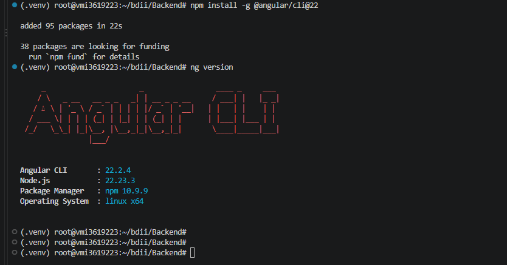
*Angular CLI 22.2.4, Node 22.23.3 y npm 10.9.9*


### F-01. Proyecto Angular con Tailwind

Guía, pasos 1 a 6. Se creó el proyecto dentro de la carpeta `Frontend/` del repositorio. La opción `--style=tailwind` hace en un solo comando lo que la guía hace en tres pasos: instala `tailwindcss`, `@tailwindcss/postcss` y `postcss`, crea `.postcssrc.json` y agrega `@import 'tailwindcss'` a `styles.css`. `--skip-git` evita crear un repositorio dentro del repositorio.

```bash
cd ~/bdii/Frontend
npx @angular/cli@22 new front-storelab-express-ii \
  --directory . \
  --style=tailwind \
  --ssr=false \
  --routing \
  --zoneless \
  --skip-git \
  --package-manager=npm
```

> Después el proyecto se renombró a `hornoraiz-frontend` en `package.json`, `angular.json` y el README (ver sección 3). Por eso algunas capturas muestran el nombre anterior, por ejemplo `dist/front-storelab-express-ii`.

`.postcssrc.json` generado (igual al de la guía):

```json
{
  "plugins": {
    "@tailwindcss/postcss": {}
  }
}
```


*`ng new` dentro de `Frontend/`, con Tailwind, rutas y sin SSR*


*`.postcssrc.json` y `styles.css` con Tailwind*


### F-02. PrimeNG, tema Aura e iconos

Guía, pasos 7 y 8. Se instaló PrimeNG con su paquete de temas, y además PrimeIcons (para los íconos `pi pi-*` del menú) y `@angular/cdk`. En `app.config.ts` se registró `providePrimeNG` con el tema Aura.

```bash
npm install primeng @primeuix/themes primeicons @angular/cdk
```

```ts
// src/app/app.config.ts
export const appConfig: ApplicationConfig = {
  providers: [
    provideBrowserGlobalErrorListeners(),
    provideRouter(
      routes,
      withComponentInputBinding(),
      withInMemoryScrolling({ scrollPositionRestoration: 'top' }),
    ),
   // provideHttpClient(withInterceptors([authInterceptor, errorInterceptor])),
    providePrimeNG({
      ripple: true,
      inputVariant: 'outlined',
      theme: {
        preset: Aura,
        options: { darkModeSelector: '.app-dark', cssLayer: false },
      },
    }),
    MessageService,
    ConfirmationService,
  ],
};
```

Al principio se importaron `authInterceptor` y `errorInterceptor`, que todavía no existen, y VS Code marcó 2 errores (se ven subrayados en rojo en la captura). Se comentaron esas líneas hasta construir el login.

En `styles.css` se agregó la hoja de PrimeIcons:

```css
@import 'tailwindcss';
@import 'primeicons/primeicons.css';
```

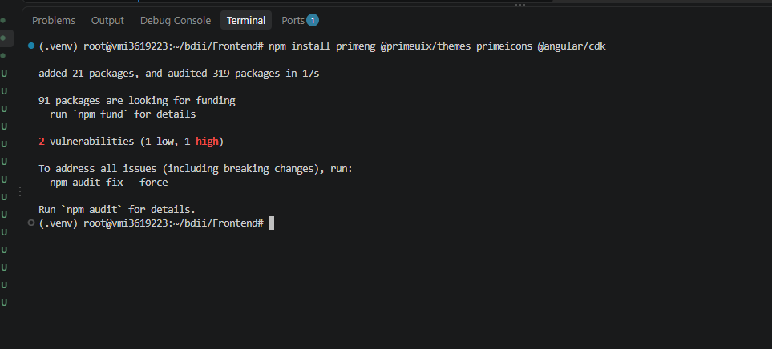
*Instalación de PrimeNG, `@primeuix/themes`, PrimeIcons y `@angular/cdk`*


*`app.config.ts` con PrimeNG y tema Aura (aquí aún con los interceptores sin crear)*


### F-03. Environments con la URL de la API

No está en la guía de instalación, pero lo usan las guías siguientes. Se crearon `environment.ts` (producción) y `environment.development.ts` (desarrollo) con la URL del backend Django y el nombre de la aplicación, que luego muestra el encabezado.

```bash
ng generate environments
```

```ts
export const environment = {
  production: true,
  appName: 'HornoRaíz',
  apiUrl: 'http://127.0.0.1:8000/api',
  requireAuth: true,
};
```


*`environment.ts`, con el backend en marcha en el puerto 8000*


*`environment.development.ts`*

> En estas capturas `appName` todavía decía `StoreLab Django`; se cambió a `HornoRaíz` en ambos archivos.


### F-04. Componentes de la plantilla

Guía, pasos 9 a 12. Se generaron los tres componentes de la plantilla en `components/layout/`, se les agregó `standalone: true` y se importaron en `app.ts`.

```bash
ng g c components/layout/header
ng g c components/layout/aside
ng g c components/layout/footer
```

`header.ts` lee el nombre del sistema desde el environment:

```ts
@Component({
  selector: 'app-header',
  standalone: true,
  imports: [],
  templateUrl: './header.html',
  styleUrl: './header.css',
})
export class Header {
  protected readonly appName = environment.appName;
}
```

```html
<!-- header.html -->
<div class="flex items-center gap-2">
  <i class="pi pi-shop text-xl"></i>
  <span>{{ appName }} · Producción y venta de panadería</span>
</div>
```

```html
<!-- footer.html -->
<p>HornoRaíz © {{ year }} · Bases de Datos II · Universidad de La Guajira</p>
```

`app.ts` importa los tres componentes. Respecto a la guía se quitó el `RouterOutlet` repetido y `CommonModule`, que no se usa:

```ts
@Component({
  selector: 'app-root',
  standalone: true,
  imports: [RouterOutlet, Header, Footer, Aside],
  templateUrl: './app.html',
  styleUrl: './app.css',
})
export class App {
  protected readonly title = signal('HornoRaíz');
}
```


*Generación de los tres componentes con `ng g c` (salida obtenida en una copia del proyecto sin `components/`, para no sobrescribir los ya creados)*


*`header.ts` y `header.html`*


*`footer.ts` y `footer.html`*


*`app.ts` importando los tres componentes*


### F-05. Estructura de la página en `app.html`

Guía, pasos 13 y 14. Se reemplazó la página de bienvenida de Angular por la estructura de la guía: encabezado arriba, menú a la izquierda, contenido en el centro (`router-outlet`) y pie abajo, todo con clases de Tailwind. Los bordes de colores de la guía se mantienen para ver cada zona; se quitarán al darle el estilo final.

```html
<main class="min-h-screen flex flex-col border-4 border-red-500">
  <header class="h-16 bg-white border-2 border-blue-500 flex items-center justify-center font-bold text-blue-600">
    <app-header></app-header>
  </header>

  <div class="flex flex-1">
    <aside class="w-64 bg-white border-2 border-blue-500 flex items-start justify-start font-bold text-blue-400">
      <app-aside></app-aside>
    </aside>

    <section class="flex-1 bg-white border-2 border-blue-500 flex items-center justify-center font-bold text-blue-600">
      <h1 class="text-3xl">Desarrollo Web · {{ title() }}</h1>
      <router-outlet />
    </section>
  </div>

  <footer class="h-16 bg-white border-2 border-blue-500 flex items-center justify-center font-bold text-blue-600 mt-auto">
    <app-footer></app-footer>
  </footer>
</main>
```

El `<h1>Desarrollo Web</h1>` del paso 6 de la guía (prueba de Tailwind) se dejó dentro del contenido central.


*`app.html` con la estructura de la página*


*`ng s` compilando sin errores*


### F-06. Menú lateral con `PanelMenu`

Guía, pasos 15 y 16. El `aside` usa `PanelMenu` de PrimeNG. En lugar de las cuatro opciones de la guía (Clientes, Tipo Productos, Productos, Ventas), el menú refleja los módulos del backend de HornoRaíz, agrupados con submenús:

```ts
export class Aside implements OnInit {
  items: MenuItem[] | undefined;

  ngOnInit() {
    this.items = [
      {
        label: 'Catálogo',
        icon: 'pi pi-fw pi-book',
        items: [
          { label: 'Productos', icon: 'pi pi-fw pi-shopping-bag' },
          { label: 'Insumos', icon: 'pi pi-fw pi-box' },
          { label: 'Recetas', icon: 'pi pi-fw pi-list' },
          { label: 'Promociones', icon: 'pi pi-fw pi-tags' },
        ],
      },
      {
        label: 'Producción',
        icon: 'pi pi-fw pi-cog',
        items: [
          { label: 'Lotes de producción', icon: 'pi pi-fw pi-th-large' },
          { label: 'Movimientos de insumos', icon: 'pi pi-fw pi-arrow-right-arrow-left' },
        ],
      },
      { label: 'Ventas', icon: 'pi pi-fw pi-shopping-cart', items: [{ label: 'Ventas', icon: 'pi pi-fw pi-receipt' }] },
      {
        label: 'Seguridad',
        icon: 'pi pi-fw pi-shield',
        items: [
          { label: 'Usuarios', icon: 'pi pi-fw pi-users' },
          { label: 'Roles', icon: 'pi pi-fw pi-id-card' },
        ],
      },
    ];
  }
}
```

```html
<!-- aside.html -->
<div class="card flex justify-center w-full p-2">
  <p-panelmenu [model]="items" class="w-full md:w-80" />
</div>
```


*`aside.ts` con los grupos del menú*


*`aside.html` con `p-panelmenu`*

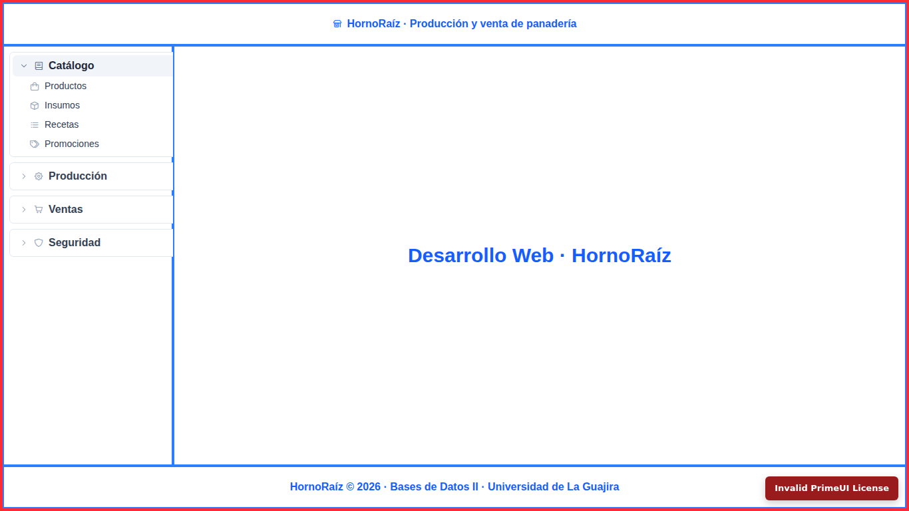
*Plantilla completa en el navegador, con el grupo Catálogo desplegado*

Abajo a la derecha aparece el aviso rojo **"Invalid PrimeUI License"**: PrimeNG 22 lo muestra cuando no se configura una licencia. La licencia gratuita *Community* se pide en el sitio de PrimeUI y se pasa en `providePrimeNG({ license })`. Queda pendiente (sección 10).


### F-07. Pruebas automáticas

El `app.spec.ts` generado por `ng new` buscaba el texto "Hello, front-storelab-express-ii", que ya no existe. Se reescribió para comprobar que la aplicación se crea y que pinta el encabezado, el menú, el pie y el título. Como el menú usa PrimeNG, la prueba registra `providePrimeNG()`. En `aside.spec.ts` se agregó una prueba que verifica los cuatro grupos del menú.

```bash
npx ng test --no-watch
```

Resultado: **4 archivos y 6 pruebas OK**.


*`ng test`: 4 archivos y 6 pruebas OK*


### F-08. Build de producción

`ng build` termina sin errores. Aparece un aviso porque el paquete inicial (596 kB) supera el presupuesto de 500 kB que trae `angular.json`; el peso viene de PrimeNG y del tema Aura. No impide el build, y bajará cuando las pantallas se carguen de forma perezosa desde las rutas.

```bash
npx ng build
```


*`ng build` sin errores, con el aviso de presupuesto*

### F-09. Componentes y rutas de insumos

Guía 2, pasos 1 a 4 (allí con Client). Se generaron los cuatro componentes de la entidad: `getall` (listado), `create` (alta), `update` (edición) y `delete` (baja). Por ahora cada uno muestra solo el texto que pone Angular ("getall works!"); el contenido llega con el consumo de la API. Se les agregó `standalone: true`, como en la guía 1.

```bash
ng g c components/supply/getall
ng g c components/supply/create
ng g c components/supply/update
ng g c components/supply/delete
```

Rutas de insumos en `app.routes.ts` (el archivo completo está en F-11):

```ts
{ path: 'supplies', component: SupplyGetall },
{ path: 'supplies/new', component: SupplyCreate },
{ path: 'supplies/edit/:id', component: SupplyUpdate },
{ path: 'supplies/delete/:id', component: SupplyDelete },
```

En el menú, la opción Insumos recibe `routerLink: '/supplies'`.

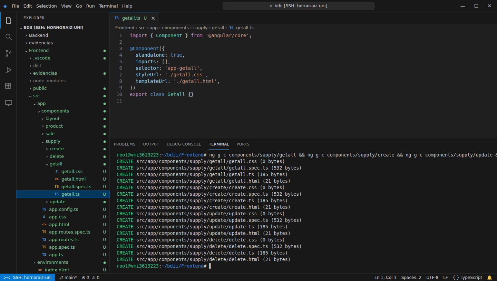
*Generación de los cuatro componentes de insumos*


*`getall.ts` (con `standalone: true`) y `getall.html` de insumos*


*Clic en Catálogo › Insumos: la URL cambia a `/supplies` y se carga el `getall` de insumos*


### F-10. Componentes y rutas de productos

Guía 2, pasos 5 a 7. Mismo patrón con `product`. Como las clases de los tres módulos se llaman igual (`Getall`, `Create`, `Update`, `Delete`), en `app.routes.ts` se importan con alias (`ProductGetall`, `SupplyGetall`...). Aquí también se agregó la ruta vacía: la guía la redirige a `'/'`, que no lleva a ninguna pantalla, y en HornoRaíz se redirige a `products`.

```bash
ng g c components/product/getall
ng g c components/product/create
ng g c components/product/update
ng g c components/product/delete
```

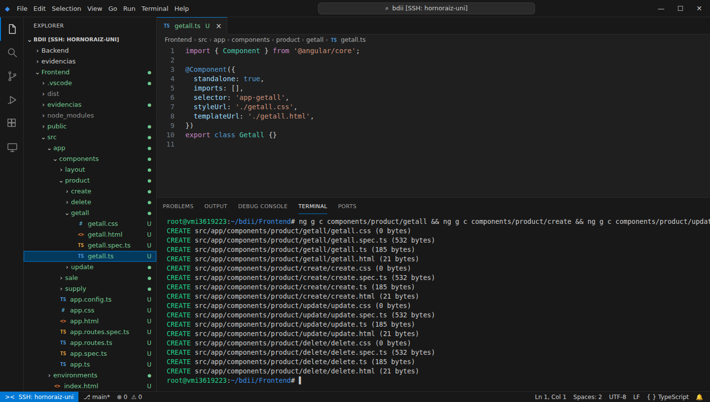
*Generación de los cuatro componentes de productos*

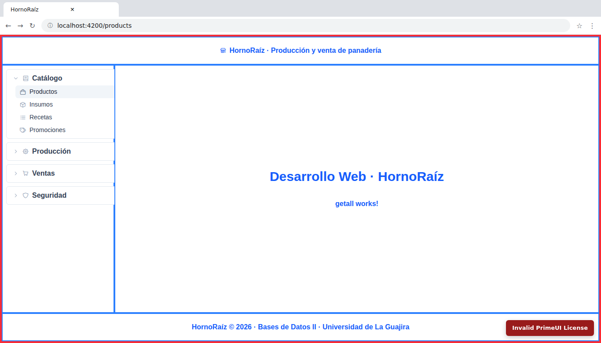
*Desde `/sales`, clic en Catálogo › Productos: la URL cambia a `/products`*


### F-11. Componentes y rutas de ventas, y menú con `routerLink`

Guía 2, pasos 8 a 11. Mismo patrón con `sale`. La guía importa el update de ventas como `SaleSaleUpdate` (error de tipeo); aquí queda `SaleUpdate`.

```bash
ng g c components/sale/getall
ng g c components/sale/create
ng g c components/sale/update
ng g c components/sale/delete
```

`app.routes.ts` final, con 13 rutas: la redirección y cuatro por entidad. `:id` es un parámetro: `/sales/edit/1` abre el `update` de ventas para la venta 1.

En `aside.ts`, tres opciones del menú tienen `routerLink`:

```ts
{ label: 'Productos', icon: 'pi pi-fw pi-shopping-bag', routerLink: '/products' },
{ label: 'Insumos', icon: 'pi pi-fw pi-box', routerLink: '/supplies' },
...
items: [{ label: 'Ventas', icon: 'pi pi-fw pi-receipt', routerLink: '/sales' }],
```

En `app.html` la zona de contenido pasó de `flex items-center` a `flex flex-col items-center gap-4`, para que el título quede encima del componente de la ruta y no al lado.

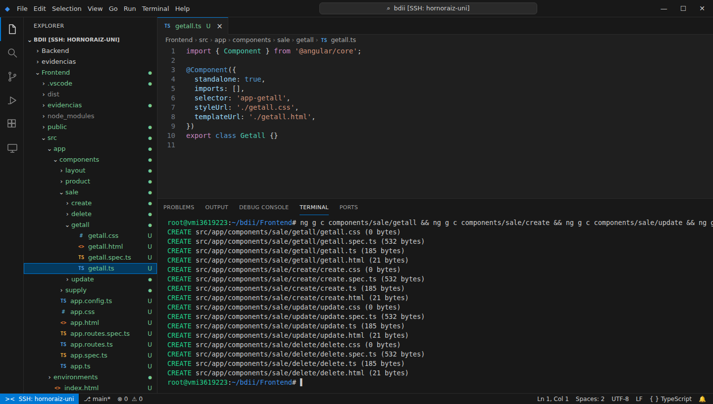
*Generación de los cuatro componentes de ventas*


*`app.routes.ts` con los imports con alias y las 13 rutas*


*`aside.ts` con `routerLink` en Productos, Insumos y Ventas*

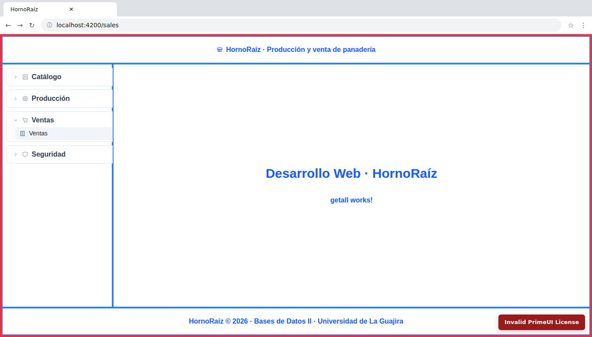
*Clic en Ventas › Ventas: la URL cambia a `/sales`*


*`/sales/edit/1` abre el componente `update` ("update works!")*


### F-12. Pruebas de rutas

Se creó `app.routes.spec.ts`. Con `RouterTestingHarness` navega a la ruta vacía (debe terminar en el listado de productos) y a las cuatro rutas de cada entidad, y comprueba que se pinta el componente correcto ("getall works!", "create works!", etc.).

Al correr las pruebas, falló `app.spec.ts`: el menú ahora tiene `routerLink`, que necesita el router, y la prueba no lo registraba (`NG0201: No provider found for ActivatedRoute`). Se agregó `provideRouter([])` a la prueba de `App` y a la del menú lateral. Resultado: **17 archivos y 22 pruebas OK**.

```ts
providers: [provideRouter([]), providePrimeNG()],
```


*Al abrir `localhost:4200/` la aplicación redirige a `/products`*


*`app.routes.spec.ts`*


*`ng test` falla: `NG0201: No provider found for ActivatedRoute` (final de la salida)*

![F-12 `app.spec.ts` con `provideRouter([])`](Frontend/evidencias/F-12-04-app-spec-corregido.png)
*`app.spec.ts` corregido con `provideRouter([])`*


*`ng test`: 17 archivos y 22 pruebas OK*


### F-13. Build de producción con las rutas

`ng build` sigue sin errores. El paquete inicial pasó de 596 kB a 600 kB, con el mismo aviso de presupuesto: las 12 pantallas están importadas directamente en `app.routes.ts`, como en la guía, así que todas viajan en el paquete inicial.


*`ng build` sin errores, con el aviso de presupuesto (599,52 kB)*

### F-14. Componentes, servicio, guard, interceptor y modelos de autenticación

Guía 3, pasos 1, 2, 7 y 11. Se generaron con el CLI el login, una pantalla de perfil (en lugar del registro), el servicio, el guard y el interceptor.

```bash
ng g c components/auth/login
ng g c components/auth/profile
ng g s services/auth
ng g guard guards/auth --functional --implements CanActivate
ng g interceptor core/interceptors/auth
```

Los modelos (`models/auth.ts`) siguen el contrato del backend Django, que responde en camelCase:

| Modelo | Uso | Campos |
|---|---|---|
| `LoginI` | Cuerpo de `POST /api/auth/login/` | `username` **o** `email`, y `password` |
| `LoginResponseI` | Respuesta del login | `access`, `refresh`, `tokenType`, `accessExpiresIn` |
| `UserI` | Respuesta de `GET /api/auth/profile/` | `id`, `username`, `email`, `firstName`, `lastName`, `status` |

La guía tiene además `RegisterI` y `RegisterResponseI`; no aplican porque no hay registro (ver sección 3).

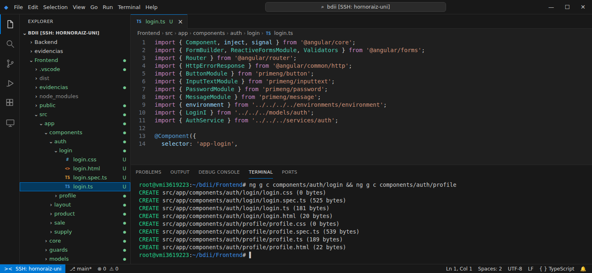
*Generación de los componentes `login` y `profile`*

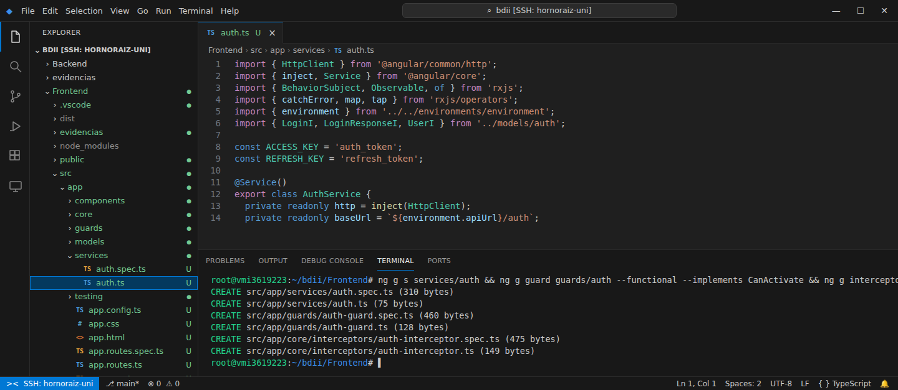
*Generación del servicio, el guard y el interceptor*


*`models/auth.ts` con el contrato de Django*


### F-15. `AuthService`, interceptor JWT y guard

Guía 3, pasos 2, 5, 11 y 13.

**`AuthService`** (`services/auth.ts`):

| Método | Qué hace |
|---|---|
| `login(credenciales)` | `POST /api/auth/login/`; guarda `access` en `auth_token` y `refresh` en `refresh_token` (`localStorage`) y emite `true` en `authState$` |
| `logout()` | `POST /api/auth/logout/` con el `refresh` (Django lo invalida, 204); borra los dos tokens y emite `false`. Si el backend falla, la sesión local se cierra igual |
| `getProfile()` | `GET /api/auth/profile/` |
| `isLoggedIn()` | `true` si hay token y su `exp` (leído del JWT) no ha pasado |
| `authState$` | `BehaviorSubject<boolean>` que escuchan el header y el layout |

**`authInterceptor`**: agrega `Authorization: Bearer <access>` a toda petición cuya URL empiece por `environment.apiUrl`, excepto el login. Se registró en `app.config.ts`, donde la línea de `provideHttpClient` estaba comentada desde F-02:

```ts
provideHttpClient(withInterceptors([authInterceptor])),
```

**`authGuard`**: si `isLoggedIn()` es `true` deja pasar; si no, redirige a `/login`.

```ts
export const authGuard: CanActivateFn = () => {
  if (inject(AuthService).isLoggedIn()) {
    return true;
  }
  return inject(Router).createUrlTree(['/login']);
};
```


*`services/auth.ts`*

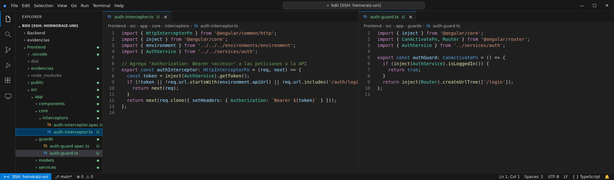
*`auth-interceptor.ts` y `auth-guard.ts`*


*`app.config.ts` con `provideHttpClient(withInterceptors([authInterceptor]))`*


### F-16. Pantalla de login contra Django

Guía 3, paso 8. Formulario reactivo con PrimeNG (`pInputText`, `p-password`, `p-button`, `p-message`):

- **Usuario o correo**: obligatorio, mínimo 3 caracteres. Si contiene `@` se envía como `email`; si no, como `username` (el backend acepta los dos).
- **Contraseña**: obligatoria, mínimo 6 caracteres, con botón para mostrarla.
- Con 401 muestra "Usuario o contraseña incorrectos."; con otro error, "No se pudo conectar con el servidor."
- Con éxito navega a `/products`.

Para probarlo se creó en el backend el usuario `demo_front` (sin permisos de administrador), con el shell de Django:

```bash
python manage.py shell -c "...create_user('demo_front', ...)"   # la contraseña no se guarda en el repositorio
```


*`login.ts` con el formulario reactivo*


*`login.html`*

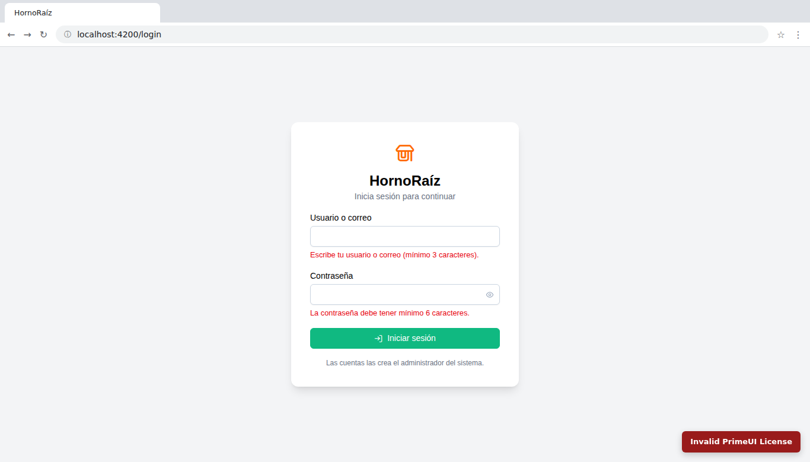
*Clic en "Iniciar sesión" con el formulario vacío: no se llama al backend y se muestran las validaciones*

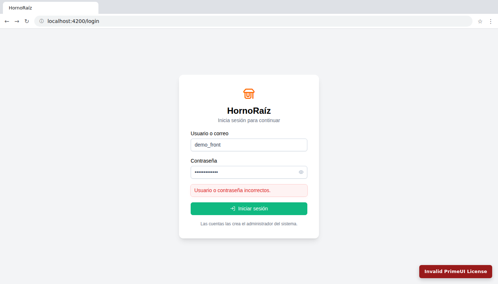
*Contraseña incorrecta: Django responde 401 y se muestra el aviso*


*Login correcto con `demo_front`: entra a `/products` con la plantilla completa*


### F-17. Header dinámico, layout condicional, perfil y cierre de sesión

Guía 3, pasos 4, 12 y 14.

- **Header**: se suscribe a `authState$`. Sin sesión el menú (`p-tieredmenu`) ofrece "Iniciar sesión"; con sesión muestra la campana de notificaciones (`p-overlaybadge`) y el menú "Mi perfil" / "Cerrar sesión".
- **Layout condicional** (`app.html`): con `@if (authState$ | async)` se pinta la plantilla completa; sin sesión, solo el `router-outlet`, así el login ocupa toda la pantalla.
- **Perfil** (`/profile`): llama a `GET /api/auth/profile/`, que exige el token, y muestra usuario, nombre, correo y estado.
- **Cerrar sesión**: llama a `POST /api/auth/logout/`, borra los tokens y vuelve a `/login`.


*`header.ts` (menú según `authState$`) y `header.html` (campana solo con sesión)*


*`app.ts` y `app.html` con `@if (authState$ | async)`*

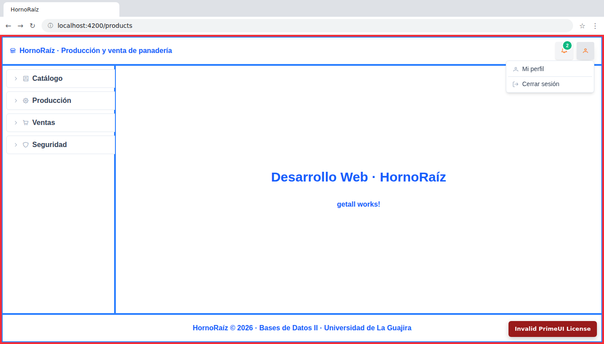
*Con sesión: campana con insignia y menú "Mi perfil" / "Cerrar sesión"*

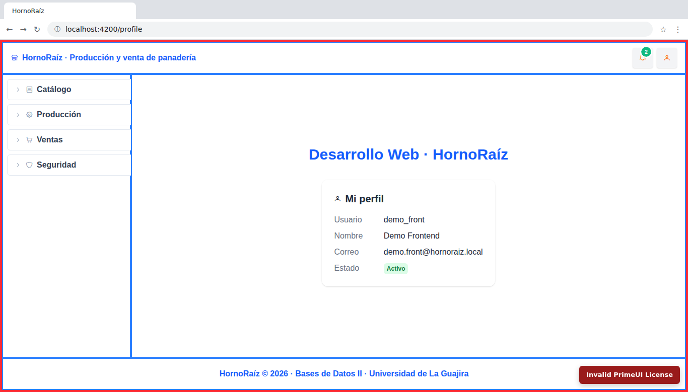
*`/profile` con los datos que devuelve `GET /api/auth/profile/`*


*Después de "Cerrar sesión": vuelve a `/login` y los dos tokens quedan borrados de `localStorage`*


*`profile.ts` y `profile.html`*


### F-18. Rutas protegidas y comprobación contra el backend

Guía 3, paso 10. En `app.routes.ts`:

- `''` redirige a `login` (antes iba a `products`).
- `login` es pública.
- `profile` y las 12 rutas de insumos, productos y ventas llevan `canActivate: [authGuard]`.
- `'**'` (cualquier ruta desconocida) redirige a `login`.

El registro de `runserver` confirma el recorrido completo de F-16 y F-17 contra Django: login fallido (401), login correcto (200), perfil (200, dos veces porque la página se recargó con F5 y la sesión se mantuvo) y cierre de sesión (204). Las peticiones `OPTIONS` son las de CORS que hace el navegador. La hora del registro está en `America/Bogota`, la zona configurada en Django.


*Abrir `localhost:4200/products` sin sesión: el guard redirige a `/login`*

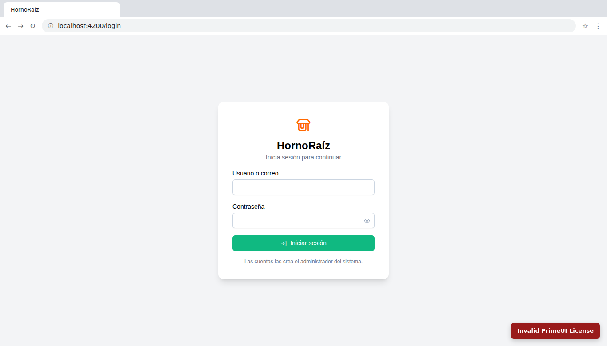
*Después del logout, `/sales/edit/1` también termina en `/login`*


*`app.routes.ts` con `login`, `profile`, `canActivate: [authGuard]` y `'**'`*

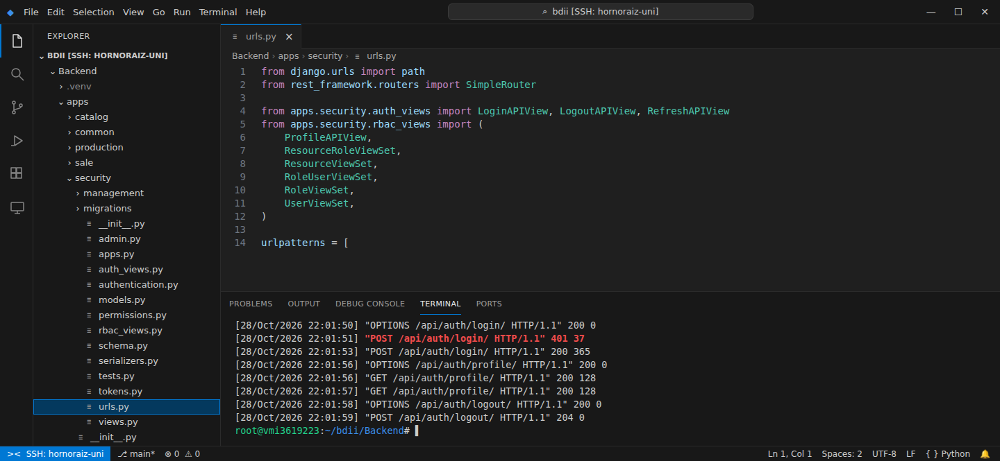
*Registro de `runserver` durante el recorrido: 401, 200, 200, 200 y 204*


### F-19. Pruebas y build

Pruebas nuevas:

| Archivo | Qué verifica |
|---|---|
| `services/auth.spec.ts` | El login guarda los dos tokens y emite `true`; el logout envía el refresh y limpia la sesión; un token vencido cuenta como sesión cerrada |
| `guards/auth-guard.spec.ts` | Sin sesión redirige a `/login`; con token válido deja pasar |
| `core/interceptors/auth-interceptor.spec.ts` | Agrega `Bearer` a la API y no lo agrega al login |
| `components/auth/login/login.spec.ts` | Formulario vacío no llama al backend; envía `email` si hay `@`; muestra el error con 401; navega a `/products` con éxito |
| `components/auth/profile/profile.spec.ts` | Pide el perfil y lo muestra |

Las pruebas existentes se ajustaron: `App`, `Header` y las rutas ahora necesitan `provideHttpClient()`, y las rutas protegidas se prueban con un JWT de prueba (`testing/fake-jwt.ts`). `app.routes.spec.ts` comprueba además que sin sesión todas las rutas protegidas y las desconocidas terminan en `/login`.

`p-tieredmenu` usa `window.matchMedia`, que no existe en jsdom (el navegador simulado de las pruebas). Se agregó `src/test-setup.ts` con una versión mínima y se registró en `angular.json` (`test.options.setupFiles`). Ese archivo y `testing/` se excluyen del build en `tsconfig.app.json`.

Resultado: **22 archivos y 38 pruebas OK**. `ng build` compila; el paquete inicial sube a 844 kB por los formularios reactivos y los componentes nuevos de PrimeNG.


*`test-setup.ts` y su registro en `angular.json`*


*`ng test`: 22 archivos y 38 pruebas OK*


*`ng build` sin errores, con el aviso de presupuesto (844 kB)*

### F-20. Modelo, servicio y formulario de insumos

Guía 4, pasos 1 y 2. En HornoRaíz el CRUD se hace sobre **insumos**, que ocupan el lugar de Client desde F-09.

`models/supply.ts` sigue el serializer de Django (`SupplySerializer`):

| Campo | Tipo | Regla del backend |
|---|---|---|
| `id` | número, opcional | Solo lectura |
| `code` | texto | Obligatorio, máximo 50, **único** |
| `name` | texto | Obligatorio, 2 a 100 |
| `unitOfMeasure` | texto | Obligatorio, máximo 30 |
| `minStock` | decimal (llega como texto, por ejemplo `"5.00"`) | Mayor o igual a 0 |
| `status` | booleano | `true` activo, `false` inactivo |

`services/supply.ts` (`SupplyService`):

| Método | HTTP | Endpoint |
|---|---|---|
| `getAllSupplies()` | GET | `/api/catalog/supplies/` |
| `getSupplyById(id)` | GET | `/api/catalog/supplies/{id}/` |
| `createSupply(supply)` | POST | `/api/catalog/supplies/` |
| `updateSupply(id, cambios)` | PATCH | `/api/catalog/supplies/{id}/` |
| `deleteSupply(id)` | DELETE | `/api/catalog/supplies/{id}/` (borrado físico) |
| `deleteSupplyLogic(id)` | PATCH `{ status: false }` | `/api/catalog/supplies/{id}/` (baja lógica) |

A diferencia de la guía, el servicio no arma la cabecera `Authorization`: la agrega `authInterceptor` (F-15).

`components/supply/shared/supply-form.ts` reúne lo que comparten alta y edición: el formulario con sus validaciones (las mismas reglas de la tabla), los mensajes de error por campo y `apiErrorMessage()`, que convierte la respuesta de Django en texto (403 con el `detail` del backend, 404, y el primer mensaje de un 400).


*`models/supply.ts`*


*`services/supply.ts`*


*`shared/supply-form.ts`: formulario, mensajes y errores de Django*


### F-21. Listado de insumos

Guía 4, paso 6. `p-table` con filas alternadas, paginador de 10, reporte "Mostrando {first} a {last} de {totalRecords} insumos", orden por ID, código y nombre (`p-sort-icon`), estado con `p-tag` y acciones Editar, Desactivar (solo si está activo) y Eliminar. Botones "Actualizar" y "Nuevo insumo".

**Primera prueba contra Django: 403.** `demo_front` (F-16) no tenía ningún rol, y el RBAC del backend niega por defecto. La pantalla lo muestra en un aviso con el mensaje de Django.

**Permiso RBAC.** Se creó en el backend el rol `inventario` con los recursos de insumos (sin `PUT`, que el frontend no usa) y se le asignó a `demo_front`, con el shell de Django. Después el listado carga los 4 insumos.

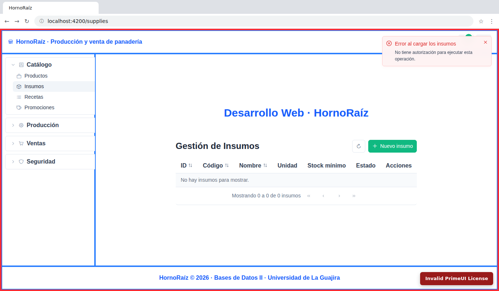
*Sin rol: Django responde 403 y se muestra "No tiene autorización para ejecutar esta operación."*

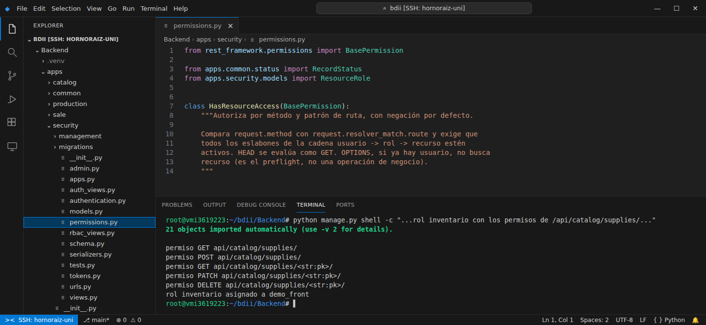
*Creación del rol `inventario` con los permisos de `/api/catalog/supplies/` y asignación a `demo_front`*

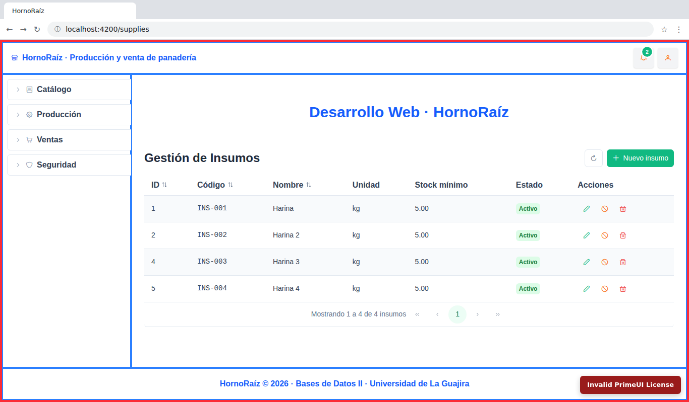
*Con el rol: listado de los 4 insumos del backend*


*`getall.ts`: carga, errores y desactivación con confirmación*


*`getall.html` con `p-table`, `p-tag` y `p-confirmdialog`*


### F-22. Alta de insumos

Guía 4, paso 7. Formulario reactivo con `pInputText`, `p-inputnumber` (2 decimales, formato es-CO) y `p-select` para el estado. Si el formulario es inválido marca los campos y muestra un aviso; si Django responde 400 (por ejemplo, código repetido) muestra su mensaje; si responde 201, avisa y vuelve al listado.

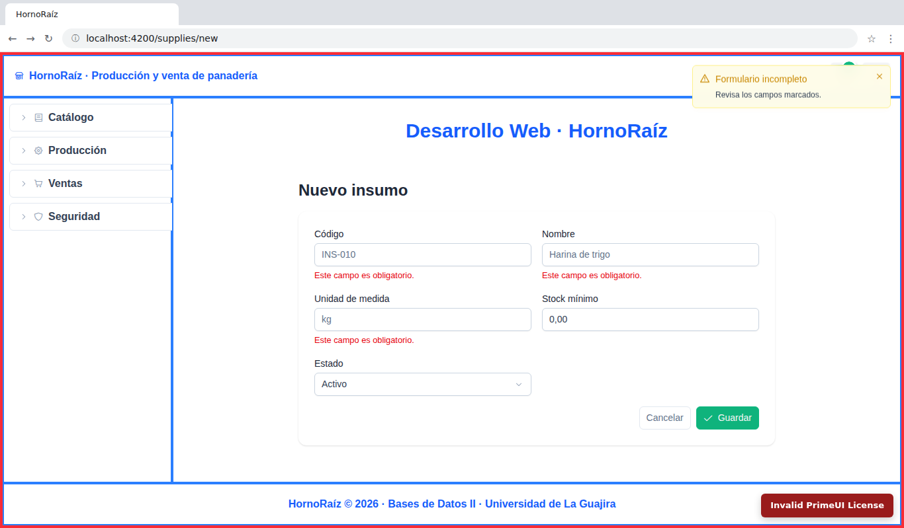
*Guardar con el formulario vacío: errores por campo y aviso "Formulario incompleto"*

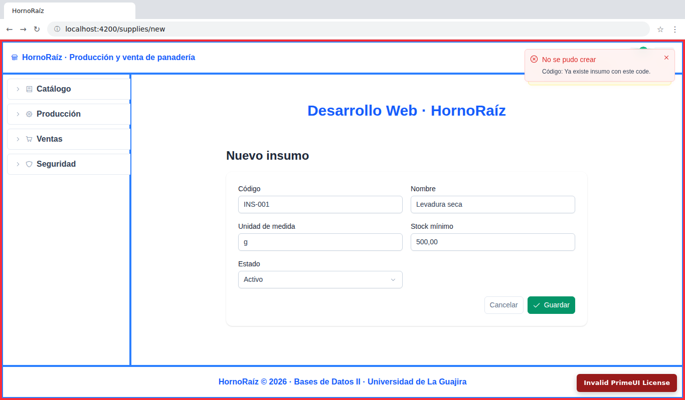
*Código `INS-001` repetido: Django responde 400 "Ya existe insumo con este code."*

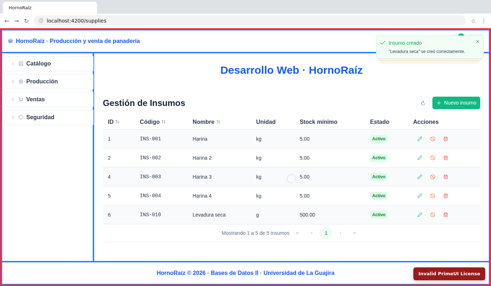
*Con el código `INS-010`: Django responde 201 y el insumo aparece en el listado*


*`create.ts`*


*`create.html`*


### F-23. Edición de insumos

Guía 4, paso 8. `/supplies/edit/:id` lee el `id` de la ruta, pide el insumo (`GET`), llena el formulario con `patchValue` (`minStock` llega como texto y se convierte a número) y guarda con `PATCH`. Mientras carga muestra un spinner. En la guía el formulario de Client exigía de nuevo la contraseña al editar; los insumos no tienen ese problema.


*`/supplies/edit/6` con los datos del insumo creado en F-22*


*Nombre "Levadura seca instantánea" y stock mínimo 750: Django responde 200*


*`update.ts`*


### F-24. Baja lógica (desactivar)

Corresponde a `deleteClientLogic` de la guía, que allí quedó sin usar. El botón Desactivar del listado abre `p-confirmdialog` y, al aceptar, envía `PATCH { status: false }`. El insumo sigue en la lista como Inactivo y ya no muestra el botón Desactivar.

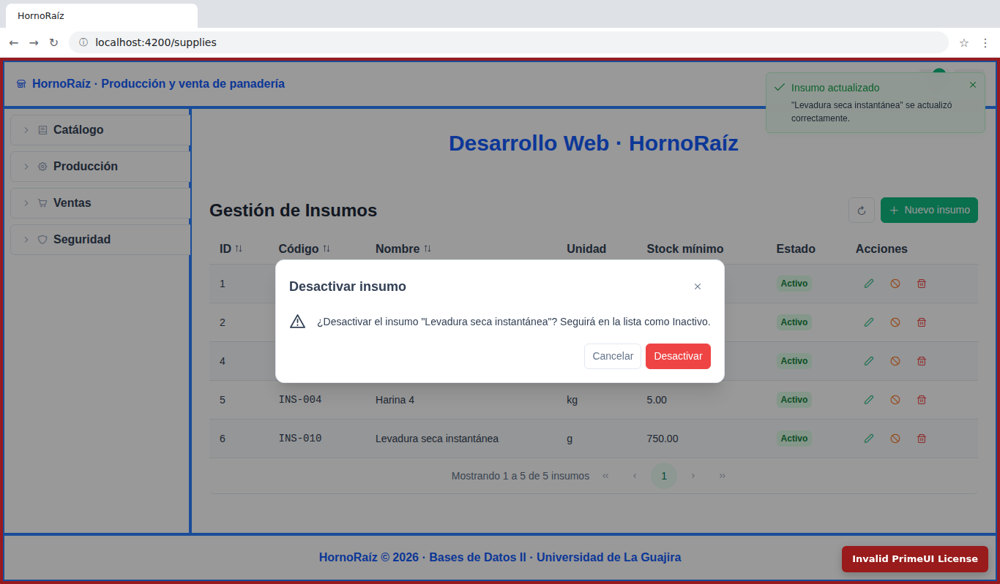
*Confirmación antes de desactivar*


*El insumo queda Inactivo*


### F-25. Borrado definitivo

La guía define la ruta `clients/delete/:id` pero no muestra su componente. En HornoRaíz `/supplies/delete/:id` muestra los datos del insumo, advierte que el borrado no se puede deshacer y envía `DELETE`.

Los modelos `RecipeSupply` y `SupplyMovement` protegen al insumo (`on_delete=PROTECT`) y el backend no maneja esa excepción, así que Django responde **500** si el insumo está en uso. La pantalla lo explica y sugiere desactivarlo. Los 4 insumos del backend están en uso, así que se probó con `INS-001` (no se borró) y luego se eliminó el insumo de prueba `INS-010` (204). Al final la tabla quedó con los mismos 4 insumos del principio.

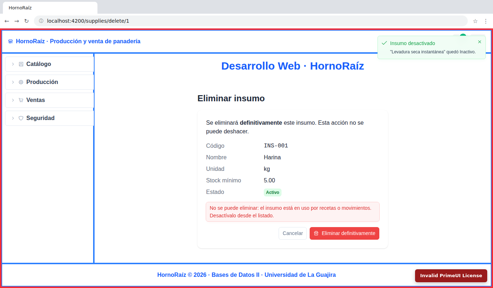
*`INS-001` está en una receta: Django responde 500 y la pantalla explica por qué no se puede eliminar*

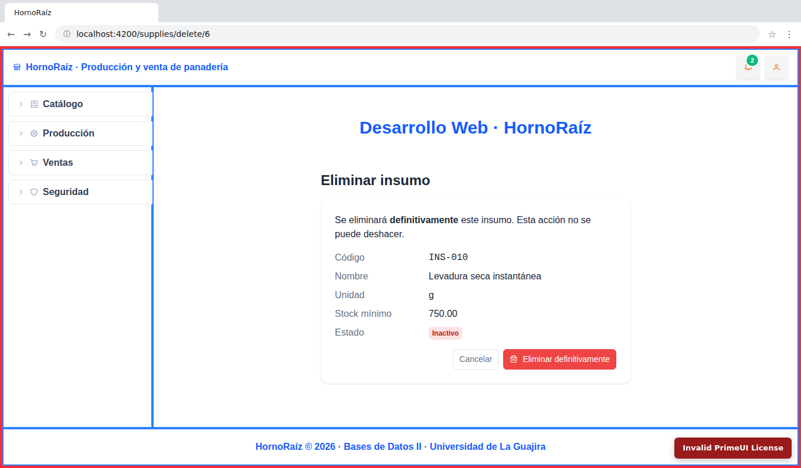
*`/supplies/delete/6` con el insumo de prueba*

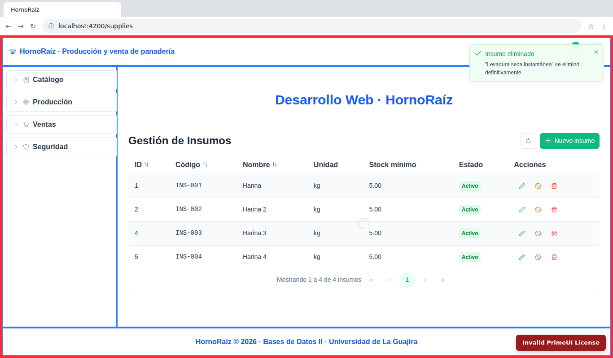
*Django responde 204 y el listado vuelve a tener 4 insumos*


*`delete.ts` y `delete.html`*

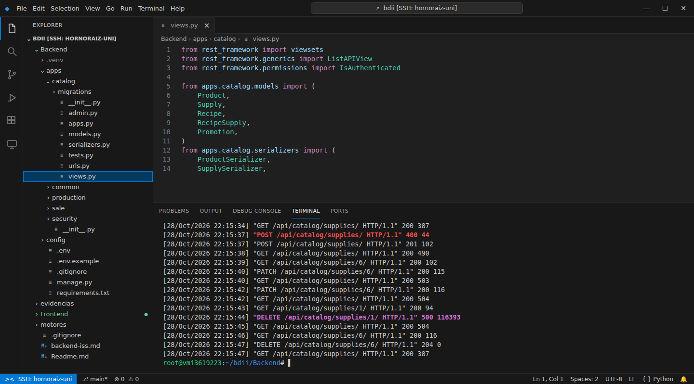
*Registro de `runserver` del recorrido F-21 a F-25: 200, 400, 201, 200 (PATCH), 200 (PATCH status), 500 (protegido) y 204*


### F-26. Errores de compilación, carga perezosa y avisos globales

**`p-sortIcon`.** La guía usa `<p-sortIcon>`; en PrimeNG 22 la etiqueta es `<p-sort-icon>`. El build falló con NG8001 en las tres columnas ordenables.

**Presupuesto de 1 MB.** Con la tabla, los formularios, el selector y el diálogo de PrimeNG, el paquete inicial llegó a **1,45 MB** y el build falló: `angular.json` permite hasta 1 MB como error (500 kB como aviso). Pasaba porque `app.routes.ts` importaba directamente las 13 pantallas, como en la guía. Se cambió a `loadComponent`, que descarga cada pantalla al abrirla:

```ts
{
  path: 'supplies',
  loadComponent: () => import('./components/supply/getall/getall').then((m) => m.Getall),
  canActivate: [authGuard],
},
```

El paquete inicial bajó a **916 kB** (queda el aviso de 500 kB); la tabla de insumos viaja en su propio archivo (386 kB) y solo se descarga al entrar a `/supplies`. Los alias de importación de F-10 ya no hacen falta.

**Avisos globales.** `<p-toast>` se puso una sola vez en `app.html`, fuera del `@if`, para que el aviso de "Insumo creado" siga visible después de volver al listado. `app.spec.ts` necesitó `MessageService` por eso.


*`ng build` falla: `'p-sortIcon' is not a known element` (NG8001)*

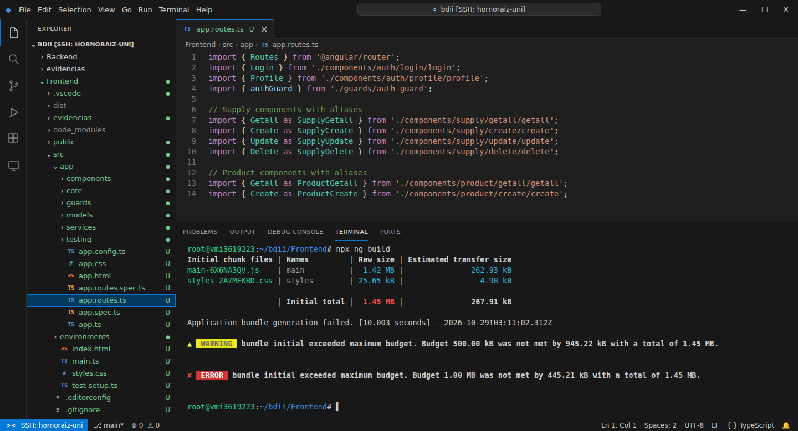
*`ng build` falla: paquete inicial de 1,45 MB, por encima del límite de 1 MB*


*`app.routes.ts` con `loadComponent`*


*`app.ts` y `app.html` con el `p-toast` global*


### F-27. Pruebas y build

Pruebas nuevas o reescritas:

| Archivo | Qué verifica |
|---|---|
| `services/supply.spec.ts` | Método y URL de cada operación (con `/` final) y que la baja lógica envía `{ status: false }` |
| `components/supply/getall/getall.spec.ts` | Pinta los insumos de la API y muestra el aviso con el 403 |
| `components/supply/create/create.spec.ts` | Con el formulario inválido no llama a la API; con datos válidos hace POST y vuelve al listado |
| `components/supply/update/update.spec.ts` | Pide el insumo por `id` y llena el formulario |
| `components/supply/delete/delete.spec.ts` | Con 500 muestra que el insumo está en uso |
| `app.routes.spec.ts` | Las cuatro rutas de insumos abren su pantalla (ahora con carga perezosa) |

Resultado: **23 archivos y 42 pruebas OK**. `ng build` compila con el paquete inicial en 916 kB y una *chunk* por pantalla.


*`ng test`: 23 archivos y 42 pruebas OK*


*`ng build` con carga perezosa: 916 kB iniciales y una *chunk* por pantalla*

---

## 7. Pruebas

Comando: `npx ng test --no-watch`.

| Archivo de pruebas | Qué verifica |
|---|---|
| `app.spec.ts` | Se crea la aplicación; sin sesión no pinta la plantilla y con sesión pinta header, aside, footer y el título |
| `components/layout/aside/aside.spec.ts` | Se crea el menú lateral y tiene los grupos Catálogo, Producción, Ventas y Seguridad |
| `components/layout/header/header.spec.ts` | Se crea el encabezado; su menú cambia según haya sesión |
| `components/layout/footer/footer.spec.ts` | Se crea el pie |
| `app.routes.spec.ts` | La ruta vacía lleva a login; sin sesión las rutas protegidas y desconocidas van a login; con sesión las 12 rutas abren su componente |
| `components/{product,sale}/*/*.spec.ts` (8) | Se crea cada componente (prueba generada por Angular) |
| `components/supply/*/*.spec.ts` (4) y `services/supply.spec.ts` | CRUD de insumos (ver F-27) |
| `services/auth.spec.ts`, `guards/auth-guard.spec.ts`, `core/interceptors/auth-interceptor.spec.ts` | Sesión, guard e interceptor (ver F-19) |
| `components/auth/login/login.spec.ts`, `components/auth/profile/profile.spec.ts` | Login y perfil (ver F-19) |

Resultado: **23 archivos y 42 pruebas OK** (ver F-27). Antes eran 22 archivos y 38 pruebas (F-19), 17 archivos y 22 pruebas (F-12), y con la guía 1, 4 archivos y 6 pruebas (F-07).

---

## 8. Problemas encontrados y cómo se resolvieron

| Problema | Causa | Solución |
|---|---|---|
| `app.config.ts` con 2 errores: no se encuentran `auth-interceptor` y `error-interceptor` | Se importaron interceptores que todavía no existen | Comentar esas importaciones y `provideHttpClient` hasta construir el login |
| `app.spec.ts` fallaría al buscar "Hello, front-storelab-express-ii" | Se reemplazó la página de bienvenida de Angular | Reescribir la prueba para la plantilla nueva |
| `appName: 'StoreLab Django'` en los environments | Valor copiado de otro proyecto | Cambiarlo a `HornoRaíz` |
| Capturas dentro de `src/environments/evidencias-frontend/` | Se guardaron en la carpeta abierta en VS Code | Moverlas a `Frontend/evidencias/` con nombres por paso |
| Aviso rojo "Invalid PrimeUI License" en el navegador | PrimeNG 22 exige una licencia, que la guía (escrita para PrimeNG 20) no menciona | Pendiente: registrar la licencia Community y pasarla en `providePrimeNG({ license })`, guardada en un archivo fuera de git |
| `ng test` falla con `NG0201: No provider found for ActivatedRoute` | El menú tiene `routerLink` y la prueba de `App` no registraba el router | `provideRouter([])` en `app.spec.ts` y `aside.spec.ts` (F-12) |
| `Can't bind to 'text' since it isn't a known property of 'p-message'` | En PrimeNG 22 `p-message` ya no tiene la propiedad `text` | Poner el mensaje como contenido: `<p-message severity="error">{{ error() }}</p-message>` |
| `TypeError: window.matchMedia is not a function` en las pruebas del header | `p-tieredmenu` usa `matchMedia` y jsdom no lo implementa | `src/test-setup.ts` con una versión mínima, registrado en `angular.json` (F-19) |
| `NG04002: Cannot match any routes. URL Segment: 'products'` en la prueba del login | Tras el login exitoso navega a `/products`, ruta que no existía en esa prueba | Registrar una ruta `products` vacía en el `provideRouter` de la prueba |
| Ícono del login muy pequeño | El tamaño de `.pi` de PrimeIcons gana sobre la clase `text-4xl` de Tailwind | Usar el modificador de importancia de Tailwind 4: `text-4xl!` |
| `'p-sortIcon' is not a known element` (NG8001) | PrimeNG 22 cambió el selector | Usar `<p-sort-icon>` (F-26) |
| `bundle initial exceeded maximum budget ... 1.00 MB` (error) | Las 13 pantallas se importaban directamente en las rutas | `loadComponent` en todas las rutas menos login (F-26) |
| `NG0201: No provider found for MessageService` en `app.spec.ts` | `App` ahora pinta el `p-toast` global | Agregar `MessageService` a la prueba |
| 403 al listar insumos con `demo_front` | El RBAC del backend niega todo a un usuario sin rol | Rol `inventario` con los permisos de insumos (F-21) |
| DELETE de un insumo responde 500 | `PROTECT` en recetas y movimientos, sin manejo en el backend | La pantalla explica el motivo y sugiere desactivar; se podría manejar `ProtectedError` en el backend para responder 409 |
| Aviso "bundle initial exceeded maximum budget" en `ng build` | PrimeNG y el tema Aura pesan más que el presupuesto por defecto | Se acepta por ahora; se reducirá con carga perezosa de pantallas |

---

## 9. Cómo ejecutarlo

```bash
# 1. Backend
cd Backend && source .venv/bin/activate && python manage.py runserver 0.0.0.0:8000

# 2. Frontend
cd Frontend
npm install
ng s               # http://localhost:4200
npx ng test --no-watch
npx ng build
```

Se entra en `/login` con un usuario del backend. Para la pantalla de insumos ese usuario necesita un rol con los permisos de `/api/catalog/supplies/` (como `inventario`, F-21); sin rol verá el aviso de 403.

---

## 10. Pendiente

- Licencia Community de PrimeNG para quitar el aviso "Invalid PrimeUI License" (archivo `primeng-license.ts` fuera de git).
- Rutas para recetas, promociones, lotes, movimientos de insumos, usuarios y roles.
- Bajar el paquete inicial por debajo de 500 kB (hoy 916 kB: el login y el header cargan formularios, `p-password` y `p-tieredmenu` desde el inicio).
- CRUD de productos y ventas con el mismo patrón de insumos.
- En el backend, responder 409 en lugar de 500 cuando un insumo protegido no se puede borrar.
- Renovar el access con `POST /api/auth/refresh/` cuando la API responda 401 (hoy, al vencer el access la sesión se da por cerrada).
- Interceptor de errores (403, 404, 5xx) con avisos (toast).
- Redirigir a `/products` si alguien con sesión abre `/login`.
- Registro de usuarios, si se decide agregar un endpoint público al backend.
- Quitar los bordes de colores de la plantilla y darle el estilo final.
